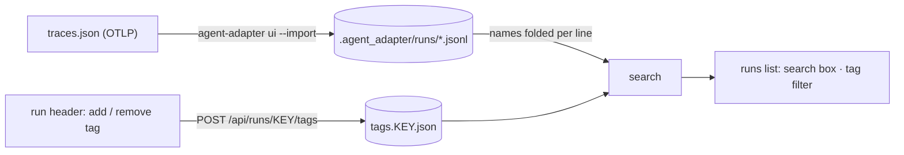

# Search and tag runs

The runs list of `agent-adapter ui` has a search box and a tag filter. Tag a run from its
header to find it again later. Traces from another app, exported as OTLP JSON, can be
added as runs too.



## Search

Type in the box above the runs list. The list updates after a short pause and says how
many runs match. Every word must match (case does not matter):

| You type | Matches runs with |
|---|---|
| `stock` | `stock` in a tool, flow, node, model, provider, stage, retriever or error kind name, the run id, the status, the framework (`otlp-import` for imported runs) or a tag |
| `refund timeout` | both words |
| `status:failed` | that status exactly (`ok`, `failed`, `paused`, `running`, `unfinished`) |
| `tag:vip` | the tag `vip` |
| `mug` | also a word in recorded arguments, results and messages, when the run was recorded with `capture_content=True` |

A run recorded without `capture_content` keeps no prompts, arguments or results on disk,
so its content cannot be searched. Search keeps the first 65,536 characters of content
per run file (one per run and process).

## Tags

The run header lists the run's tags. Type a tag and press **add**; press **×** on a tag
to remove it. Pick a tag in the filter next to the search box to list only those runs.

- A tag is 1 to 40 letters, digits, spaces or `_ . : / + -`, stored lower-case.
- A run holds at most 20 tags.
- Tags live in a small file per run, `tags.<run key>.json`, next to the run's files. The
  run files themselves are never changed. Copy both to move a tagged run. When rotation
  deletes a run, its tags file stays behind, unused.
- A bad or oversized tags file is ignored with a WARNING.

Setting tags is a POST with the same checks as approvals: the access token, a JSON body,
the page's `Origin` and its CSRF token. An exported `--export` file shows no search box
and no tags.

## Import OTLP traces

```bash
agent-adapter ui --import traces.json            # into .agent_adapter/runs, then serve
agent-adapter ui runs --import traces.json --export report.html
```

`traces.json` is an OTLP JSON trace export (`{"resourceSpans": [...]}`), for example from
an OpenTelemetry collector's file exporter. The file is only parsed; nothing in it runs.

| Span | Becomes |
|---|---|
| `gen_ai.operation.name` `chat`, `generate_content`, `text_completion` | an `llm` call: provider, model, tokens, cost, finish reason |
| `execute_tool` | a `tool` call; a span with `error.type` or an error status fails |
| `embeddings` | an `embedding` call |
| `invoke_workflow`, `node FLOW.NODE` | a flow and its nodes |
| anything else (HTTP, database) | skipped |

- Each trace becomes one run, `otlp-<trace id>`, or `otlp-<gen_ai.conversation.id>` when
  the spans carry one; its framework shows `otlp-import`. Parent spans become parent calls.
- A missing, negative or out-of-range span time counts as 0; ids are cut to 128 characters.
- Message, argument and result attributes are kept when present; secret-named keys are
  masked and long strings cut, as for recorded runs.
- Importing the same file again rewrites the same run files.
- Limits: 32 MB per file, 100,000 spans, 1,000 traces. Past them the import is refused.

From code:

```python
--8<-- "examples/viewer_search_import.py:import"
```

## Files

| File | Does |
|---|---|
| `agent_adapter/viewer/_search.py` | names folded per run file; the query and its match |
| `agent_adapter/viewer/_tags.py` | the tags files: read, check, write whole |
| `agent_adapter/viewer/_runs_routes.py` | `GET /api/runs?q=&tag=` and `POST /api/runs/KEY/tags` |
| `agent_adapter/viewer/_otlp_import.py`, `_otlp_spans.py` | OTLP JSON to run files |
| `agent_adapter/viewer/static/runsearch.js` | the search box, tag filter and tag editor |
