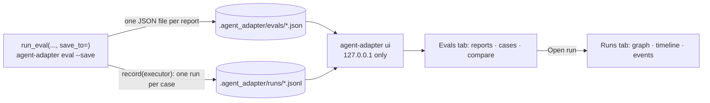

# See your evals

Save each eval report to a folder, then open the **Evals** tab of the local viewer. It
lists every saved report with its score, cost and time, shows each case with its input,
expected value, output and every grader's reason, and compares two reports side by side
with the regressions marked. Each case links to its run in the **Runs** tab. Start with
[Evaluate your agent](evaluate-your-agent.md) if you have no eval yet.



## 1. Save the report

Pass `save_to=` to `run_eval` (or `run_eval_sync`). Record the executor too, so each case's
run is there to open:

```python
--8<-- "examples/evals_viewer.py:save"
```

From the command line, add `--save`. It writes to `.agent_adapter/evals` (or the folder you
name) and records the case runs to `.agent_adapter/runs` by default:

```bash
agent-adapter eval app:agent cases.jsonl --save
agent-adapter eval app:agent cases.jsonl --save reports/ --min-score 0.9 --junit evals.xml
```

You can also save a report you already have: `save_report(report, folder)` returns the
path. Each save is a new file named `<start time>-<eval name>-<random>.json`, so a folder
keeps your history.

## 2. Open the viewer

```bash
agent-adapter ui                       # runs from .agent_adapter/runs, reports from .agent_adapter/evals
agent-adapter ui my/runs --evals my/evals
```

From Python, `serve(...)` and `make_server(...)` take `evals=` the same way.

## What the Evals tab shows

| Part | Shows |
|---|---|
| Report list | name, start time, mean score, passed of total, cost; a chip says all passed, how many failed, or how many errored. A file that is not a report shows as unreadable |
| Headline | mean score with a bar, pass rate, errors, total cost, wall time |
| By tag, by grader | cases, passed and mean score per tag and per grader; click a tag to filter the cases |
| Cases | each case folds open: input, expected, output, the error if it did not finish, each grader's score, verdict and reason, the tools it called, its cost and time |
| Open run | switches to the Runs tab at that case's run (it must be recorded in the folder the viewer reads) |
| Compare with | pick a baseline report: the mean score change, then every case side by side, regressions first |

The comparison is `EvalReport.compare` on the server: a case regressed when it passed in the
baseline and fails now, or its score dropped. Added and removed cases are listed too.

## Try it

```bash
python examples/evals_viewer.py my-evals
agent-adapter ui my-evals/runs --evals my-evals/evals
```

It saves two reports of a ticket desk agent: one that looks events up with a tool, and a
worse one that guesses. Pick the worse report, then compare it with the better one: two
cases show as regressed.

## Security

The Evals tab has the viewer's protections:

- The server binds `127.0.0.1` only, and every `/api/evals` request needs the access token
  from the printed link. The routes only read; nothing on the page changes a report.
- The page's CSP is `default-src 'none'`: no network beyond the viewer itself.
- Report text (inputs, outputs, reasons) is only ever set as text, never parsed as HTML.
- Only files named like a report are read, each at most 16 MB, newest 500 listed. A file that
  is not a valid report, or holds a number that is not finite, is listed as unreadable.
- Reports hold your case inputs and outputs: keep the folder as private as your runs.
- An exported HTML file (`--export`) holds runs only; the Evals tab needs the live viewer.

## Files

| File | Does |
|---|---|
| `evals/store.py` | `save_report`, `DEFAULT_EVALS_FOLDER` |
| `viewer/_evals.py` | reads the folder: summaries, one report, a comparison; the `/api/evals` routes |
| `viewer/static/evals.js` | the tab's data calls and pure logic |
| `viewer/static/evalscards.js`, `evalsview.js` | the headline, tables, case cards, comparison; the tab itself |
| `examples/evals_viewer.py` | the example above |
