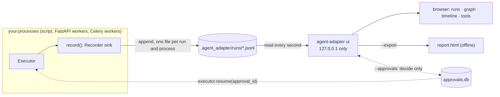

# See your runs

Record every run to a folder with one line, then open a local page that shows it: the
flow graph, a timeline of parallel calls, costs, cache hits, retries and pending
approvals. It works with any framework and with plain code, offline, with no extra
package. The same page can also [chat with your agent](chat-with-your-agent.md).



## 1. Record

`record()` adds a recorder next to the executor's sinks; it never replaces them. Every
context, `executor.model(...)` wrapper, `FlowRunner` and compiled flow of that executor
reaches it, even one made before the call. With no executor it follows the default one,
also after `aa.configure(...)` replaces it.

```python
--8<-- "examples/viewer_setups.py:script"
```

| App | Where the one line goes |
|---|---|
| plain script | at the top, as above |
| FastAPI | in the lifespan, on the executor you keep in `app.state` |
| Celery, RQ | in the per-process executor factory |
| LangGraph or any framework | on the executor you pass as `executor=` |

```python
--8<-- "examples/viewer_setups.py:fastapi"
```

```python
--8<-- "examples/viewer_setups.py:celery"
```

```python
--8<-- "examples/viewer_setups.py:framework"
```

`record(executor=None, *, folder=".agent_adapter/runs", capture_content=False,
keep_runs=200, source="")` returns the `Recorder`. A second call for the same executor and
folder returns the same recorder; other options for it are a `ConfigError`. `source` names
the framework or backend in the runs list. Writes run on a background thread; queued events
are written at exit, or now with `recorder.flush()`. `recorder.stop()` detaches it from the
executor (or the default), writes what is queued and ignores later events;
`executor.remove_sink(sink)` undoes any `add_sink`.

## 2. Open the viewer

```bash
agent-adapter ui                                  # .agent_adapter/runs on port 8780
agent-adapter ui path/to/runs --port 9000
agent-adapter ui runs --approvals approvals.db --reviewer ana
agent-adapter ui runs --export report.html        # one offline file, then exit
agent-adapter ui runs --export one.html --run KEY # one run only
agent-adapter ui runs --import traces.json        # add OTLP JSON traces as runs, then serve
```

It prints `http://127.0.0.1:PORT/#token=...`: open that address. New runs from any process
on the machine appear within about a second. A big run loads in pages; the timeline shows
every flow and node, then the latest 5,000 calls.

## What the page shows

| Part | Shows |
|---|---|
| Runs | time, status (`ok`, `failed`, `paused`, `running`, `unfinished`), duration, cost, framework or backend, tags; a search box and a tag filter ([Search and tag runs](search-your-runs.md)); a call made outside `run_scope` is a run that ends with its last call |
| Flow graph | the `Flow` a `FlowRunner` ran, with live status per node (`stopped` ■ for one cancelled when its flow or run ended): zoom, pan, minimap, search, replay, node panel ([Navigate the graph](navigate-the-graph.md)) |
| Timeline | one lane per concurrent call; retries, timeouts, cache hits, cost, `context.compressed` tokens before → after, error kinds |
| Events, State, Compare | every event, filterable, with its raw JSON; each node's changed fields (values when traced); two runs side by side |
| Detail | the recorded data of each event of the clicked call |
| Tools | the registry when the run started: schemas, `confirm`, cache, effects, timeouts, retries |
| Approvals | with `--approvals` only: pending records, Approve and Deny |

A run with no `Flow` shows the timeline only. Flows compiled to LangGraph or ADK show the
timeline and record changed field names only; `flow.to_mermaid()` draws their graph.

## What is written

| Rule | Detail |
|---|---|
| layout | `<start ms>.<run id>.<pid>.jsonl`; each process writes only its own files, so many workers can share one folder |
| content | the keys `arguments`, `result`, `input_messages`, `output_messages` only with `capture_content=True`, as with `OTelSink`; other event data (your `custom.*` events, integration extras) is written with secret masking only |
| flow state | `node.finished` names the changed fields; with `FlowRunner(trace_state=True)` their values are kept too, even without `capture_content` (secret-named keys masked, 2 KB each) |
| secrets | values under secret names (`api_key`, `password`, `access_token`) are always `***` |
| size | strings over 2,000 characters are cut; a run stops at 50,000 events with one `truncated` line |
| rotation | past `keep_runs` runs, the oldest ended ones are deleted; a run any process wrote to in the last 15 minutes and has not ended is kept |
| failures | a write error or a full queue (10,000 events) is logged as a WARNING and never reaches your call |

## Approvals from the page

The page only records a decision in the SQLite store, with `decided_by` set to
`--reviewer`. It never runs a tool. Your app's own `executor.resume(approval_id)` then
runs the call once, as in [Resume a parked call](../concepts/approval-resume.md). The page
does not decide flow-node approvals (use `FlowRunner.resume`) or records the HTTP tool
server parked (it re-checks the caller itself).

## Security

| Guard | Why |
|---|---|
| binds `127.0.0.1` only, exclusively; any other `--host` is refused | run data never leaves the machine; no second program shares the port |
| an access token, new on every start, after `#` in the printed address; the page moves it to this tab's `sessionStorage`, removes it from the address bar, and sends it as `X-AA-Token` on every data request; no cookie | other users and programs on the machine get no data without the address; the token never reaches a server log, a Referer or another port |
| `Host` header must be `127.0.0.1:PORT` or `localhost:PORT` | blocks DNS rebinding |
| decide and tag: POST only, JSON body, `Origin` of this page, a CSRF token new on every start | another site cannot decide or tag for you |
| a decided record is refused (409) | each decision is made once |
| strict `Content-Security-Policy`; data shown as text, never as HTML | recorded data cannot run script |
| `--export` file: data inline, no external URL, CSP `default-src 'none'` | safe to open offline |

Anyone who has the printed address can read every run and, with `--approvals`, approve or
deny as `--reviewer`: keep it private, and stop the viewer when you are done (the address may
stay in the browser's history; it stops working with the viewer). Anyone who can
read the runs folder sees the runs too. Keep `capture_content=False` where prompts or
results hold personal data.

## Try it

```bash
python examples/viewer_fan_out.py
agent-adapter ui .agent_adapter/runs --approvals .agent_adapter/approvals.db --reviewer you
```

`examples/viewer_fan_out.py` searches a help center: a fan-out over three sources, a join,
one loop that hits the cache, a compressed model call, one parallel batch and one
`confirm=True` tool waiting for approval.

## Files

| File | Does |
|---|---|
| `agent_adapter/viewer/recorder.py` | `Recorder` sink (queue and writer thread) and `record()` |
| `agent_adapter/viewer/_segments.py` | the lines of each run file; inferred ends of plain calls |
| `agent_adapter/viewer/_files.py`, `_scrub.py` | file names, appends, rotation; content and secret rules |
| `agent_adapter/viewer/runs.py`, `_fold.py` | reads the folder from where it stopped; summaries folded line by line, paged details |
| `agent_adapter/exec/_sink_hub.py` | the executor's stable sink, and flow graphs for graph-taking sinks |
| `agent_adapter/viewer/lanes.py`, `layout.py` | timeline spans and lanes; graph layers |
| `agent_adapter/viewer/server.py`, `approvals.py` | the loopback server and the approval desk |
| `agent_adapter/viewer/export.py`, `assets.py`, `static/` | the page, and the one-file export |
| `agent_adapter/flow/diagram.py` | `Flow.graph()` and `Flow.to_mermaid()` |
