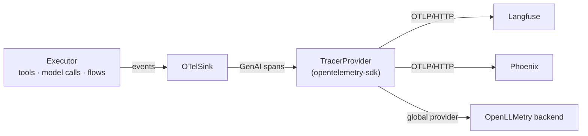

# Send traces to Langfuse, Phoenix or OpenLLMetry

`OTelSink` turns the executor's events into OpenTelemetry spans that follow the GenAI
semantic conventions. Any backend that takes OTLP can show them. You pick the exporter;
the adapter needs no backend-specific code.



## Install

```bash
pip install "agent-adapter[otel]" opentelemetry-sdk opentelemetry-exporter-otlp-proto-http
```

The `otel` extra brings only `opentelemetry-api`. `agent-adapter doctor` reports
`otel export` as ready once the SDK and an OTLP exporter are installed.

## 1. Build a provider for your exporter

```python
--8<-- "examples/traces_otlp.py:provider"
```

Then give the sink to the executor. Every tool call and model call becomes a span:

```python
--8<-- "examples/traces_otlp.py:wire"
```

`run_once(OTelSink(tracer_provider=otlp_provider(exporter)))` sends one run. Call
`provider.shutdown()` before the process exits so the batch is flushed.

## 2. Langfuse

```python
--8<-- "examples/traces_otlp.py:langfuse"
```

Langfuse takes OTLP over HTTP only, not gRPC. The public and secret keys come from the
project settings; keep them in environment variables or a secret store.

## 3. Arize Phoenix

```python
--8<-- "examples/traces_otlp.py:phoenix"
```

A local Phoenix listens on port 6006. For a hosted Phoenix, pass its collector URL and
add the API key header its settings page shows (`headers={...}` on the exporter).

## 4. OpenLLMetry

```python
--8<-- "examples/traces_otlp.py:openllmetry"
```

OpenLLMetry (`traceloop-sdk`) installs a global tracer provider and its own exporter.
`OTelSink()` with no provider writes to that global one, so our spans and OpenLLMetry's
land in the same traces. If OpenLLMetry also instruments the SDK your model port calls,
each model call shows twice: once from it and once from us. Turn off its instrumentation
for that SDK, or keep both on purpose.

## What the spans carry

| Span | Attributes |
|---|---|
| `chat {model}` (`generate_content` for Gemini) | `gen_ai.operation.name`, `gen_ai.provider.name`, `gen_ai.request.model`, `gen_ai.response.model`, `gen_ai.usage.input_tokens`, `gen_ai.usage.output_tokens`, cache and reasoning tokens |
| `execute_tool {tool}` | `gen_ai.tool.name`, `gen_ai.tool.call.id`, `gen_ai.tool.type` |
| `invoke_workflow {flow}`, `node {flow}.{node}` | `gen_ai.workflow.name`, `agent_adapter.flow.*` |
| every span | `gen_ai.conversation.id` = the run id; `agent_adapter.*` extras such as cost, stage and cache hits on model spans |

**Convention version.** Names follow the OpenTelemetry GenAI semantic conventions as
shipped in `opentelemetry-semantic-conventions` 0.66b. The conventions are still in
Development, so a backend may label some fields differently. Every name lives in
`agent_adapter/tracing/semconv.py`.

**Content stays off.** Prompts, replies, tool arguments and results are not exported
unless you pass `OTelSink(capture_content=True)`. Turn it on only where the backend may
hold that data.

## Output

The example runs offline with an in-memory exporter in place of OTLP:

```text
chat house-7b chat run_shop
execute_tool stock execute_tool run_shop
```

Without `opentelemetry-sdk` it prints `opentelemetry-sdk not installed`.

## Files

| File | Does |
|---|---|
| `agent_adapter/tracing/otel.py` | `OTelSink`: events in, GenAI spans and metrics out |
| `agent_adapter/tracing/semconv.py` | every attribute, span and metric name |
| `examples/traces_otlp.py` | providers and exporters for each backend; one traced run |
| `tests/tracing/test_traces_otlp.py` | runs the example and checks the span attributes |

More on spans, parents and metrics: [Tracing](../concepts/tracing.md).
