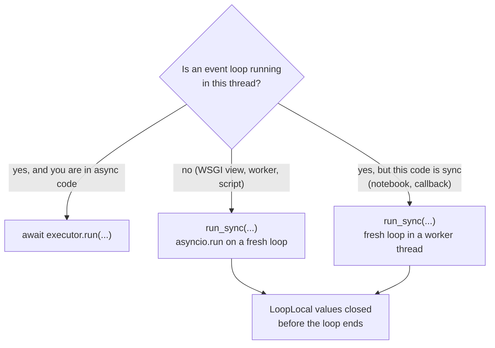

# Sync code and backends

The adapter is async. Sync code (a Flask or Django view, a Celery task, a cron script, a
notebook cell) calls it through `run_sync`. Async code (FastAPI, Django async views)
just awaits.



## Pick the call

| Where your code runs | Call | Guide |
|---|---|---|
| FastAPI, Starlette, any ASGI app | `await executor.run(...)` | [FastAPI](../backends/fastapi.md) |
| Django async view | `await executor.run(...)` | [Django](../backends/django.md) |
| Flask, Django under WSGI | `run_sync(executor.run(...), timeout=...)` | [Flask](../backends/flask.md), [Django](../backends/django.md) |
| Celery, RQ, cron, CLI scripts | `run_sync(batch, timeout=...)`, one loop per task | [Celery](../backends/celery.md), [Scripts](../backends/scripts.md) |
| Jupyter, or sync code inside a running loop | `run_sync(...)`: it moves to a worker thread | below |

`run_sync` never uses `nest_asyncio`.

## One executor per process

```python
--8<-- "examples/howto_sync.py:executor"
```

Build it at import time and share it. Guard counters are thread-safe; the run lock and
`per_kind` slots exist per event loop, so concurrent `run_sync` calls from several
request threads do not block each other.

## A WSGI view

```python
--8<-- "examples/howto_sync.py:view"
```

Each `run_sync` call runs a fresh event loop and closes it. Always pass `timeout`: on
expiry the work is cancelled and `TimeoutError` is raised.

## A worker task or script

```python
--8<-- "examples/howto_sync.py:task"
```

Run a whole batch inside one `run_sync` call: one loop, and `run_many` runs the calls
concurrently. Pass a zero-argument callable (`batch`), not `batch()`: the coroutine is
created inside the new loop.

## Inside a running loop

```python
--8<-- "examples/howto_sync.py:running_loop"
```

With a loop already running in this thread, `run_sync` starts a fresh loop in a one-shot
worker thread, copies the `contextvars`, and blocks the caller until done. If the work
blocks its loop past `timeout`, the caller stops waiting 5 s later (`CALLER_GRACE_S`); the
abandoned thread still holds up interpreter exit until it returns. In async code, prefer
`await`.

## Loop-bound clients

```python
--8<-- "examples/howto_sync.py:client"
```

SDK clients (httpx, redis) and asyncio locks break on a loop other than the one that
made them, and every `run_sync` call has a new loop. Keep them in a `LoopLocal`: one
value per loop, created on first `get()`, closed by `run_sync` before its loop ends.
Never keep such a client in a module global.

## Output

```text
{'item': 'laptop', 'rate': 18.0}
[18.0, 5.0, 18.0]
{'item': 'book', 'rate': 5.0}
3
True True
```

Three `run_sync` calls made three clients. The last one ran in the
`agent_adapter-run_sync` worker thread.

## Rules

| Rule | Why |
|---|---|
| Sync tools run in `asyncio.to_thread` | a blocking tool never stalls the loop; `contextvars` are copied in |
| Keep runs inside one `run_sync` call when they share state | a run's lock lives on one loop; calls of one run on two loops do not exclude each other |
| Pass a `ctx` you made with `executor.context(...)` to group calls | guards, caps and budgets count per run |
| Ledger and trace state are objects passed around | never written through child-task `contextvars`, so nothing is lost across threads |

See [Runtime](../concepts/runtime.md) for `run_sync`, `LoopLocal` and the current context.

## Files

| File | Does |
|---|---|
| `examples/howto_sync.py` | a loop-local client, a WSGI view, a worker task, a running-loop call |
| `tests/docs/test_howto_examples.py` | runs it offline and checks the output |
