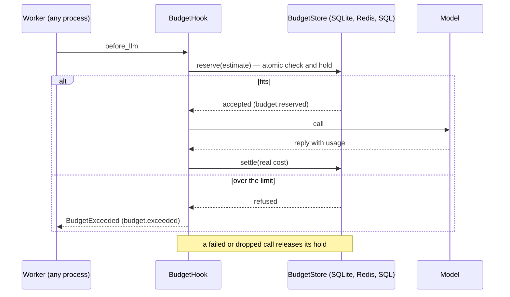

# Team budgets

Cap what each user, each team, or everyone may spend, per UTC day or month, across every
worker and host. `BudgetHook` keeps the spend in a shared `BudgetStore`; each model call
holds an estimate first, so racing calls cannot overspend by more than the gap between
their estimates and their real costs.



## 1. Limits per user and per team

```python
--8<-- "examples/howto_team_budgets.py:hooks"
```

| `scope` | Charged to | Needs |
|---|---|---|
| `"user"` / `"principal"` | the authenticated principal (HTTP server), else `ctx.user_id`; callers with neither share one anonymous counter | never set `user_id` from client input; a different `user_id` beside a principal is ignored (one WARNING) |
| `"team"` | `scope_key(ctx)` | a non-empty string; a raising or empty key refuses the call |
| `"global"` | everything | — |
| `"run"`, `"thread"` | the run or thread | as in [Budgets](budgets.md) |

`per="day"` or `per="month"` resets at the UTC boundary; `per=None` never resets.
`budget="chat"` names the counter, so two budgets of one scope can share a store.

## 2. Share the spend between workers

```python
--8<-- "examples/howto_team_budgets.py:workers"
```

| Store | Shared by | Atomic by |
|---|---|---|
| `MemoryBudgetStore()` (default) | one process; past `max_keys` live counters a new key is refused | a lock |
| `SQLiteBudgetStore(path)` | every process on one host; the file is created 0600 (POSIX SQLite gives `-wal`/`-shm` the same mode) | `BEGIN IMMEDIATE` |
| `RedisBudgetStore(lambda: Redis.from_url(url))` | every host (Redis 5+; `usage` also runs on a replica) | one cached Lua script per step |
| `SQLAlchemyBudgetStore("postgresql+asyncpg://...")` | every host | a row lock (`UPDATE`), always READ COMMITTED on Postgres |

Install `agent-adapter[redis]` or `agent-adapter[sqlalchemy]` for the last two;
`agent-adapter doctor` reports whether they are ready.

## 3. Reserve, settle, release

| Step | When | Counts |
|---|---|---|
| reserve | before each model call | the estimate, held for at most `hold_s` (default 900 s: keep it above your longest call) |
| settle | when the call ends | what the ledger bills for it: cache hits and hook replies are $0; a nested instrumented call is charged once |
| release | the call ends unbilled: refused by a later hook, cancelled, closed mid-stream | nothing |

The estimate is the prompt (4 characters a token) plus `max_output_tokens` (1024 when
unset), at the model's price. Pass `estimate_usd=0.05` or `estimate_usd=lambda inv: ...`
to set your own. A call is refused when spent plus held is at the limit, or the estimate
would cross it. Tool calls are checked but hold nothing: the ledger bills them at $0.

Prices come from `prices=` or the context's `Ledger`. A model with no price counts as $0
and logs one `WARNING`, as in the ledger.

## 4. Read what is left

```python
--8<-- "examples/howto_team_budgets.py:status"
```

`status(ctx)` returns a `BudgetStatus`: `limit_usd`, `spent_usd`, `reserved_usd`,
`remaining_usd`, `window`, `resets_at` (epoch seconds) and `view()` for JSON.

Over HTTP, `GET /budget` lists the caller's own user and team budgets; `GET /budget/team`
filters by scope ([HTTP server](../cross-language/http-server.md)).

| Caller | Sees |
|---|---|
| any authenticated principal | its own user budget and its own team's |
| a holder of `approvals:decide` | also `global`, and any user or team with `?key=` |
| anyone else asking for `?key=` or `/budget/global` | 403 |

## Output

```text
ana answered
ana answered
bo answered
bo answered
ana refused by the team budget
cy answered
user ana 0.4 0.1
team support 0.8 day
```

## Notes

| Note | Detail |
|---|---|
| Hook order | each budget hook reserves on its own; a refused call gives back the holds of the others when it ends (`on_llm_end`) |
| Crashes | a worker that dies mid-call leaves its hold; it frees itself after `hold_s` |
| Events | `budget.reserved` and `budget.exceeded` carry the scope and window, never the user or team id; the run viewer marks a run a budget refused |
| Backend down | the store's error fails the call (closed); a failed settle is logged and the hold expires |
| Limits live in code | every worker must build the same hooks; the store holds only spend |

## Files

| File | Does |
|---|---|
| `examples/howto_team_budgets.py` | user and team caps per day, two workers on one SQLite file |
| `tests/docs/test_team_budgets_example.py` | runs it offline and checks the output |
