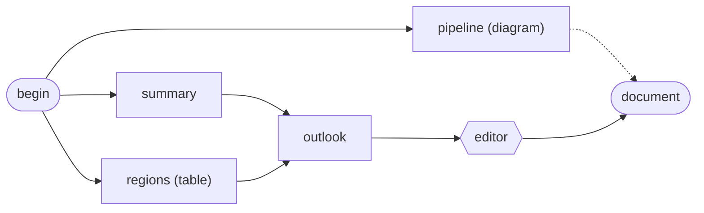

# Template documents

Write the document once as Markdown with `{{ name }}` blanks. Each blank is filled by a
model or an agent; blanks that do not depend on each other fill in parallel. Tables and
diagrams come back as data, and the code draws them, so they are always well formed. One
editor then reads the whole draft and makes the wording fit together.



## The template

```python
--8<-- "examples/report_template.py:template"
```

- **Blanks** are `Blank(name, prompt, kind=, agent=, max_words=, required=)`. Any other
  `{{ name }}` (here `company` and `quarter`) is an input you pass to `compose`.
- **Order** comes from the prompts: `outlook` uses `{{ summary }}` and `{{ regions }}`, so
  it fills after them and sees their final Markdown. A cycle is refused when the template
  is built, with every other problem listed together (`FlowDefinitionError`).
- **Literal braces**: write `\{{` to keep `{{` in the output.

| `kind` | The model returns | You get |
|---|---|---|
| `text` (default) | Markdown text | the text |
| `list` | `{"items": [...]}` | a `- ` bullet list |
| `number` | `{"value": 42}` | the number |
| `table` | `{"rows": [...]}` with exactly `columns=` | a pipe table we draw (pipes in cells escaped) |
| `diagram` | `{"nodes": [...], "edges": [...]}` | a Mermaid `flowchart` (`direction="TD"` or `"LR"`) |

Structured kinds use the request's `output_schema`, so every provider port applies its own
structured-output mode.

## Run it

```python
--8<-- "examples/report_template.py:run"
```

`compose()` returns a `ComposeResult`:

| Field | What it holds |
|---|---|
| `.markdown` | the finished document |
| `.blanks` | `{name: BlankResult}`: `value`, `markdown`, `problems`, `attempts`, `cached`, `edited`, `cost_usd` |
| `.revisions` | every editor revision, accepted or not, with `before` and `after` |
| `.cost` | USD for the blanks and the editor, from the executor's ledger |
| `.ok` / `.problems` | whether every blank passed its checks |

In sync code, wrap the call with `aa.run_sync(compose(...))`, as above.

## Checks and the single retry

Each blank is checked as soon as it fills:

- **required**: not empty (`required=False` lets it stay empty);
- **words**: at most `max_words` (text and lists);
- **schema**: the answer is JSON of the right shape;
- **tables**: every row has exactly the columns;
- **diagrams**: unique node ids, and edges only between known nodes.

A blank that fails is asked once more, alone, with its answer and the problems. The rest
of the document is not re-run. If it fails again, it is kept with `problems` set and
`result.ok` is False; the blanks after it still run.

## Per-blank agents

A blank can use its own model, or a `LoopAgent` with tools, instead of the document's
model:

```python
from agent_adapter.exec import LoopAgent

researcher = LoopAgent(model, registry.subset(names=["search_sales"]), instructions="Cite numbers.")
Blank("regions", "Revenue by region.", "table", columns=["Region", "Revenue"], agent=researcher)
```

Its tool calls run through the executor, so approvals, budgets, guards and the ledger apply.
Give the executor the agent's registry (`aa.Executor(registry)`).

## The editor

`Editor(model, style=...)` sees the whole draft, each blank marked by name, and returns
revisions per blank through structured output. A revision is read back and checked like a
fresh answer, and it must keep the shape:

- a table keeps its columns and its number of rows (cells may change);
- a diagram keeps its nodes and edges (labels may change);
- text and lists stay within `max_words`.

A revision that breaks a rule is dropped and recorded with `accepted=False` and its
`problems`, so a person can see what the editor wanted and why it was refused.

## Cache: change one blank, re-run one blank

Give the executor a cache and the run a thread id. Each blank is cached by its settings,
its model and the exact messages it would send, which include the values of the blanks it
uses:

```python
executor = aa.Executor(registry, cache=aa.MemoryCache())  # or RedisCache for many processes
await compose(template, model=model, executor=executor, thread_id="acme-q3")
```

Change one blank's prompt and run again: only that blank, the blanks that use it, and the
editor run; the rest come back with `cached=True` at $0. Entries are signed, like every
flow node cache. Use `cache_scope="global"` only for public data; `None` turns caching off.

## Live preview and events

- `on_blank(result)` (sync or async) gets each `BlankResult` as it fills, and again with
  `edited=True` after an accepted revision. A failing callback is logged, never raised.
- Events: `compose.blank_started`, `compose.blank_filled` (`ok`, `attempts`, `cached`,
  `cost_usd`) and `compose.edited` (`revised`, `rejected`). The Markdown and revision texts
  go only to sinks that capture content.
- `agent_adapter.viewer.record(executor, capture_content=True)` and `agent-adapter ui`
  show the document filling in, with each blank's status and cost.

## Things to know

- The template compiles to a `Flow` (`aa_begin`, one node per blank, `aa_editor`), run by
  a `FlowRunner` on your executor. `concurrency=4` caps blanks in flight; pass
  `runner=FlowRunner(executor, checkpoints=...)` for checkpoints or other runner settings.
- Pass `ctx=` (a tool's context) to compose inside a running tool or flow: the blanks then
  share that run's budget, approvals and ledger.
- A blank's agent that stops early (`max_steps`, a pending approval) counts as a failed
  check and is retried once.

See also: [Flows](../concepts/flows.md), [Multi-agent](multi-agent.md),
[Caching](caching.md), [See your runs](see-your-runs.md).
