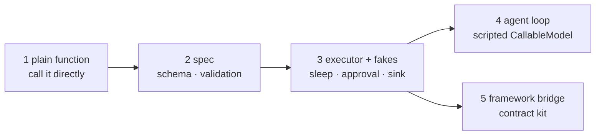

# Testing tools

Test tools offline: no network, no API keys, no real waiting. Test at the level you
changed: the function, its schema, the executor's policies, or a whole agent loop.



## The tools under test

```python
--8<-- "examples/howto_testing.py:tools"
```

A decorated function is still a plain function: `fetch_rate("USD")` works in a test like
any other call. Start there.

## Schema and validation

```python
--8<-- "examples/howto_testing.py:plain"
```

`spec.invoke(args)` validates and calls the tool without the executor. It is for tests
only: it skips approval, budgets, guards, the cache and the ledger, so never run a model's
tool call with it. Assert the schema the model sees with a renderer (`chat_tool` from
`agent_adapter.integrations.openai`, `anthropic_tool` from `.anthropic`) or with `spec.json_schema()`. `ToolArgsInvalid.errors` never
holds input values, so it is safe to assert on and to log.

## Executor policies, with offline fakes

```python
--8<-- "examples/howto_testing.py:executor"
```

| Fake | Replaces | Lives in |
|---|---|---|
| `Executor(sleep=..., rng=..., clock=...)` | backoff waits, jitter, time | the constructor |
| `CallbackApproval(fn)`, `AutoApprove()`, `AutoDeny()` | a reviewer | `agent_adapter` |
| `DeferredApproval(MemoryApprovalStore())` | a review queue | `agent_adapter` |
| `EventLog()` | your tracing backend: assert with `of_type("tool.retry")` | `agent_adapter.tracing` |
| `Ledger(prices=Prices.load({...}))`, `MemorySink()` | billing; prices you control | `agent_adapter`; `MemorySink` from `agent_adapter.cost` |
| `MemoryCache()` | Redis | `agent_adapter` |
| `LoopLocal(factory)` with a fake factory | an SDK client | `agent_adapter.runtime` |

Use `run_call` when a test asserts on failures: it returns a `ToolResult` (status, error
kind, attempts, `cached`) instead of raising.

## A whole agent loop, with a fake model

```python
--8<-- "examples/howto_testing.py:fake_llm"
```

`CallableModel(fn)` turns any function into a model port. `fn` returns reply text, an
`LLMResponse`, or a mapping of its fields (`tool_calls`, `text`, `usage`, ...);
`provider`, `model` and `message` are filled in. Script the replies in order, as here,
or branch on `request.messages[-1]`. Return `usage=Usage(...)` to test budgets and the
ledger ([Budgets](budgets.md)).

## A framework bridge: the contract kit

When you write an integration for a new framework, the contract kit runs eight checks
(C1–C8: schema, happy path, invalid arguments, executor policy, call ids, approval,
cancellation, discovery) through the framework's own call path. It is test code, not
part of the wheel: copy `tests/integrations/kit.py`, `tests/integrations/_kit_support.py`
and `tests/fakes/{hooks,approval}.py` into your package's tests (keep them under a `tests/`
package: kit.py imports `tests.fakes.*` and `tests.integrations._kit_support`, or edit
those imports), write a `Harness`, and
install what `contract_tests(MyHarness)` returns. Pass `runner_factory=Executor` to run
the checks through the real executor. Details: [Writing an
integration](../contributing/writing-an-integration.md#5-pass-the-contract-kit).

## Output

```text
test_schema_and_validation ok
test_retries_without_waiting ok
test_approval_paths ok
test_agent_loop_with_a_fake_model ok
```

## Tips

| Tip | Why |
|---|---|
| One `Registry()` per test module, not the global `tool` decorator | the default registry is process-wide: every module shares it, and a name registered twice raises `DuplicateTool` |
| Reset module state each test | tools here read `outages`; each test sets it first |
| Call `reset_default_executor()` (from `agent_adapter.exec`) after a test that uses `aa.configure` or `aa.call` | the default executor is process-wide; the next use makes a fresh one |
| pytest with `asyncio_mode = "auto"` | `async def test_...` runs without a marker |
| `filterwarnings = ["error"]` | a stray `RuntimeWarning` (an un-awaited coroutine) fails the test |
| Assert on error `kind`, not message text | kinds are stable ids (`tool-failed`, `approval-denied`, ...) |

## Files

| File | Does |
|---|---|
| `examples/howto_testing.py` | the tools and four tests, runnable as a script |
| `tests/docs/test_howto_examples.py` | runs it offline and checks the output |
