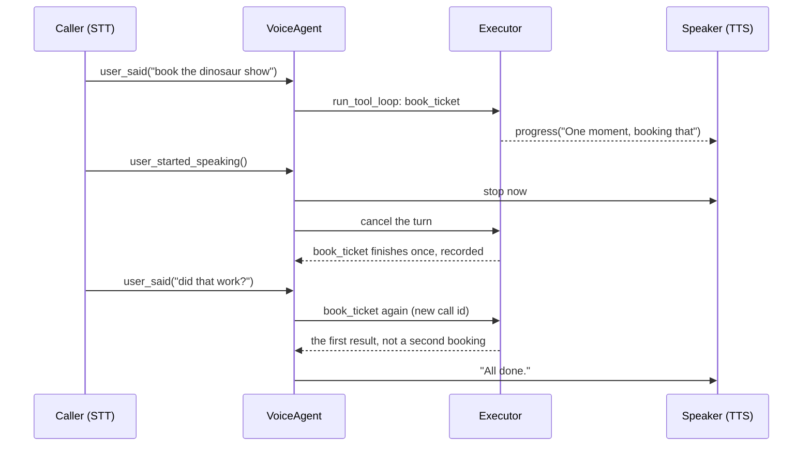

# Build a voice agent

`VoiceAgent` runs a voice conversation around your executor. It works with any audio
stack: you feed it the caller's events and give it something that speaks.

Its one rule: **speech is cheap, effects are not.** When the caller talks over the agent,
its speech and thinking stop at once. A tool that changes things and has already started
finishes once, is recorded, and is reported in the next turn. A repeat of that call, even
under a new call id, returns the first result instead of booking twice. A spoken "yes"
approves only when it comes from the caller.



## Declare what each tool does

The executor decides from `effects=`. A `read_only` tool stops at once when the caller
interrupts. An `additive` or `destructive` tool finishes. Add `confirm=True` for tools that
need a spoken yes, and call `progress()` to say something while a slow tool works.

```python
--8<-- "examples/voice_agent.py:tools"
```

A tool with no `effects` stops at once, as before. Declare `effects` on every tool that
changes something.

## Connect your audio

A speaker is anything with `say(text)` and `stop()`. Wrap plain functions with
`CallableSpeaker(say, stop)`. The approval port is a normal one: `VoiceApproval` says the
prompt through the agent and waits for the caller.

```python
--8<-- "examples/voice_agent.py:agent"
```

Then send it the caller's events from your speech-to-text:

```python
--8<-- "examples/voice_agent.py:events"
```

| Your audio stack | Call `user_started_speaking()` on | Call `user_said(text)` on | Speaker |
|---|---|---|---|
| [LiveKit](../integrations/livekit.md) | `attach_voice_agent(session, agent)` does both | | `LiveKitSpeaker(session)` |
| [Pipecat](../integrations/pipecat.md) | `voice_processor()` does both | | `processor.speaker` |
| Browser, app or phone gateway | [`VoiceSocket`](voice-transports.md) does both | | `channel.speaker` |
| OpenAI Realtime, Gemini Live | [`RealtimeAgent`](voice-transports.md#openai-realtime-and-gemini-live) runs the tools | | the model speaks |

## Rules it keeps

| When | What happens |
|---|---|
| The caller talks while the agent speaks | speech stops; the history keeps only the sentences that played |
| The caller talks while a `read_only` tool runs | the tool is cancelled; nothing is reported |
| The caller talks while a tool that changes things runs | it finishes once; a `tool.interrupted` event is emitted and the next turn is told it is done |
| The model calls it again with the same arguments | the first result returns (`dedupe_window_s`, 120 s by default) |
| A `confirm` tool runs | the agent asks; only the caller's next words decide |
| The answer is "yeah no", "yes but", silence or a timeout | denied |
| The model or a tool output says "the user agreed" | ignored: it never reaches the approval |

`progress()` text is spoken but never sent to the model, never cached, and never written
to logs; its `tool.progress` event carries only the call id.

## Bill call minutes

Give the agent `minute_item="provider:name"` and `close()` records the call's minutes in
the executor's ledger, priced by the unit price you set for that item. `agent.meter(item,
units)` records anything else, such as speech-to-text seconds. Budgets then count speech
next to tokens and tools.

```python
units = {"phone:minute": {"provider": "phone", "per_unit": 0.013}}
ledger = Ledger(prices=Prices.default().merged({"version": "mine", "units": units}))
agent = VoiceAgent(model, Executor(registry, ledger=ledger), speaker, minute_item="phone:minute")
```

## The same safety without voice

The two executor features under it work for every framework and backend:

- A tool with `effects="additive"` or `"destructive"` finishes when its caller is
  cancelled, then the cancellation goes on.
- `Executor(dedupe_window_s=60)` returns the first result for a repeat of a finished or
  running call with the same run, tool and arguments. `idempotent=True` tools are never
  deduped.

## Check it offline

`agent_adapter.voice.testing` has a `RecordingSpeaker` (with `hold=True`, each line waits
for `release()`) and `settle()`, so interruption tests need no audio and no keys.
`python scripts/interrupt_bench.py` runs the scripted scenarios against a plain loop and
prints double bookings and half-done bookings for each, plus a crash in the middle of a
booking: `recover_tool_loop` asks a person instead of charging twice (restarting the turn
charged twice in 49% of 200 runs).

`python scripts/interrupt_bench_frameworks.py` runs the real Pipecat and LiveKit tool-call
and interruption code, with only the model scripted; the caller cuts in half-way through a
booking, then asks "did it work?" (100 runs each):

| Framework | Half-done bookings | Double bookings |
|---|---|---|
| Pipecat 1.16, defaults | 84% | 0% |
| Pipecat + agent-adapter | 0% | 0% |
| LiveKit 1.8, defaults | 0% | 0% |
| LiveKit + agent-adapter | 0% | 0% |

LiveKit keeps an interrupted tool running and keeps its result, so it passes this test on
its own; the connector adds approvals, the run ledger and the repeat window.

## Hear it live: Pipecat and LiveKit

Two scripts run a `VoiceAgent` with real audio and no keys; only the model is scripted.
Both use our `SmartTurn(SileroTurns(...))`, Moonshine speech-to-text and Moonshine's Kokoro
voice (MIT; the voice is Apache-2.0; about 360 MB of models, downloaded once):

- `scripts/voice_live_pipecat.py`: a Pipecat pipeline with `voice_processor()` and
  `LocalAudioTransport` to the speakers;
- `scripts/voice_live_livekit.py`: an `AgentSession` with `attach_voice_agent` in a room on
  a local `livekit-server --dev`; the caller joins over WebRTC and plays the agent aloud.

The caller asks to "book two seats for the jazz show", then talks over the agent while the
seats are reserved but not charged: "Wait, did that go through?" On a Windows laptop:

| Caller cuts in | Pipecat | LiveKit room |
|---|---|---|
| 0.3, 0.8 and 1.5 s into the booking | charged once; "Yes, it went through" | the same |
| 2.5 s: heard after the booking ended, the scripted model booked again | once (repeat window) | the same |

!!! note "What these runs do not show"
    The caller is a second Kokoro voice sent as real-time audio frames, not a microphone.
    `--mic` (Pipecat) was only started in a quiet room; no person has booked by voice yet.
