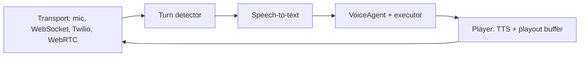

# Run a voice call with no framework

`VoiceSession` is a whole voice pipeline in this package. It takes raw audio from a
transport, finds the turns, transcribes them, runs your [`VoiceAgent`](voice-agents.md),
speaks with any text-to-speech and plays the reply. No Pipecat, no LiveKit, no media server.



## Start a call

```python
from agent_adapter.voice import LocalAudio, VoiceAgent, VoiceSession
from agent_adapter.voice.moonshine import MoonshineSTT, MoonshineTTS
from agent_adapter.voice.silero import SileroTurns
from agent_adapter.voice.smart_turn import SmartTurn

session = VoiceSession(
    LocalAudio(),
    stt=MoonshineSTT(),
    tts=MoonshineTTS(),
    turns=SmartTurn("smart-turn-v3.2-cpu.onnx", SileroTurns("silero_vad.onnx")),
)
agent = VoiceAgent(model, executor, session.speaker, instructions="You book shows.")
await session.run(agent)  # until the transport ends; then the agent is closed
```

Moonshine (MIT, Kokoro voices Apache-2.0) runs on the CPU with no keys:
`pip install "agent-adapter[voice-local,vad]"`. Any other provider fits `CallableSTT(fn)`
and `CallableTTS(fn, sample_rate=)`; an STT with `open()` (`StreamingSTT`) hears each
turn as it is spoken.

## Pick a transport

| Transport | For | Notes |
|---|---|---|
| `LocalAudio()` | a laptop | sounddevice; use headphones (no echo cancelling) |
| `AudioSocket(socket)` | a browser, app or gateway | binary PCM16 both ways; we send `{"type": "clear"}` on a cut |
| `TwilioStream(socket)` | phone calls | Twilio Media Streams, 8 kHz μ-law; `clear` on a cut, `mark` per line |
| `WebRTCAudio()` | a browser, peer to peer | `pip install "agent-adapter[webrtc]"` (aiortc, BSD) |

Every transport drains the session's playout buffer at the pace audio plays, so a pause
or a cut takes effect within one block (20 ms), or `lead_ms` (60 to 80 ms) over a socket.
On Twilio a line counts as played only when Twilio echoes its mark.

```python
from agent_adapter.voice import TwilioStream
from agent_adapter.voice.socket import text_socket


@app.websocket("/twilio")  # your <Connect><Stream url="wss://.../twilio"/> TwiML
async def twilio(ws):
    await ws.accept()
    phone = TwilioStream(text_socket(ws.send_text, ws.iter_text()))
    session = VoiceSession(phone, stt=stt, tts=tts, turns=turns)
    await session.run(VoiceAgent(model, executor, session.speaker))
```

For WebRTC, `answer = await WebRTCAudio().accept(offer)` answers the browser's SDP offer from
any route you own; `webrtc_page("/offer")` is a one-page client to try it. The browser
cancels echo, so speakers work. With no `ice_servers` it contacts no STUN server and offers
local addresses only; pass your STUN or TURN servers for calls across networks.

## What it does on a call

| When | What happens |
|---|---|
| The caller starts talking | playback pauses within one audio block |
| The speech lasts `confirm_ms` (300) or has words | the turn is cut: thinking stops; a started booking finishes once |
| A cough, or "uh-huh" while the agent speaks | playback resumes where it paused; nothing is cut |
| The caller goes quiet for `early_ms` (200) | the final transcription starts while the detector still decides |
| The caller goes on after all | that early pass is dropped and the whole turn is heard |
| A line is cut half-way | the history keeps the words that played, by the share of audio heard |
| The agent has more to say | the next sentence is synthesised while this one plays |
| Each turn | a `custom.voice_turn` event with `voice_to_voice_ms` and `cut_ms`, never the words |

Test all of it offline with `agent_adapter.voice.testing`: `MemoryTransport` (you send the
caller's audio and pull the agent's), `ScriptedSTT` and `WordTTS`.

## The same call on three stacks

`scripts/voice_race.py` runs one scripted call on our pipeline, on Pipecat with
`voice_processor()` and on LiveKit with `attach_voice_agent`: the same caller, the same
Silero and Smart Turn detectors, the same Moonshine models and the same scripted model. The
caller asks for a booking, then cuts in 0.3, 0.8, 1.5 or 2.5 s into it. Each stack is timed
from what the caller hears. 20 runs per stack (5 at each cut point) on a Windows laptop, CPU
only (Pipecat and LiveKit re-run after the fix to the quiet measure below); medians, with
the range in brackets:

| | Our pipeline | Pipecat 1.16 | LiveKit 1.8 |
|---|---|---|---|
| Charged once | 20 of 20 | 20 of 20 | 20 of 20 |
| First reply heard, after the caller stops | **2.4 s** (2.1 to 2.7) | 4.3 s (4.0 to 4.4) | 4.3 s (4.2 to 8.7) |
| Agent goes quiet, after the caller cuts in | **54 ms** (0 to 78), 10 runs | **54 ms** (31 to 79), 10 runs | 484 ms (453 to 485), 5 runs |
| The VoiceAgent is told of the cut | 352 ms | 63 ms | 391 ms |
| CPU time for the call | 47 s | 25 s | 47 s |

How to read it:

- **First reply** is taken from the runs that cut in at 1.5 and 2.5 s, where nothing was cut
  before the agent first spoke. We are faster because speech-to-text streams and starts its
  last pass early, and the voice plays from its first chunk. Pipecat runs its own
  `MoonshineSTTService`, which transcribes once the turn ends. LiveKit has no Moonshine
  service, so both use the same batch adapters we wrote for them.
- **Goes quiet** counts only runs where the agent was talking when the caller cut in. We tie
  with Pipecat; LiveKit is slower because its turn detection hears the cut later. A gap in
  the audio counts as quiet: Pipecat writes nothing while silent, and a first version of
  this script missed that and showed Pipecat taking 5.5 s.
- **Told of the cut** is later for us by design: playback stops at once, but the turn is cut
  only after 300 ms of speech, so a cough does not throw away the agent's work.
- **CPU**: we use more than Pipecat, because the streaming passes and the early pass
  transcribe some audio twice.
- The caller is a second Kokoro voice sent as audio frames, not a person or a microphone.
  The cut line was heard as "Wait till that go through" in some runs on every stack. The
  same audio gives "did" or "till" depending only on the silence before it.
