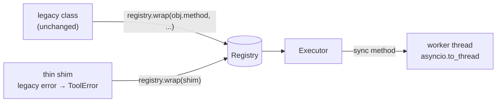

# Wrap a legacy class

Turn an existing service class into tools without editing it: its methods, its blocking
sync calls and its own exceptions. Functions, partials, callable objects and the
per-argument options (`fixed=`, `hide=`, `rename=`, `result=`) are on
[Wrap existing code](../get-started/wrap-existing-code.md).



## 1. The existing code

A sync service with blocking calls and its own exceptions. None of it changes.

```python
--8<-- "examples/howto_wrap_legacy.py:legacy"
```

## 2. Register its methods

Register **bound** methods (`service.find`), not the functions in the class body: `self`
has no annotation, so `build_spec` raises `ToolDefinitionError` and points you to
`wrap(obj.method)`.

```python
--8<-- "examples/howto_wrap_legacy.py:methods"
```

| Choice | Why |
|---|---|
| `name=f"invoice_{...}"` | method names like `find` clash across services; the name must match `[A-Za-z_][A-Za-z0-9_]*`, max 64 |
| `effects="read_only"`, `parallel_safe=True` | reads may run side by side; MCP clients see a read-only hint |
| `confirm=True`, `effects="destructive"` | the write asks the approval port first; no port means denied |
| `kind="db"` | lets `RunLimits(per_kind={"db": 4})` cap concurrent database calls per run |
| `timeout=5` | each attempt is timed; a sync tool keeps running in its thread after a timeout |

The docstring becomes the description and its `Args:` section the parameter
descriptions. A method without a docstring needs `description=`.

## 3. Blocking sync code

Sync functions and methods run in a worker thread (`asyncio.to_thread`), with
`contextvars` copied, so they never block the event loop. Rules for legacy sync code:

| Rule | Reason |
|---|---|
| Give it a `timeout` | a stuck call returns `ToolTimeout` to the caller; the thread itself cannot be killed |
| Use `retries=` only when the call is safe to repeat | a retry runs the method again (`idempotent=True` only informs MCP clients and the HTTP catalogue) |
| Set `parallel_safe=False` (the default) for code that is not thread-safe | it takes the run's exclusive lock: nothing else in the run runs meanwhile |
| Keep loop-bound clients out of sync code | sync code has no loop; async clients belong in a `LoopLocal` ([Runtime](../concepts/runtime.md#looplocal-one-client-per-loop)) |

## 4. Legacy exceptions

A foreign exception (here `KeyError`) becomes `ToolFailed`: kind `tool-failed`, with no
exception text, so nothing internal leaks to the model. The executor logs the exception
type at `ERROR`. To give the model a useful message, add a thin shim that raises
`ToolError`; its message is shown to the model.

```python
--8<-- "examples/howto_wrap_legacy.py:shim"
```

## 5. Run it

```python
--8<-- "examples/howto_wrap_legacy.py:run"
```

Output:

```text
['invoice_find', 'invoice_total_open', 'invoice_void', 'invoice_lookup']
{'amount': 1200.0, 'status': 'open'}
error tool-failed tool 'invoice_find' failed after 1 attempt
tool-error no invoice X; ask the user for the number
INV-1 voided: duplicate
300.0
```

The `CallbackApproval` reviewer approves a void only when a reason is given. In
production use a [deferred review](human-in-the-loop.md).

## Other shapes

| Legacy shape | Do |
|---|---|
| A function, a `functools.partial`, a callable object | [Wrap existing code](../get-started/wrap-existing-code.md) |
| A REST service with an OpenAPI spec | `import_openapi(registry, spec, base_url=...)` ([OpenAPI](../integrations/openapi.md)) |
| LangChain tools you already have | `import_langchain(registry, tools)` ([LangChain](../integrations/langchain.md)) |
| Tools on an MCP server | `import_mcp(...)` ([MCP](../integrations/mcp.md)) |

## Files

| File | Does |
|---|---|
| `examples/howto_wrap_legacy.py` | the legacy service, its registration, the shim and the calls |
| `tests/docs/test_howto_examples.py` | runs it offline and checks the output |
