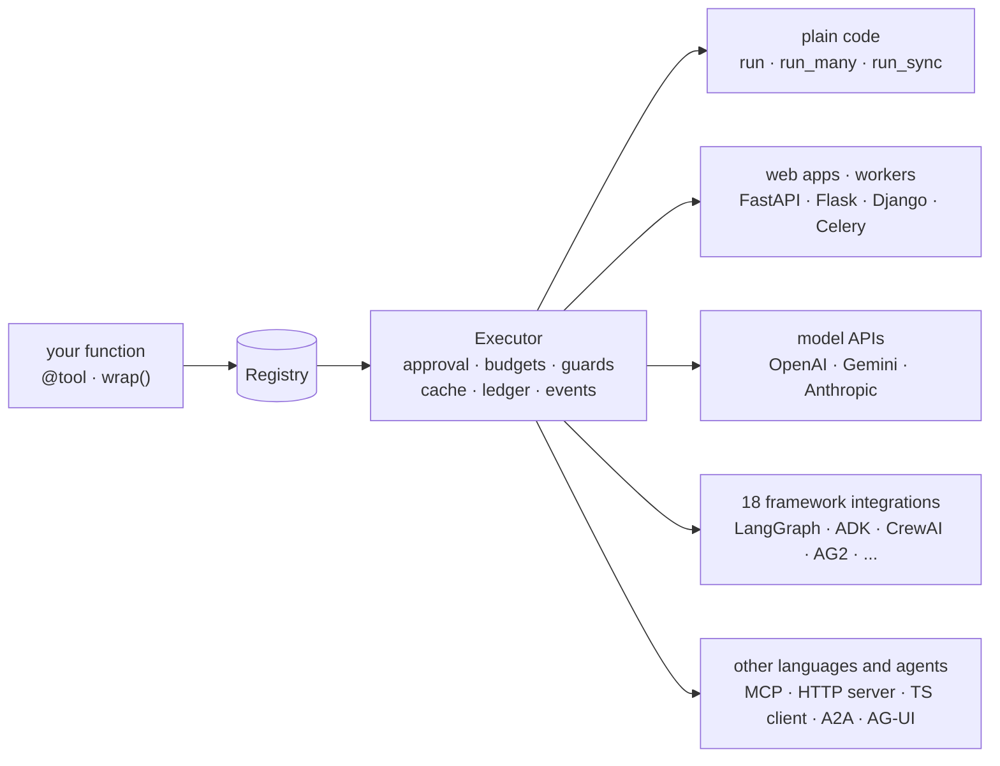

---
hide:
  - navigation
  - toc
---

<div class="aa-hero" markdown>


# Agent Adapter

<p class="aa-pitch">Write a tool once, as a plain Python function.<br>Use it with any model API or agent framework, or from plain code.</p>

[Attach anywhere](how-to/attach-anywhere.md){ .md-button .md-button--primary }
[Quickstart](get-started/quickstart.md){ .md-button }
[See every feature](features.md){ .md-button }

[Which feature do I need?](choose.md) · [Cookbook](cookbook/index.md) ·
[Troubleshooting](troubleshooting.md) · [Support matrix](support-matrix.md)

</div>

## What it is

Agent Adapter is an open-source (Apache-2.0), framework-independent Python SDK (version **1.0.0**). It
turns your functions into LLM tools, checks their schemas once at startup, and runs every
call through one executor that applies approval, budgets, guards, caching and cost
tracking. The core depends only on pydantic; every framework is an optional extra.

No agent framework is needed: a FastAPI service calling an LLM gets tools, approvals,
budgets, cost, cache and [context compression](concepts/context-compression.md) directly.
The adapter can also be your framework: `run_tool_loop` with your own model is the loop.



## Attach anywhere

The same tool, the same executor and the same safety rules, wherever the call comes from.
[Attach anywhere](how-to/attach-anywhere.md) picks the entry point for your situation.

| You have | Use | Page |
|---|---|---|
| a script, a service, a notebook | `executor.run(...)`; `run_sync(...)` from sync code | [Sync code and backends](how-to/sync-backends.md) |
| code you cannot edit | `registry.wrap(obj.method)` | [Wrap a legacy class](how-to/wrap-legacy-code.md) |
| a raw model API | `chat_tools`, `function_declarations`, `anthropic_tools`, then `executor.run_call` per tool call; or `run_tool_loop` | [OpenAI](integrations/openai.md), [Tool loop](concepts/tool-loop.md) |
| an agent framework | one module per framework, one extra each | [Integrations](integrations/index.md) |
| another language | MCP, the HTTP tool server, the TypeScript client | [Cross-language](cross-language/index.md) |

## Safe by default

<div class="grid cards" markdown>

-   :material-shield-lock:{ .lg .middle } **Approval that cannot be bypassed**

    ---

    A `confirm` tool runs only after the executor's `ApprovalPort` approves. Each decision is
    used once, for one call: same run, call id, tool and argument digest. A framework's
    own "approved" signal never counts alone; a bridge passes only a one-use token the
    adapter issued. No port: denied. One opt-in exception: an MCP server built with
    `client_approval=True` makes the MCP client's user the approver instead of the port.
    [The one-use rule](how-to/human-in-the-loop.md#the-one-use-rule) · [MCP approval](integrations/mcp.md#approval)

-   :material-server-security:{ .lg .middle } **A locked-down HTTP server**

    ---

    No authenticator is a startup error unless you opt in to anonymous mode. Run, thread
    and call ids are scoped to the caller; the first principal owns a run; approvals are
    visible to the invoker or an approver only; hooks fail closed.
    [Security model](cross-language/http-server.md#security-model)

-   :material-cash-lock:{ .lg .middle } **Budgets, guards and limits**

    ---

    `BudgetHook(max_usd)`, `once_per_run`, `RunLimits`, per-kind caps, rate limits,
    timeouts and retries, on every call from every surface.
    [Budgets](how-to/budgets.md)

-   :material-eye-off:{ .lg .middle } **No secrets in logs or errors**

    ---

    `LoggingHook` redacts secret-looking keys and never logs `confirm` tool arguments.
    Foreign exceptions reach the model as `tool-failed`, without their text.
    [Errors](concepts/errors.md)

</div>

## Features

<div class="grid cards" markdown>

-   :material-function-variant:{ .lg .middle } **One definition** — schema from the signature and docstring; portable-schema check at startup. [Tools](concepts/tools.md)
-   :material-call-split:{ .lg .middle } **Parallel execution and flows** — `run_many`, `run_plan` waves, portable `Flow` graphs that compile to LangGraph and ADK. [Flows](concepts/flows.md)
-   :material-cash-check:{ .lg .middle } **Cost and cache** — a priced ledger per call; tool-result, LLM-response and provider prefix caches. [Cost](concepts/cost.md)
-   :material-swap-horizontal:{ .lg .middle } **Model ports** — OpenAI, Gemini, Anthropic, your own function, with fallback and streaming. [Model ports](concepts/models.md)
-   :material-arrow-collapse-vertical:{ .lg .middle } **Context compression** — shrink long histories before each model call, in any framework's own message type. [Context compression](concepts/context-compression.md)
-   :material-chart-timeline:{ .lg .middle } **Tracing** — an event catalogue, sinks and OpenTelemetry GenAI spans. [Tracing](concepts/tracing.md)
-   :material-tune:{ .lg .middle } **Optimiser** — an offline loop that proposes a reviewable prompt diff. [Optimiser](optimiser.md)

</div>

## Install

Install from PyPI (Python 3.11+); details in [Install](get-started/install.md).

| Command | Adds |
|---|---|
| `pip install -e .` | the core (pydantic only): tools, executor, flows, approval, cost, cache |
| `pip install -e ".[openai]"` (one extra per provider, framework or protocol) | that SDK; [every extra](get-started/install.md#extras) |
| `pip install -e ".[all]"` | every extra that co-installs; CrewAI, Strands, Semantic Kernel, ADK, CAMEL-AI and DSPy need their own environment ([why](integrations/index.md#install-several)) |

## Quickstart

Define a tool, or wrap code you already have:

```python
--8<-- "examples/howto_attach.py:define"
```

Build one executor with your policies, then run:

```python
--8<-- "examples/howto_attach.py:executor"
--8<-- "examples/howto_attach.py:run"
```

The same spec renders for every model API, with nothing redefined:

```python
--8<-- "examples/howto_attach.py:surfaces"
```

This code is `examples/howto_attach.py`; the test suite runs it. Next: the
[Quickstart](get-started/quickstart.md), then [how it works](architecture/index.md) and
the [API reference](reference.md).
