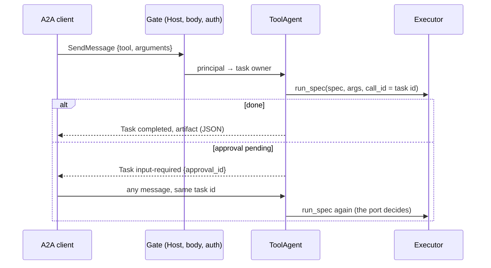

# A2A

:material-check-circle:{ .status-ok } Available · `pip install "agent-adapter[a2a]"` · `a2a-sdk[http-server]` 1.3+ (A2A protocol 1.0)

Serve registry tools as an [A2A](https://a2a-protocol.org/latest/specification/) agent, and
import a remote A2A agent's skills as tools. Every call runs through the
[executor](../concepts/executor.md), so hooks, approval, limits, cache and the ledger apply.
IBM's ACP merged into A2A, so this covers ACP agents too.

## Functions

| Function (`agent_adapter.integrations.a2a`) | Returns |
|---|---|
| `a2a_app(registry, *, url, executor=None, authenticate=None, authorize=None, allow_anonymous=False, host="127.0.0.1", allowed_hosts=None, public_card=False, client_approval=False, name="agent-adapter", description=, version=, max_body_bytes=1 MiB, max_data_bytes=256 KiB, task_store=None)` | a Starlette app: the card at `/.well-known/agent-card.json`, JSON-RPC at `/` |
| `a2a_executor(registry, *, executor=None, client_approval=False, authorize=None, max_data_bytes=256 KiB)` | an SDK `AgentExecutor`, for your own `DefaultRequestHandler` |
| `agent_card(registry, *, url, name=, description=, version=)` | an `AgentCard`: one `AgentSkill` per tool exported to `a2a` |
| `bounded_task_store(*, ttl=24 h, max_tasks=10 000, max_per_owner=1 000)` | the default SDK `TaskStore` of `a2a_app` (in memory, bounded) |
| `static_bearer({token: caller_id})` | an `authenticate` hook for `Authorization: Bearer` |
| `await connect_a2a(url, *, headers=None, auth=None, allow_private=False, trusted_hosts=(), allow_cross_origin=False, timeout_s=30, max_response_bytes=4 MiB, http_transport=None)` | an open `A2AConnection` (card + SDK client); close it, or use `async with` |
| `await import_a2a(registry, connection, *, prefix="", names=None, task_timeout_s=300, poll_interval_s=1, **policy)` | the registered `ToolSpec`s, one per remote skill |
| `INTEGRATION` | `export_tools(registry)` → `AgentSkill`s; `bind_context(request_context)` (call id = task id) |

## Serve

```python
--8<-- "examples/a2a_server.py:tools"
```

```python
--8<-- "examples/a2a_server.py:app"
```

A client sends one message per call: a data part `{"tool": "<skill id>", "arguments": {…}}`.
The result is an artifact with one `application/json` text part (exact JSON; a data part
would turn every int into a float).

`create_app` does not mount A2A. To serve both, mount `a2a_app(...)` beside it in your own
Starlette app, with its own `authenticate`, and run its lifespan.



| Outcome | Task state | Status message |
|---|---|---|
| value | `completed` | (artifact `result`) |
| tool error, invalid args, denial, timeout | `failed` | text `kind: message`, data `{"error": {kind, message}}` |
| bad message, unknown tool, `authorize` says no | `rejected` | same shape; kind `bad-request`, `tool-not-found`, `forbidden` |
| approval pending | `input-required` | text `approval required: <id>`, data `{kind, approval_id, tool, answer}` |

## Approval

A pending call is parked on the server: tool, arguments, run id and approval id. The next
message on that task re-runs exactly that call. What the message says never changes it.

| Mode | Who decides | What the follow-up message does |
|---|---|---|
| default | the executor's port (`DeferredApproval`: reviewers decide in its store) | only asks to try again; a client "approved" is ignored |
| `client_approval=True` (opt-in, warns) | the A2A client | `{"approval_id": "<id>", "approved": true}` becomes a one-use token bound to run, task id, tool and argument digest |

With `client_approval`, anything but an exact `approval_id` and a JSON `true` re-asks. A
`false` denies. A replayed answer finds a finished task (the SDK refuses it). Another
caller cannot see the task at all.

## Security

| Guard | Default |
|---|---|
| Auth | `authenticate(request) -> principal` (anything with a string `.id`, such as the HTTP server's `Principal`); none → 401 |
| No `authenticate` | local `host`: loopback peers only (403 `non-local-client`); public `host`: refused unless `allow_anonymous=True` |
| Owner scope | the SDK task store, our parked calls and run ids are keyed by `principal.id` |
| Host header | must be in `allowed_hosts` (local names by default): no DNS rebinding; else 421 |
| Body | `max_body_bytes` (413), read within 30 s (408); a call's data part ≤ `max_data_bytes`, depth ≤ 32 |
| Card | needs auth too, unless `public_card=True` |
| Call context | keeps only the `A2A-Version` and extension headers, never `Authorization` |
| Push notifications, streaming | off (no outbound requests from the server) |
| `authorize(principal, spec, arguments)` | must return `True`; a raising hook refuses |
| Task store | `bounded_task_store()`: a task expires 24 h after its last update; over 1 000 per owner the owner's own oldest goes, over 10 000 the oldest finished task goes; a rejected task keeps no history. Pass `task_store=` for a durable SDK store |
| Parked calls | 100 per owner (more are `rejected`, kind `too-many-pending`), 10 000 in all, 24 h |

## Import

```python
--8<-- "examples/a2a_import.py:import"
```

| Remote skill | Local tool |
|---|---|
| described in the card's `urn:agent-adapter:a2a:tools:v1` extension (our servers) | typed arguments, sent as `{tool, arguments}` |
| any other skill | `{"message": str}`, sent as text |

| Remote task ends | Tool result |
|---|---|
| `completed` | the one part's value (JSON text parsed), else a list of values |
| a direct message | the same, from the message parts |
| `failed`, `rejected`, `canceled`, `input-required`, `auth-required` | `ToolError`; `details` hold `task_id`, `context_id`, `state` |
| still running after `task_timeout_s` | `ToolError` (polls with `GetTask`) |

A remote `input-required` never approves anything locally. Approve it on the remote side.

| Outbound guard | Default |
|---|---|
| Private, loopback, link-local, multicast, CGNAT, site-local, Teredo hosts, and IPv6 forms that embed a private IPv4 (NAT64 `64:ff9b::/96`, `::a.b.c.d`, 6to4) | refused (`HostRefused`) unless `allow_private=True` or in `trusted_hosts` |
| Interfaces in the card on another origin | dropped; none left → `IntegrationError` (`headers` / `auth` never leave the origin) |
| Redirects | not followed |
| Response size | `max_response_bytes` per response |

The host is resolved once per connection; every answer is checked and the socket goes to a
checked address (no second lookup, so DNS rebinding cannot swap it). TLS still checks the
certificate against the host name. A custom `http_transport` (tests, ASGI) is checked per
request but makes its own connections. Card errors and logs show only `scheme://host:port`.

## Files

| File | Role |
|---|---|
| `integrations/a2a/__init__.py` | `A2AIntegration`, `INTEGRATION`, the public names |
| `integrations/a2a/server.py` | `a2a_app`, the gate (Host, body, auth), `static_bearer` |
| `integrations/a2a/agent.py` | `ToolAgent`: run, park, resume; `a2a_executor` |
| `integrations/a2a/card.py` | `agent_card`, `agent_skill` |
| `integrations/a2a/client.py` | `connect_a2a`, `import_a2a`, `call_remote` |
| `integrations/a2a/_wire.py`, `_pending.py` | message format and bounds; parked calls |
| `integrations/a2a/_guard.py`, `_pinned.py` | outbound host policy; the transport that connects to checked IPs |
| `integrations/a2a/_task_store.py`, `_owned.py` | `bounded_task_store`; the per-owner expiring table both use |

Limits: parked calls live in one process (route a task's follow-ups to the same replica,
as the SDK's own `ActiveTaskRegistry` needs). Numbers in arguments arrive as doubles; whole
values become ints before validation.
