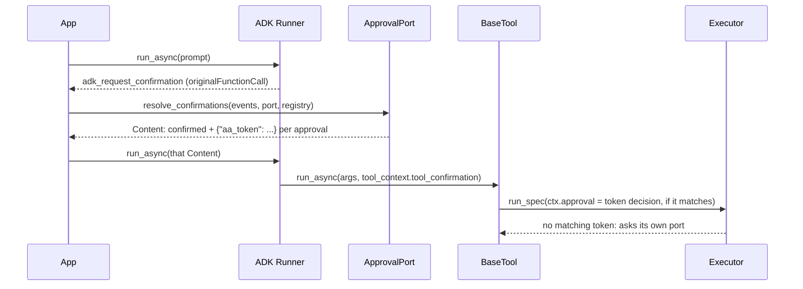
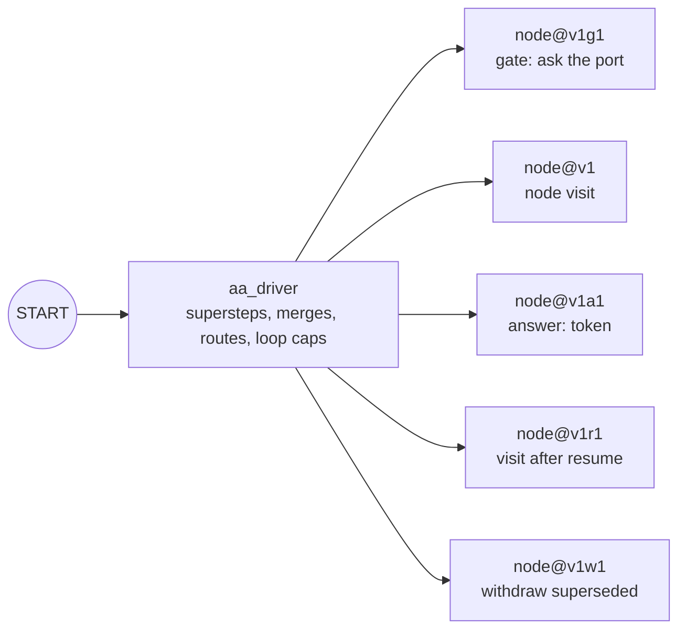

# Google ADK

:material-check-circle:{ .status-ok } Available · `BaseTool` per spec · flows compile to a
`Workflow` · `pip install "agent-adapter[adk]"` (google-adk 2.13+, google-genai 2.30+; own
environment: ADK pins `opentelemetry <= 1.44`)

## Functions

| Function (`agent_adapter.integrations.adk`) | Returns |
|---|---|
| `adk_tool(spec, *, executor=None)` | one ADK `BaseTool` running `spec` through the executor |
| `adk_tools(registry, *, executor=None)` | one per registry tool exported to `adk` |
| `bind_context(tool_context)` | our `ToolContext`: run = `invocation_id`, call = `function_call_id`, thread = session id |
| `await resolve_confirmations(events, port, registry)` | the user `Content` answering every open tool confirmation of one invocation (its `invocation_id` is the run), or `None`; several invocations or none → `ToolUsageError` |
| `compile_flow(flow, *, executor=None, name=None, max_steps=100, model=None)` | a `Workflow`: `START -> aa_driver` |
| `await run_workflow(workflow, state, *, session_service=None, user_id="user")` | a `FlowResult` (`state` may be a `resume_message`) |
| `resume_message(interrupt_id, decision)` | the user `Content` answering one flow pause |
| `INTEGRATION` | `get_integration("adk")`; also a `FlowCompiler` |

Declarations use the Gemini schema family (`to_gemini_parameters`). Results reach ADK as
JSON; `ToolArgsInvalid`, `ToolError`, `ApprovalDenied`, `GuardrailBlocked` and
`RunLimitExceeded` come back as `{"error": {"kind", "message"}}`; other errors propagate.

## Tools and approval

```python
--8<-- "examples/adk_tools.py:wire"
```

A `confirm` rule drives `check_require_confirmation`, so ADK pauses the call with an
`adk_request_confirmation`. ADK's `confirmed: true` is only an **extra** gate: the call is
approved by a one-use token that `resolve_confirmations` issues after **your port**
approved (`approval.batch.ask_each`, two-phase for `DeferredApproval`).



| Confirmation | What happens |
|---|---|
| From `resolve_confirmations` | token bound to the invocation id, the call id, the tool and the validated arguments; used once; may edit the arguments |
| `confirmed: false` | ADK rejects the call (`This tool call is rejected.`) |
| `confirmed: true` with no token, a forged or spent token, or a payload with anything beside `aa_token` | ignored: the executor asks its own port (no port: denied) |
| A tool outside the registry | asked with its raw arguments, confirmed without a token, never edited |
| A `DeferredApproval` port and no token yet | the call raises `ApprovalPending` out of the tool; ADK logs it at ERROR (`Node execution failed`): expected |

## Flows

```python
--8<-- "examples/adk_flow.py:run"
```

`compile_flow` builds one driver node that runs the local runner's supersteps. Each step
with an effect is a child node with a deterministic run id; when ADK re-runs the driver on
resume it **replays** finished children from the session (de-duplicated by node path), so
every node, tool call, ledger entry and event happens once.



| Concept | On ADK |
|---|---|
| Supersteps, `Join`, merges, `Route`, `max_loops` | the driver, exactly as the local runner (node-name merge order; routes see the pre-step state plus their own node's writes) |
| `Map` | one node calling `executor.run_many` |
| Retries, timeouts | the node's own policy (not `RetryConfig`, whose count ADK does not persist) |
| `pause=` gate, tool approval | an `adk_request_input` interrupt (ToolConfirmation schema); `FlowResult.pending.metadata["interrupt_id"]` |
| Resume | `run_workflow(workflow, resume_message(interrupt_id, decision), session_service=…)` |
| Run id | the ADK `invocation_id` (kept across resumes) |
| `max_steps` | `compile_flow(max_steps=)`; ADK has no recursion limit |
| Another version of the flow | refused on resume (`FlowError`): the graph digest is the run's first step |

A resume answer counts only with its token: it is bound to the pending request's run, call
id, tool and argument digest, settled in the port's `ApprovalStore` and used once. Without
one (forged, spent, another run's, or an unknown interrupt after a restart) a
`DeferredApproval` port's stored record of that approval id is used (other ports are asked
again): a decision made in the store resumes the run and is consumed once; otherwise it
pauses again and nothing runs. The fallback never looks a call
up afresh, so a resume that loses a race leaves no orphan pending record. A pause that was already answered (spent in this process, or consumed in the
store) is refused with `ApprovalAlreadyDecided`, never asked again, so a second resume
cannot run a call twice. `run_workflow` serialises runs of one session in a process;
**serialise resumes of one session across processes** yourself (a losing concurrent resume
raises `ApprovalAlreadyDecided`). The per-session lock is not reentrant: a node or tool must
never call `run_workflow` on its own session (it would wait for itself).

## Differences from the local runner

All parity cases of `tests/flow/parity.py` give the same pauses, states and visits.

| Topic | Local runner | ADK |
|---|---|---|
| Durability | sealed `FlowCheckpoint` | the ADK session (`checkpoint` is `None`) |
| Finished calls of a resumed node | replayed from the journal | the same (LangGraph re-runs them) |
| Node outputs | any value until a pause | must have a canonical encoding (ADK stores each one), else `state-not-sealable` |
| Initial state | a model or mapping | crosses ADK as JSON, validated by the state model |
| Superseded approval records | withdrawn at the pause | the same, as a child step |
| `visits` while paused | before the paused superstep | finished visits, including siblings of the paused node |
| Tokens across processes | — | per process; after a restart, decide in the store and send any answer |
| `CancelledError` raised inside a tool | propagates | ADK's `Runner` ends the turn quietly (cancelling `run_async` reaches the tool) |
| `CancelledError` raised by flow code | propagates | the run ends (`run.finished`, `ok=False`); `run_workflow` raises `FlowError` "cancelled inside ADK" |
| A route that raises | its siblings finish, then `FlowError` | routes run inside their node's step, so running siblings are cancelled; the same `FlowError` |
