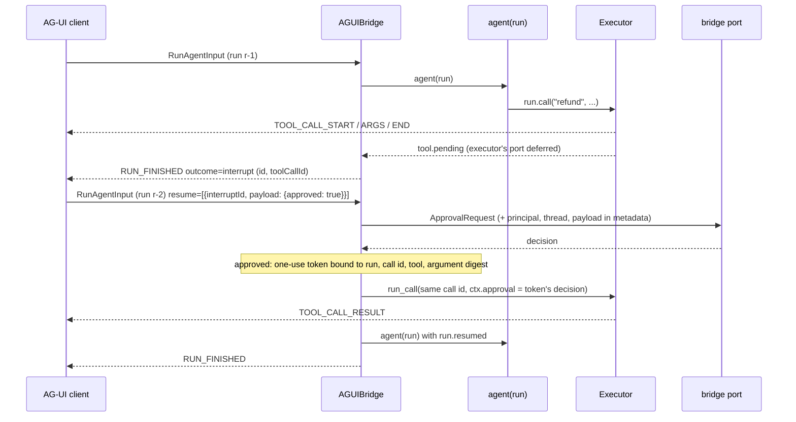

# AG-UI

:material-check-circle:{ .status-ok } Available · `pip install "agent-adapter[ag-ui]"` · `ag-ui-protocol>=1.0,<2` (protocol 1.0)

[AG-UI](https://docs.ag-ui.com) is the event protocol between an agent and its user
interface (CopilotKit and others). This bridge streams one of your agent functions as an
AG-UI run: each tool call becomes `TOOL_CALL_*` events, a call that waits for approval ends
the run with an **interrupt**, and the next run's `resume` entry goes to your
`ApprovalPort`. The SSE output plugs into Starlette and FastAPI.

Frameworks that ship their own AG-UI adapter (Pydantic AI, LangGraph, ADK, MAF, CrewAI)
already carry our tools inside them. Use this bridge when your app runs our executor itself.

## Names

| Name (`agent_adapter.integrations.ag_ui`) | What it is |
|---|---|
| `AGUIBridge(executor, *, port=None, interrupts=None, max_events=10_000, trace=True)` | runs agents; holds open interrupts. `port` decides resumes (default: the executor's port) |
| `bridge.stream(run_input, agent, *, principal="")` | async iterator of AG-UI event models |
| `bridge.sse(run_input, agent, *, principal="")` | the same, as `text/event-stream` frames |
| `AGUIRun` | what `agent(run)` gets: `call`, `text`, `custom`, `messages()`, `executor`, `ctx`, `resumed` |
| `agui_endpoint(bridge, agent, *, authenticate, max_body_bytes=1 MiB, allowed_hosts=None)` | a Starlette/FastAPI `POST` handler; 421 for a `Host` not served (default: local names when `authenticate=anonymous`, else any) |
| `anonymous` | an `authenticate` that admits everyone as `""` (local use only) |
| `parse_input(body)` / `to_messages(run_input)` | a bounded `RunAgentInput`; its conversation as `Message`s |
| `InterruptTable(ttl=900, max_interrupts=1024, max_per_principal=64)` | the open interrupts (in memory, one process); a caller over its cap drops its own oldest, never another's |
| `INTEGRATION` | the [integration](../contributing/writing-an-integration.md) object; `export_tool` gives an AG-UI `Tool` descriptor |

## Run, pause, resume

```python
--8<-- "examples/ag_ui_bridge.py:port"
--8<-- "examples/ag_ui_bridge.py:agent"
--8<-- "examples/ag_ui_bridge.py:round-trip"
```



## Events

| Executor activity | AG-UI event |
|---|---|
| a tool call starts (hook `before_tool`) | `TOOL_CALL_START`, `TOOL_CALL_ARGS` (JSON of the validated arguments), `TOOL_CALL_END` |
| it returns (hook `after_tool`) | `TOOL_CALL_RESULT` (`content`: the value as JSON text) |
| `tool.failed` | `TOOL_CALL_RESULT` with `{"error": {"kind", "message"}}` |
| `tool.pending` | no result; the run ends with an interrupt for that call |
| `run.text(...)` / `run.custom(...)` | `TEXT_MESSAGE_START/CONTENT/END` / `CUSTOM` |
| any other trace event (`trace=True`) | `CUSTOM` named `agent_adapter.trace`, data without content keys |
| agent returns `value` | `RUN_FINISHED` with `result` (or the interrupt outcome) |
| agent raises | `RUN_ERROR` with `code` = error kind; foreign errors show only their type |

`run.call` and `run_tool_loop(model, registry, run.messages(), executor=run.executor,
ctx=run.ctx)` both stream this way. Past `max_events`, trace events are dropped first.
Closing the stream (a client disconnect) cancels the agent.

## Approval

| Resume entry | What happens |
|---|---|
| `status: "cancelled"`, or a payload other than `{"approved": true}` | denied without asking; `TOOL_CALL_RESULT` with `approval-denied` |
| `{"approved": true}` | a **request** to the bridge's port; only its decision counts |
| port approves | the call runs once, with an adapter-issued one-use token; port edits apply |
| port defers (`ApprovalPending`) | the call stays paused; a new interrupt is returned |
| unknown, expired, answered before, other thread or other principal | ignored with a warning and a `CUSTOM` `agent_adapter.resume_ignored`; nothing runs |

A client's `editedArgs` are passed to the port in `metadata["resume_payload"]`; they never
apply by themselves. With the default port (a `DeferredApproval`), a remote "approved"
does nothing until someone decides the record in the store, for example over the
[HTTP server](../cross-language/http-server.md).

## Serve it

```python
--8<-- "examples/ag_ui_starlette.py:auth"
--8<-- "examples/ag_ui_starlette.py:app"
```

| Response | When |
|---|---|
| 401 | `authenticate` returned `None` |
| 415 / 413 / 422 | not `application/json` / body over `max_body_bytes` / invalid `RunAgentInput` |
| 200 `text/event-stream` | the run's events, one `data: <json>` frame each |

Public host checklist: authenticate every request (never `anonymous`); serve over TLS;
give each user their own principal (interrupts are bound to it); put a database-backed
store behind `DeferredApproval` and run one bridge process, or pin a thread to one
process, since interrupts live in memory.

## Limits

- Bounds: 1 MiB body, 1,000 messages, 64 resume entries, ids of 1 to 128 characters.
- Interrupts expire after 15 minutes. An interrupt left out of a resume stays open.
- Frontend tools in `RunAgentInput.tools` are not run here; only registry tools are.

## Files

| File | Role |
|---|---|
| `integrations/ag_ui/bridge.py` | `AGUIBridge`: the run driver, outcomes, interrupts |
| `integrations/ag_ui/run.py` | `AGUIRun`: the agent's handle |
| `integrations/ag_ui/_events.py` | hook + sink: executor activity to AG-UI events |
| `integrations/ag_ui/_resume.py` | resume entries to port decisions and tokens |
| `integrations/ag_ui/_interrupts.py` | `PendingCall`, `InterruptTable` |
| `integrations/ag_ui/_input.py` | `parse_input`, `to_messages`, bounds |
| `integrations/ag_ui/_channel.py` | the per-run, thread-safe event queue |
| `integrations/ag_ui/starlette.py` | `agui_endpoint`, `anonymous` |
| `integrations/ag_ui/_support.py` | `INTEGRATION`, version guard, SSE encoding |
