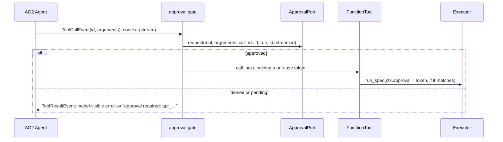

# AG2

:material-check-circle:{ .status-ok } Available · `FunctionTool` per spec · approval gate as
tool middleware · `pip install "agent-adapter[ag2]"` (`ag2`, the 1.x package imported as
`ag2`)

AG2 1.x is the `ag2` package (`from ag2 import Agent`). It is not the old `autogen`
0.2 API, and not Microsoft AutoGen 0.7, which has its own [integration](autogen.md).

## Functions

| Function (`agent_adapter.integrations.ag2`) | Returns |
|---|---|
| `ag2_tool(spec, *, executor=None, approval=None, middleware=())` | one `ag2.tools.types.FunctionTool` running `spec` through the executor |
| `ag2_tools(registry, *, executor=None, approval=None, middleware=())` | one per registry tool exported to `ag2` |
| `INTEGRATION` | `get_integration("ag2")`; `bind_context(event)` or `bind_context((event, context))`; `bind_approval(port)` is `None` (use `approval=`) |

The tool takes the neutral JSON schema (AG2 drops its top-level `title`). `middleware` is
extra AG2 tool middleware, outermost first. `ag2_tool` refuses (`IntegrationError`) an
AG2 outside the extra's range or without what the bridge reads.

## Wiring

```python
--8<-- "examples/ag2_tools.py:wire"
```

## Approval

`approval=port` adds a gate as the **innermost** tool middleware, so the port sees the
arguments that run. For a call whose `confirm` rule says yes it asks the
[approval port](../concepts/approval.md) once.



| Case | What happens |
|---|---|
| Approved by the gate | a one-use token bound to the stream id, the call `id`, the tool and the validated arguments; the call takes it and the executor does not ask again |
| A token the call did not take | dropped when the gate returns |
| Another call id, another stream, a replayed event | no token: the executor asks its own port (no port: denied) |
| AG2's `approval_required()` answered `y` or `always` | not an approval: it only adds a gate; the executor still decides |
| `DeferredApproval` port | the gate returns `approval required: apr_…`; the tool does not run |
| An approval edits arguments | denied: the gate cannot apply edits |
| No `approval=` | the executor's port decides every `confirm` call |

!!! warning "Trust assumptions"
    A `ToolCallEvent` is the model's (or a remote peer's) request, never an approval.
    Only the gate's own port decision issues a token, in the process that runs the agent.

## Calls and errors

| Item | Behaviour |
|---|---|
| Call id | `ToolCallEvent.id` → `ctx.call_id` |
| Run | the conversation stream's id → `ctx.run_id` and `ctx.thread_id` |
| Arguments that are not a JSON object | `ToolErrorEvent`, kind `tool-args-invalid` |
| Any failure (`ToolArgsInvalid`, `ToolFailed`, …) | `ToolErrorEvent`; the model sees `{"error": {"kind", "message"}}`, not AG2's traceback; the event's `error` is the exception |
| `CancelledError` | propagates |
| Registration copies | AG2 deep-copies tools; copies share the spec, the executor and the gate's tokens |

## Files

| File | Role |
|---|---|
| `agent_adapter/integrations/ag2.py` | `ag2_tool`, `ag2_tools`, the gate, `INTEGRATION` |
| `examples/ag2_tools.py` | the wiring above, with AG2's scripted `TestConfig` model |
| `tests/integrations/test_ag2_contract.py` | contract kit C1-C8; forged, replayed and cross-run approvals |
