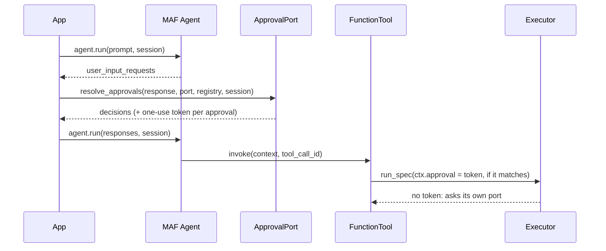

# Microsoft Agent Framework

:material-check-circle:{ .status-ok } Available · `FunctionTool` per spec · approval from your
port · `pip install "agent-adapter[agent-framework]"` (`agent-framework-core`)

## Functions

| Function (`agent_adapter.integrations.agent_framework`) | Returns |
|---|---|
| `agent_framework_tool(spec, *, executor=None)` | one `FunctionTool` (a subclass) running `spec` through the executor |
| `agent_framework_tools(registry, *, executor=None)` | one per registry tool exported to `agent_framework` |
| `await resolve_approvals(response, port, registry, *, session=None)` | the `function_approval_response`s answering `response`'s approval requests |
| `INTEGRATION` | `get_integration("agent_framework")`; `bind_context(invocation_context)` gives ids only |

The tool takes the neutral JSON schema as `input_model`. Every call runs the full
[executor pipeline](../concepts/executor.md): validation, hooks, cache, retries, ledger.
`agent_framework_tool` refuses (`IntegrationError`) an MAF outside the extra's range or
without what the bridge reads.

## Wiring

```python
--8<-- "examples/agent_framework_tools.py:wire"
```

## Approval

Any `confirm` rule exports the tool with `approval_mode="always_require"`, so MAF pauses the
run with a `function_approval_request` (a callable rule is asked **every time**: MAF has no
per-call rule). MAF's approval is only an **extra** gate: answer it with
`resolve_approvals`, which asks your [approval port](../concepts/approval.md).



| Case | What happens |
|---|---|
| Approved by `resolve_approvals` | a one-use token bound to the session, the `tool_call_id`, the tool and the validated arguments; the call that matches takes it and the executor does not ask again |
| Any other approval (a hand-made or forged `function_approval_response`, a caller-built `FunctionInvocationContext`, changed arguments, a replay) | no token: the executor asks its own port (no port: denied) |
| `DeferredApproval` port | two-phase: `ApprovalPending` until every request is decided, then each record is consumed once |
| Edited arguments | refused (denied): MAF cannot apply them |

!!! warning "Trust assumptions"
    Pass the run's `session` to `resolve_approvals` (its id is the run id the token is
    bound to). Never enable MAF's `disable_approval_response_binding`: it lets any message
    claim an approval. The adapter still asks its port then, but MAF's own gate is gone.

## Calls and errors

| Item | Behaviour |
|---|---|
| Call id | MAF's `tool_call_id` → `ctx.call_id` |
| Run, thread | the `AgentSession.session_id` → `ctx.run_id` and `ctx.thread_id` |
| `ToolArgsInvalid`, `ToolError`, `ApprovalDenied`, `GuardrailBlocked`, `RunLimitExceeded` | returned as `{"error": {"kind", "message"}}` |
| Other errors (timeout, failure) | raised; MAF turns them into an error result (detail only with `include_detailed_errors`) |
| `CancelledError` | propagates |

The tool's own context parameter is named `_aa_invocation`; tool arguments cannot use that
name.
