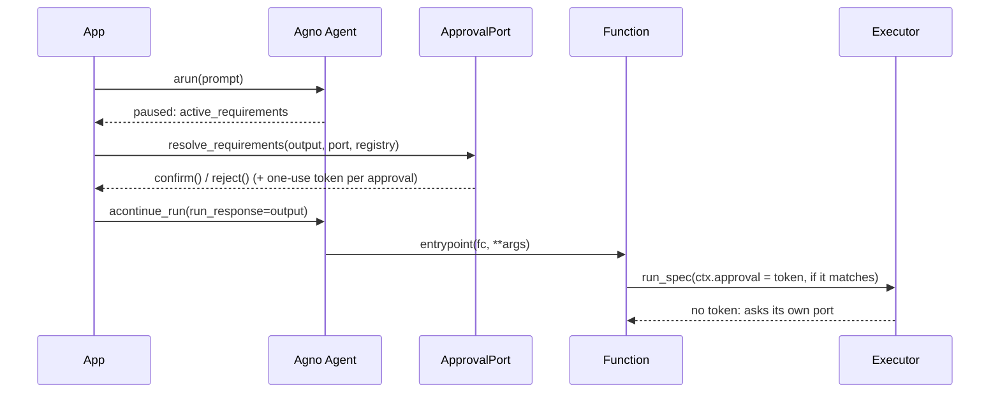

# Agno

:material-check-circle:{ .status-ok } Available · `Function` per spec · approval from your
port · `pip install "agent-adapter[agno]"`

## Functions

| Function (`agent_adapter.integrations.agno`) | Returns |
|---|---|
| `agno_function(spec, *, executor=None)` | one `agno.tools.function.Function` running `spec` through the executor |
| `agno_functions(registry, *, executor=None)` | one per registry tool exported to `agno` |
| `await resolve_requirements(output, port, registry)` | `None`; confirms or rejects each confirmation `output` paused on |
| `INTEGRATION` | `get_integration("agno")`; `bind_context(function_call)` gives ids only |

The function takes the neutral JSON schema as `parameters`
(`skip_entrypoint_processing=True`). Results reach Agno as JSON text, because Agno shows
`str(result)` to the model. `agno_function` refuses (`IntegrationError`) an Agno outside the
extra's range or without what the bridge reads.

## Wiring

```python
--8<-- "examples/agno_tools.py:wire"
```

## Approval

Any `confirm` rule sets `requires_confirmation=True`, so the agent pauses
(`output.is_paused`; a callable rule is asked **every time**). Agno's confirmation is only an
**extra** gate: resolve it with `resolve_requirements`, which asks your
[approval port](../concepts/approval.md), then `agent.acontinue_run(run_response=output)`.



| Case | What happens |
|---|---|
| Confirmed by `resolve_requirements` | a one-use token bound to `output.run_id`, the `tool_call_id`, the tool and the validated arguments; the call that matches takes it and the executor does not ask again |
| `requirement.confirm()` by hand, edited `tool_args`, another `tool_call_id`, a replayed requirement (`result=None`) | no token: the executor asks its own port (no port: denied) |
| `DeferredApproval` port | two-phase: `ApprovalPending` until every call is decided, then each record is consumed once |
| Edited arguments | refused (rejected): Agno cannot apply them |

!!! warning "Trust assumptions"
    Agno (and AgentOS `continue_run`) rebuild requirements from what the client sends, so a
    confirmation is never taken as an approval. Resolve pauses with `resolve_requirements`
    in the process that runs the agent.

## Calls and errors

| Item | Behaviour |
|---|---|
| Call id | `FunctionCall.call_id` → `ctx.call_id` |
| Run | the agent's `run_id` → `ctx.run_id` (a continued run keeps it); `session_id` → `ctx.thread_id` |
| `ToolArgsInvalid`, `ToolError`, `ApprovalDenied`, `GuardrailBlocked`, `RunLimitExceeded` | returned as `{"error": {"kind", "message"}}` (JSON text) |
| Other errors | raised; Agno reports a failed tool call to the model |
| `CancelledError` | propagates |

Agno injects the `FunctionCall` into a parameter named `fc`, so a tool argument named `fc`
is refused with `ToolDefinitionError`.
