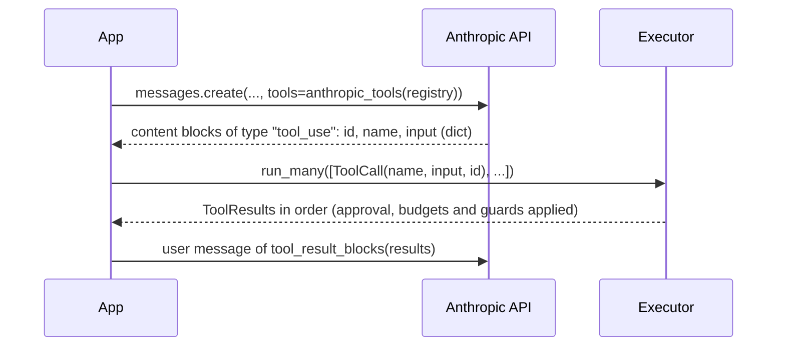

# Anthropic

:material-check-circle:{ .status-ok } Available · Messages API tools · no SDK needed

The renderers return plain dicts. Import the functions by name
(`from agent_adapter.integrations.anthropic import ...`), so the `anthropic` SDK name stays free.

## Functions

| Function (`agent_adapter.integrations.anthropic`) | Returns |
|---|---|
| `anthropic_tools(registry)` | every tool in Messages API format |
| `anthropic_tool(spec)` | one tool: `{"name", "description", "input_schema"}` |
| `tool_result_blocks(results)` | one `tool_result` block per `ToolResult`, in order |
| `INTEGRATION` | the [integration](../contributing/writing-an-integration.md) object: `export_tools(registry)`, and `bind_context(block)` puts the `tool_use` id into `ctx.call_id` |

## Round trip

Pass the rendered list as `tools=`. Run the `tool_use` blocks the model sends through one
`Executor`, never with `spec.invoke`: `invoke` skips approval, budgets, run guards, the
cache and the ledger, so a `confirm=True` tool would run unapproved.

```python
--8<-- "examples/providers.py:anthropic"
```



| Step | Notes |
|---|---|
| Executor | build it once, with `approval=` if any tool has `confirm=True`; with no port such a call is denied ([approval](../concepts/approval.md)) |
| One call | `await executor.run_call(ToolCall(...))` gives one `ToolResult` |
| Whole loop | [`run_tool_loop`](../concepts/tool-loop.md) with `AnthropicModel` sends the calls and answers them for you |

## Answering tool calls

`tool_result_blocks` turns results into the next user message. An ok value is sent as
text (strings as they are, anything else as JSON); an error sets `is_error` and sends
`{"error": {"kind", "message"}}`; a pending approval sends `approval required: <id>`.
`examples/anthropic_results.py` answers two calls, one of which fails.

## What the schema looks like

`input_schema` is the plain schema: `$ref` inlined, `title` dropped, `const` turned into
a one-value `enum`. Optional fields stay optional and keep their `default`.
