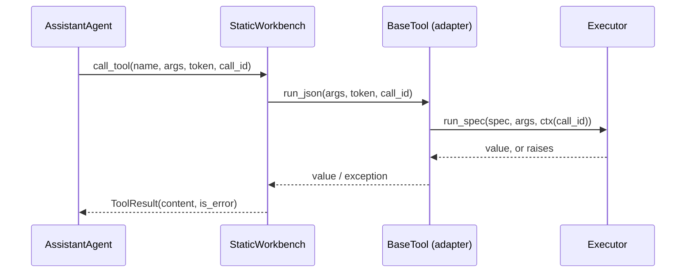

# AutoGen

:material-check-circle:{ .status-ok } Available · `BaseTool` per spec · `pip install "agent-adapter[autogen]"`

For AutoGen 0.7 (`autogen-core`, `autogen-agentchat`). AutoGen is in maintenance mode;
Microsoft Agent Framework is its successor. For the `ag2` package (AG2 1.x, a separate
project), see [AG2](ag2.md).

## Functions

| Function (`agent_adapter.integrations.autogen`) | Returns |
|---|---|
| `autogen_tool(spec, *, executor=None)` | one `autogen_core.tools.BaseTool` for `spec` |
| `autogen_tools(registry, *, executor=None)` | a tool for every registry tool whose `targets` include `autogen` |
| `AutoGenCall` | what `ctx.extras["autogen"]` holds: `call_id`, `cancellation_token`, `tool` |
| `INTEGRATION` | the [integration](../contributing/writing-an-integration.md) object (`get_integration("autogen")`) |

`executor=None` uses the default executor at call time (`set_default_executor`).

## Use

```python
--8<-- "examples/autogen_tools.py:tools"
```

In an agent:

```python
--8<-- "examples/autogen_tools.py:agent"
```



## What AutoGen sees

| `BaseTool` member | From |
|---|---|
| `name`, `description` | `spec.name`, `spec.description` |
| `args_type()` | `spec.args_model` |
| `schema["parameters"]` | the plain schema (refs inlined, titles dropped): `properties`, `required`, `additionalProperties` (default `False`); `strict: False` |
| `return_value_as_string(v)` | text as is, anything else as JSON |

## Behaviour

| Topic | Rule |
|---|---|
| Validation | `run_json` sends the raw arguments to the executor; the tool's own args model validates them. `run(args_model_instance, token)` also works |
| Errors | Adapter errors raise from `run_json`; the workbench returns them as `ToolResult(is_error=True)` with the message (AutoGen's own error channel) |
| Call id | The workbench's `call_id` (the model's function-call id) becomes `ctx.call_id` |
| Approval | AutoGen has no per-tool gate: `confirm` tools ask the executor's `ApprovalPort`. Edited arguments from the port are validated again and applied. Use a port that blocks until it decides (`CallbackApproval`, a console or UI prompt): a `DeferredApproval` raises `ApprovalPending`, which the workbench (it catches `Exception`) reports to the model as a tool error instead of pausing the run |
| Cancellation | The `CancellationToken` is linked to the call: `token.cancel()` cancels the tool. `CancelledError` always propagates |
| Telemetry | AutoGen's tool span and `ToolCallEvent` are kept; the event shows no arguments for `confirm` tools |
| Components | Exported tools are not AutoGen components: `dump_component()` is not supported |
