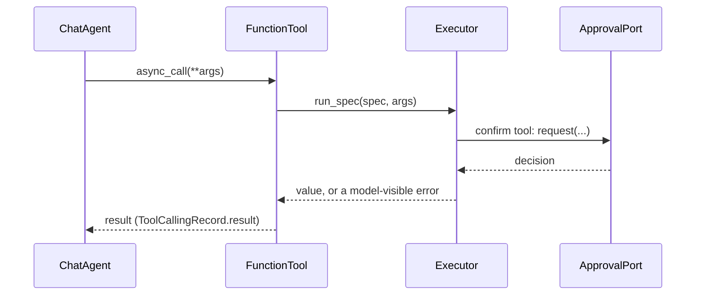

# CAMEL-AI

:material-check-circle:{ .status-ok } Available · `FunctionTool` per spec · approval from the
executor's port · `pip install "agent-adapter[camel]"` (`camel-ai`) · own environment (needs
`mcp<2` and pins `pydantic<=2.12.0`, while `all` needs `mcp>=2.3` and `pydantic>=2.12.5`; not in `all`)

## Functions

| Function (`agent_adapter.integrations.camel`) | Returns |
|---|---|
| `camel_tool(spec, *, executor=None, strict=True)` | one `camel.toolkits.FunctionTool` running `spec` through the executor |
| `camel_tools(registry, *, executor=None, strict=True)` | one per registry tool exported to `camel` |
| `openai_tool_schema(spec, *, strict=True)` | the Chat Completions tool dict CAMEL sends to the model |
| `INTEGRATION` | `get_integration("camel")`; `bind_approval(port)` is `None` |

The schema is the [OpenAI transform](openai.md#strict-mode) of the neutral schema. A spec
that cannot be strict is sent with `strict: false`. `camel_tool` refuses
(`IntegrationError`) a CAMEL outside the extra's range or without `FunctionTool.async_call`.

## Wiring

```python
--8<-- "examples/camel_tools.py:wire"
```

## How a call runs

| CAMEL entry | Bridge path |
|---|---|
| `await agent.astep(...)` → `tool.async_call(**args)` | awaits `executor.run_spec` on CAMEL's loop |
| `agent.step(...)` → `tool(**args)` | `run_sync` over the same call (a worker thread inside a running loop) |



## Approval

CAMEL 0.2.90 has no tool-confirmation gate and hands a tool no call id. So nothing CAMEL
does can approve a `confirm` tool: the **executor's own port** decides every one. With
no port, the executor denies it.

| Case | What happens |
|---|---|
| `confirm` rule says yes | the executor asks its port (call id: one the executor makes) |
| No port on the executor | denied: `{"error": {"kind": "approval-denied", ...}}` |
| An approval edits arguments | the executor applies the edits |
| A CAMEL toolkit or human-in-the-loop tool "approves" | not an approval: it can only add a gate in front |

!!! warning "Trust assumptions"
    The executor's port is the only approval. Do not wrap a `confirm` tool in your own
    CAMEL confirmation and drop the port: the executor would then deny it.

## Calls and errors

| Item | Behaviour |
|---|---|
| Call id | none from CAMEL; the executor makes one per call |
| Arguments | keyword only; positional ones raise `ToolUsageError` |
| `ToolArgsInvalid`, `ToolError`, `ApprovalDenied`, `GuardrailBlocked`, `RunLimitExceeded` | returned as `{"error": {"kind", "message"}}` |
| Other errors (`ToolFailed`, …) | raised; CAMEL records `Tool execution failed: …` with the error's message |
| `CancelledError` | propagates (`astep`); a `step` worker thread runs on until the call ends |
| Schema warnings | none: the bridge checks the parameters are a JSON Schema without CAMEL's per-field warnings |

## Files

| File | Role |
|---|---|
| `agent_adapter/integrations/camel.py` | `camel_tool`, `camel_tools`, `openai_tool_schema`, `INTEGRATION` |
| `examples/camel_tools.py` | the wiring above, with a scripted CAMEL model |
| `tests/integrations/test_camel_contract.py` | contract kit C1-C8 and the bridge's edge cases |
