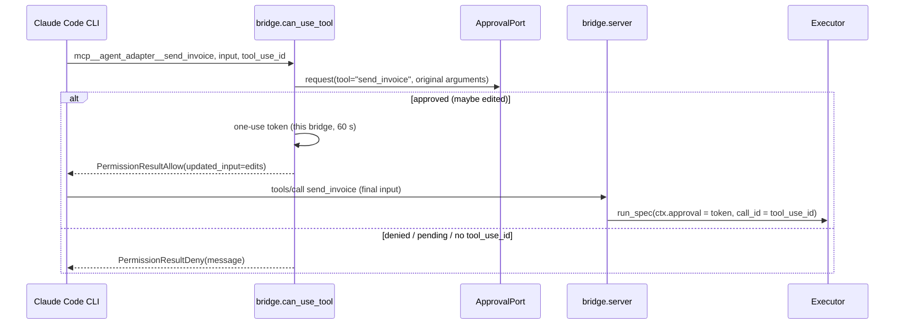

# Claude Agent SDK

:material-check-circle:{ .status-ok } Available · in-process SDK MCP server · a bridge pairs it
with its own `can_use_tool` gate (edits allowed) · `pip install "agent-adapter[claude-agent]"`
(`claude-agent-sdk`, ~350 MB: it bundles the Claude Code CLI)

## Functions

| Function (`agent_adapter.integrations.claude_agent`) | Returns |
|---|---|
| `claude_sdk_bridge(registry, port, *, executor=None, name="agent_adapter")` | `ClaudeSdkBridge(name, server, can_use_tool, run_id, hooks)`: a server, the gate its tools trust, and the hooks that end its tokens with the turn |
| `claude_sdk_server(registry, *, executor=None, name="agent_adapter")` | a server without a gate: `confirm` tools are decided by the executor's port |
| `can_use_tool(port, registry, *, server="agent_adapter")` | a permission-only callback: it issues no tokens, so a `confirm` tool is asked again by the executor |
| `claude_sdk_tool(spec, *, executor=None)`, `claude_sdk_tools(registry, …)` | `SdkMcpTool`s (neutral JSON schema), without a gate |
| `INTEGRATION` | `get_integration("claude_agent")`; `bind_approval(port)` asks about every tool, issues no tokens |

Claude sees each tool as `mcp__<server>__<tool>`, where `<server>` is the bridge's `name`
(use it as the `mcp_servers` key). Results are MCP text content; values that are not
strings are JSON text.

## Wiring

```python
--8<-- "examples/claude_agent_tools.py:wire"
```

!!! warning "One bridge = one run"
    Build a bridge **per `ClaudeSDKClient` session**, inside the function that runs it, never
    at module level. Everything using one bridge shares its run id (so `once_per_run` and
    `RunLimits.max_calls` count across all of it) and its approval tokens. Pass
    `hooks=bridge.hooks`, and call `executor.end_run(bridge.run_id)` when the session ends.

With hooks of your own, merge the lists per event, e.g.
`{ev: bridge.hooks.get(ev, []) + mine.get(ev, []) for ev in {*bridge.hooks, *mine}}`; never
`{**bridge.hooks, **mine}`, which drops the bridge's hooks for the events you also use.

## Approval

The CLI asks `can_use_tool` before a tool runs, unless `allowed_tools`, settings allow
rules, `bypassPermissions` or a `PreToolUse` hook already allow it.



| Case | What happens |
|---|---|
| This server's tool, rule says yes | the port is asked under the **registry** name with the original arguments |
| Approved | edits come back as `updated_input`. The token belongs to **this bridge only** and is bound to the `tool_use_id`, `mcp__<name>__<tool>` and the final validated input. The bridge's server reads the `tool_use_id` Claude Code sends with `tools/call` (`_meta["claudecode/toolUseId"]`) and takes only that call's token; the executor does not ask again |
| Another call, even an identical one (another `tool_use_id`, or none) | no token: the executor's own port decides |
| Approved but never executed | the token is dropped at the end of the turn (`Stop`) or at the next prompt (`UserPromptSubmit`), after 60 s at the latest; a later identical call is asked again |
| Call reaches the tool without a token (`allowed_tools`, allow rules, permission modes, another gate, a used or expired token) | the executor's own port decides (no port: denied) |
| Rule says no | allowed without asking |
| Denied | `PermissionResultDeny` with `{"error": {"kind": "approval-denied", ...}}` |
| Port raises `ApprovalPending` | denied with `approval required: <id>` |
| Other tools (`Bash`, other MCP servers, a same-named tool on another server) | the port is asked under their Claude name; edits pass through; **never** a token for our tools |

## Calls and errors

| Item | Behaviour |
|---|---|
| Call id | the `tool_use_id` from `tools/call` `_meta` → `ctx.call_id` (bridge servers); `claude_sdk_server` / `claude_sdk_tool` get none from the SDK and use a fresh id |
| Run | one run id per bridge, on every request and call; run guards (`once_per_run`, `max_calls`) count per bridge |
| `ToolArgsInvalid`, `ToolError`, `ApprovalDenied`, `GuardrailBlocked`, `RunLimitExceeded` | `is_error: true` with `{"error": {"kind", "message"}}` |
| Other errors | `is_error: true` with `{"error": {"kind", "message"}}` on both servers (bridge and `claude_sdk_server`); an error from outside the adapter shows only its type, never its message |
| Control flow (`CancelledError`, registered types) | propagates from the handler |

The bridge needs `mcp` 2.x (its server is a low-level `mcp.server.lowlevel.Server`) and
refuses older releases, and `claude-agent-sdk` outside `0.2.150` to below `0.3`, with
`IntegrationError`. Tests run the bundled CLI offline against a
scripted Messages API (`ANTHROPIC_BASE_URL`): stale and other-server approvals, and two
identical calls in one turn, never share a token.
