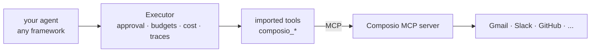

# Composio

[Composio](https://composio.dev/) hosts ready-made tools for SaaS apps (Gmail, Slack, GitHub,
Notion, HubSpot and many more) and handles each user's sign-in to them. It serves those tools
over MCP, so Agent Adapter imports them with its MCP client. You get Composio's apps and
accounts; every call still goes through your executor, with its approvals, budgets, cost and
traces.



## Set up

1. In Composio, create an MCP server with the apps you need and copy its URL and your API key.
   Composio's own docs show where; the URL and header name can change, so take them from there.
2. Install the MCP extra:

    ```bash
    pip install "agent-adapter[mcp]"
    ```

## Import the tools

```python
import asyncio
import os

from agent_adapter import CallbackApproval, Executor, Registry
from agent_adapter.integrations.mcp import import_mcp, mcp_client


async def main() -> None:
    url = os.environ["COMPOSIO_MCP_URL"]
    headers = {"x-api-key": os.environ["COMPOSIO_API_KEY"]}  # the header Composio names
    async with mcp_client(url, headers=headers) as client:
        tools = Registry()
        # Mark the tools that write, send or delete so they need an approval.
        await import_mcp(tools, client, prefix="composio_")
        executor = Executor(tools, approval=CallbackApproval(lambda req: input(f"Run {req.tool}? [y/N] ") == "y"))
        print(tools.names())  # then: await executor.run("composio_<tool>", {...})


asyncio.run(main())
```

The tools work while the client stays open. From here they are ordinary registry tools:
[attach](../how-to/attach-anywhere.md) them to any framework, or run them with
`executor.run(...)` in your backend.

## Safety

- **Approvals:** tools whose MCP hints say they change data are imported as side effects.
  To be sure, import the writes with `confirm=True` (`import_mcp(..., names=[...], confirm=True)`)
  so each call waits for a person.
- **Budgets and limits:** `BudgetHook` and `RunLimits` on the executor cap every Composio call
  like any other tool.
- **Secrets:** keep the API key in the environment or a secret store; it travels in the client
  headers, never as a tool argument the model can see.
- **Traces and cost:** every call is in the ledger and the [run viewer](../how-to/see-your-runs.md).

## See also

- [MCP](mcp.md): the client and server reference.
- [MCP tasks and OAuth](mcp-tasks.md): long-running calls and OAuth sign-in.
- [Connect anywhere](../connect/index.md): other hosted tool platforms.
