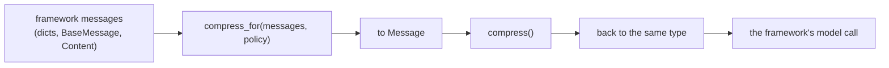

# Compression by framework

Every framework keeps its own message list. `compress_for` converts that list to the
adapter's `Message`, compresses it and converts it back to the same type. Messages that
are kept come back as the very same objects; changed ones keep every field but the text.
Tool-call ids stay paired, and pinned messages stay verbatim. Approval items stay too when
they are marked: the adapter's approval results, MCP approval requests and responses, and
any item whose type names an approval or confirmation (ADK `adk_request_confirmation`).
Pass `pinned=` for a framework's approval state that carries no such marker.



| Format | `format=` | Covers |
|---|---|---|
| `Message` | `"agent_adapter"` | `run_tool_loop`, `CallableModel`, your own code |
| LangChain `BaseMessage` | `"langchain"` | LangChain, LangGraph |
| OpenAI chat dicts and Responses items | `"openai"` | OpenAI, OpenAI Agents SDK, any OpenAI-compatible API |
| Anthropic Messages dicts | `"anthropic"` | Anthropic |
| Gemini `contents` (dicts or `types.Content`) | `"gemini"` | Gemini, Google ADK |
| Pydantic AI, Agno, Strands, smolagents, AutoGen and AG2 messages | `"pydantic_ai"`, `"agno"`, `"strands"`, `"smolagents"`, `"autogen"`, `"ag2"` | registered when you import that framework's integration module |
| LlamaIndex `ChatMessage`, Semantic Kernel `ChatMessageContent`, Agent Framework `Message`, CAMEL-AI `MemoryRecord` | `"llamaindex"`, `"semantic_kernel"`, `"agent_framework"`, `"camel"` | registered when you import that framework's integration module |
| CrewAI `LLMMessage`, the messages a DSPy adapter builds | `"openai"` | they are OpenAI chat dicts |

`format="auto"` (the default) detects it; plain `{"role", "content"}` dicts count as
OpenAI. Pin native messages with `pinned=lambda message: ...`: no marker is added to them.
Your own integration can add a format with `register_format(name, converter, detect=...)`
from `agent_adapter.context.formats`.

## Where to hook

| Integration | Where to hook | Format | Snippet |
|---|---|---|---|
| No framework (FastAPI, a script) | `LLMRequest(compression=)` | `agent_adapter` | [how-to](../how-to/compress-long-context.md) |
| The adapter's own loop | `run_tool_loop(compression=)` | `agent_adapter` | [how-to](../how-to/compress-long-context.md#4-your-own-agent-loop) |
| OpenAI | before `chat.completions.create` | `openai` | [OpenAI](#openai) |
| Anthropic | before `messages.create` | `anthropic` | [Anthropic](#anthropic) |
| Gemini | before `models.generate_content` | `gemini` | [Gemini](#gemini) |
| LangChain | before `model.invoke(messages)` | `langchain` | [LangChain](#langgraph-and-langchain) |
| LangGraph | in your agent node: `langgraph_compressor(policy)` | `langchain` | [LangGraph](#langgraph-and-langchain) |
| OpenAI Agents SDK | `RunConfig(call_model_input_filter=...)` | `openai` | [OpenAI Agents](#openai-agents-sdk) |
| Google ADK | `LlmAgent(before_model_callback=...)` | `gemini` | [ADK](#google-adk) |
| Haystack | `ChatMessage.to_openai_dict_format()` before, `ChatMessage.from_openai_dict_format()` after | `openai` | [OpenAI](#openai) |
| Pydantic AI | `Agent(capabilities=[ProcessHistory(pydantic_ai_history_processor(policy))])` | `pydantic_ai` | [Agent frameworks](#agent-frameworks) |
| Agno | `Agent(model=agno_compressed_model(model, policy))` | `agno` | [Agent frameworks](#agent-frameworks) |
| Strands Agents | `agent.add_middleware(InvokeModelStage.Input, strands_compress_middleware(policy))` | `strands` | [Agent frameworks](#agent-frameworks) |
| smolagents | `CodeAgent` or `ToolCallingAgent(model=smolagents_compressed_model(model, policy))` | `smolagents` | [Agent frameworks](#agent-frameworks) |
| AutoGen | `AssistantAgent(model_context=autogen_model_context(policy))` | `autogen` | [Agent frameworks](#agent-frameworks) |
| AG2 | `Agent(assembly=[ag2_compress_policy(policy)])` | `ag2` | [Agent frameworks](#agent-frameworks) |
| CrewAI | `register_before_llm_call_hook(...)` | `openai` | [More frameworks](#more-agent-frameworks) |
| DSPy | `dspy.configure(adapter=...)`, a `ChatAdapter` subclass | `openai` | [More frameworks](#more-agent-frameworks) |
| LlamaIndex | before `llm.achat(messages)`, or on an agent's `chat_history=` | `llamaindex` | [More frameworks](#more-agent-frameworks) |
| Semantic Kernel | before `get_chat_message_contents(chat_history=...)` | `semantic_kernel` | [More frameworks](#more-agent-frameworks) |
| CAMEL-AI | `ChatAgent(memory=ChatHistoryMemory(...))` with a context creator | `camel` | [More frameworks](#more-agent-frameworks) |
| Microsoft Agent Framework | `Agent(middleware=[...])`, a chat middleware | `agent_framework` | [More frameworks](#more-agent-frameworks) |
| Claude Agent SDK | its harness compacts its own context | — | — |
| MCP, MCP tasks, A2A, AG-UI, OpenAPI | tools and protocols: no model history here | — | — |

## OpenAI

```python
--8<-- "examples/compression_frameworks.py:openai"
```

## Anthropic

The system prompt is a separate argument, so it is never in the list:

```python
--8<-- "examples/compression_frameworks.py:anthropic"
```

## Gemini

```python
--8<-- "examples/compression_frameworks.py:gemini"
```

## LangGraph and LangChain

In a LangGraph node, compress what the model gets; the graph state keeps the full
history:

```python
--8<-- "examples/compression_langgraph.py:node"
```

With LangChain alone, compress before the call:

```python
--8<-- "examples/compression_langchain.py:langchain"
```

## OpenAI Agents SDK

The filter gets the Responses input items of each model call, reasoning items included:

```python
--8<-- "examples/compression_frameworks.py:openai_agents"
```

## Google ADK

```python
--8<-- "examples/compression_frameworks.py:adk"
```

## Agent frameworks

Import the hook from the framework's integration module; that import also registers the
format for `compress_for(format="auto")`. Pydantic AI keeps the processed history for
the rest of the run; the others shorten only what each model call sends.

```python
--8<-- "examples/compression_framework_hooks.py:hooks"
```

## More agent frameworks

CrewAI and DSPy send OpenAI chat dicts, so they use `openai`. The CrewAI hook shortens
the agent's own list in place. The other four send the model a shorter copy, and the
history keeps every message. Tool rounds that Semantic Kernel or a LlamaIndex agent run
inside one call are not seen by these hooks; Agent Framework middleware sees every call.
A framework's own compaction (CrewAI `respect_context_window`, CAMEL `summarize_threshold`,
Agent Framework `compaction_strategy`) can run instead; use one, not both.

```python
--8<-- "examples/compression_crewai.py:crewai"
--8<-- "examples/compression_dspy.py:dspy"
--8<-- "examples/compression_llamaindex.py:llamaindex"
--8<-- "examples/compression_semantic_kernel.py:semantic_kernel"
--8<-- "examples/compression_camel.py:camel"
--8<-- "examples/compression_agent_framework.py:agent_framework"
```

## Rules for every framework

- `compress_for` never calls your main model; AI steps call the models you gave them.
- In async code use `await compress_for(...)`; `compress_for_sync` is for sync code.
- A framework that compacts on its own (OpenAI's `OpenAIResponsesCompactionSession`,
  LangChain's summarisation middleware) can run instead; use one, not both.
