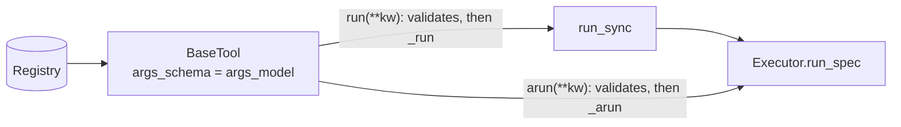

# CrewAI

:material-check-circle:{ .status-ok } Available · `pip install "agent-adapter[crewai]"` · `crewai>=1.15,<2` · own environment

Every registry tool becomes a CrewAI `BaseTool` with `args_schema=spec.args_model`.
`_arun` runs through the [executor](../concepts/executor.md); `_run` (what CrewAI agents
call) goes through [`run_sync`](../concepts/runtime.md), so it works inside a running event
loop too. CrewAI is imported only when you export a tool.

!!! note "Install CrewAI in its own environment"
    `crewai` 1.15 pins `pydantic<2.13`, `mcp<2` and `openai<3`, so it cannot share an
    environment with the `mcp` or `openai-agents` extras. It needs Python < 3.14.

## Functions

| Function (`agent_adapter.integrations.crewai`) | Returns |
|---|---|
| `crewai_tool(spec, *, executor=None)` | one `BaseTool` |
| `crewai_tools(registry, *, executor=None)` | one per tool whose `targets` include `crewai` |
| `INTEGRATION` | the [integration](../contributing/writing-an-integration.md) object |

`executor=None` uses the default executor.

## Run

```python
--8<-- "examples/crewai_tools.py:run"
```



## Behaviour

| Topic | Rule |
|---|---|
| Description | the tool's own; CrewAI builds its prompt text in `formatted_description` |
| Arguments | CrewAI validates against `args_schema` first and passes the dumped model; the executor validates again |
| Result cache | off (`cache_function` always `False`), so hooks, guards and approval run on every call |
| Approval | CrewAI has no gate of its own: the executor's approval port decides and applies a decision's `edited_args` |
| Ports | use one that answers in the call (`CallbackApproval`, `AutoApprove`, `AutoDeny`); `DeferredApproval` cannot resume here (no native call id, and `ApprovalPending` does not pause the crew) |
| Ids | no native call id: `ctx.call_id` is a fresh `call_…` id |

## Errors to expect

| Case | What you get |
|---|---|
| arguments fail `args_schema` | `ValueError("Tool '<name>' arguments validation failed: …")` from CrewAI |
| `ToolError`, `ApprovalDenied`, `GuardrailBlocked`, `RunLimitExceeded` | the result `{"error": {"kind", "message"}}` |
| any other error (`ToolTimeout`, `ToolFailed`, ...) | raised from `run` / `arun` |
| `asyncio.CancelledError` | propagates from `arun` |

Inside a crew, CrewAI's tool runner catches an exception from a tool (including
`ApprovalPending`, `ToolTimeout`, `ToolFailed`), counts it as a tool error on the task and
gives the agent the error text; the task goes on (its `tool_failure_policy` decides whether
a reported failure aborts).
