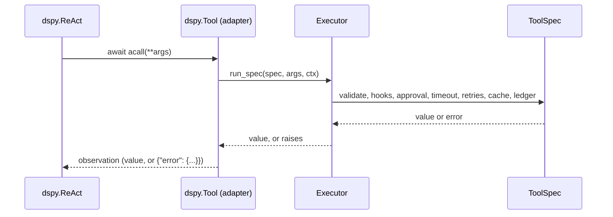

# DSPy

:material-check-circle:{ .status-ok } Available · `dspy.Tool` per spec · `pip install "agent-adapter[dspy]"`

Works with DSPy 3.4 and 3.5. DSPy 3.4 pulls in litellm, openai and boto3 (about 300 MB),
so the extra is not part of `all` and its contract tests run in their own
`nox -s contract-dspy` session. DSPy 3.5 makes LiteLLM optional (`dspy[litellm]`).

With DSPy 3.4, or `dspy[litellm]`, keep it apart from the `openai` extra. LiteLLM caps
`openai<3`, while `OpenAIModel` needs `openai>=3.41`. Installing both makes pip backtrack
into a LiteLLM sdist that needs Rust. DSPy calls the model through its own `dspy.LM`.

## Functions

| Function (`agent_adapter.integrations.dspy`) | Returns |
|---|---|
| `dspy_tool(spec, *, executor=None)` | one `dspy.Tool` (a subclass) for `spec` |
| `dspy_tools(registry, *, executor=None)` | a tool for every registry tool whose `targets` include `dspy` |
| `dspy_compress_prompt(prompt, policy, *, pinned=None, model_max_tokens=None)` | what `Adapter.format` returned, compressed, and a report: see [compression](compression-by-framework.md#more-agent-frameworks) |
| `INTEGRATION` | the [integration](../contributing/writing-an-integration.md) object (`get_integration("dspy")`) |

`executor=None` uses the default executor at call time (`set_default_executor`).

## Use

```python
--8<-- "examples/dspy_tools.py:tools"
```

Inside `dspy.ReAct` (`react(...)` and `await react.acall(...)` both work). DSPy 3.5's ReAct
sends each turn's `tool_calls` and ends with its `submit` tool; 3.4's names one tool per turn.
The tools work the same in both:

```python
--8<-- "examples/dspy_tools.py:react"
```



## What DSPy sees

| `dspy.Tool` field | From |
|---|---|
| `name`, `desc` | `spec.name`, `spec.description` |
| `args` | the properties of the plain schema (refs inlined, titles dropped, defaults kept) |
| `arg_types` | `str`, `int`, `float`, `bool`, `list`, `dict` from each JSON `type`; `Any` otherwise |

DSPy marks an argument required when its schema has no `default`. An optional argument
without a default (an imported tool, or `required` omitted) is therefore shown as required
to the model; validation still accepts it missing.

## Behaviour

| Topic | Rule |
|---|---|
| Validation | The tool's own args model, in the executor. DSPy's JSON-schema check is skipped, so its `ValueError` (which quotes the input) never appears |
| Errors | `ToolArgsInvalid`, `ToolError`, `ApprovalDenied`, `GuardrailBlocked`, `RunLimitExceeded` come back as `{"error": {"kind", "message"}}`; anything else raises, and ReAct shows it as an execution error |
| Sync calls | `tool(**args)` runs `acall` through `run_sync`, also inside a running loop. No `allow_tool_async_sync_conversion` needed |
| Call id | DSPy passes only arguments, so each call gets a fresh `call_...` id. `ctx.extras["dspy"]` is the `dspy.Tool` |
| Approval | DSPy has no approval gate: `confirm` tools ask the executor's `ApprovalPort`. Edited arguments from the port are validated again and applied. Use a port that blocks until it decides (`CallbackApproval`, a console or UI prompt): a `DeferredApproval` raises `ApprovalPending`, which ReAct (it catches `Exception`) reports to the model as a tool error instead of pausing the run |
| Native tool calls | `dspy.ToolCalls.ToolCall.execute(functions=[tool])` calls `tool.func` directly and returns an un-awaited coroutine for these async tools. Run each call with `await tool.acall(**call.args)` (or `tool(**call.args)` from sync code) |
| Cancellation | Cancelling `acall` cancels the tool; `CancelledError` always propagates |
