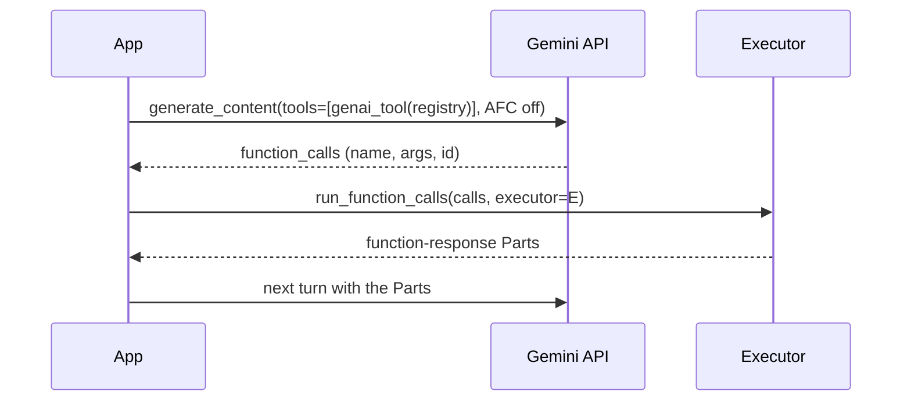

# Gemini

:material-check-circle:{ .status-ok } Available · function declarations, call dispatch, genai automatic function calling · `google-genai` optional

## Functions

| Function (`agent_adapter.integrations.gemini`) | Returns | Needs |
|---|---|---|
| `function_declarations(registry)` | every tool as a declaration dict | nothing |
| `function_declaration(spec)` | `{"name", "description", "parameters_json_schema"}` | nothing |
| `genai_tool(registry)` | one `google.genai.types.Tool` holding every tool | `pip install "agent-adapter[gemini]"` |
| `run_function_calls(calls, *, executor=None, ctx=None, registry=None)` | one function-response `types.Part` per call, in order | the extra |
| `afc_callable(spec, *, executor=None)` | an async function genai AFC can call | the extra, to use it |
| `afc_callables(registry, *, executor=None)` | `afc_callable` for every tool exported to `gemini` | as above |
| `INTEGRATION` | the [integration](../contributing/writing-an-integration.md) object: declaration dicts; `bind_context(function_call)` reads its `id` | `get_integration("gemini")` needs the extra |

Without google-genai, `genai_tool` and `run_function_calls` raise `MissingDependency`
(also an `ImportError`). `executor=None` uses the default executor.

## Manual dispatch (recommended)

Send the declarations, turn AFC off, and answer the model's calls with
`run_function_calls`. Every call runs through the executor.

```python
--8<-- "examples/gemini_afc.py:manual"
```



| What | How |
|---|---|
| `calls` | `types.FunctionCall`s, parts with a `function_call`, or `{"name", "args", "id"}` dicts |
| Tool lookup | `registry=`, else the executor's registry; only tools exported to `gemini` |
| Concurrency | an `Executor` runs the calls at once in one run (`parallel_safe` honoured); another runner runs them in order |
| Call id | `FunctionCall.id` becomes `ctx.call_id` and the response's `id`; a call without one gets a stable id from its name, arguments and occurrence (the n-th identical call), so a reordered retry matches |
| Result | `{"result": value}` (JSON mode) |
| Model-visible errors | `{"error": {"kind", "message"}}` |
| Other errors (`ApprovalPending`, `ToolNotFound`, `ToolTimeout`, `ToolFailed`) | raised: stop the turn, decide, retry |
| Run | `ctx=`, else `current_context()` inside an adapter run, else a fresh run per batch |
| Approval (`DeferredApproval`) | pass `ctx=executor.context(run_id=<stable id for this turn>)`; after `ApprovalPending`, decide, then call again with the same calls and `ctx`. Calls that already completed are answered from memory (bounded, in process), not run again; without a caller run id they run again |

## Automatic function calling (AFC)

`afc_callables` gives genai real async functions. genai reads each one's synthesised
signature and docstring, declares it, and calls it during `generate_content`.

```python
--8<-- "examples/gemini_afc.py:afc"
```

| What | How |
|---|---|
| Declared schema | each property keeps its Gemini schema; optional ones carry `default` (`null` when they have none), because genai marks every property without a default as required |
| Parameter names | schema property names; ones that are not Python identifiers are sanitised (`X-Trace` → `X_Trace`, `class` → `p_class`) and mapped back |
| Validation | the spec's own (genai's type check is bypassed) |
| Errors | genai turns any exception into an `error` reply to the model; `CancelledError` propagates |
| Approval | the port must decide at once (`AutoApprove`, `CallbackApproval`); AFC cannot pause. For approval, use `run_function_calls` |
| Call id and run | AFC hands the function no call id: each call gets a fresh id and, outside an adapter run (`current_context()`), its own run, so run guards such as `once_per_run` do not span calls |

AFC is being removed from `models.generate_content` in genai 3.0, so the manual path is the
durable one.

## What the schema looks like

The schema goes in `parameters_json_schema`.

- Keywords Gemini does not accept are dropped. It keeps `type`, `description`,
  `properties`, `required`, `enum`, `format`, `minimum`, `maximum`, `items`,
  `minItems`, `maxItems`, `anyOf`, `additionalProperties` and `nullable`.
- `default` is removed. Each argument's default is written into its description
  (`Default: "c".`).
- Optional fields stay optional (not in `required`).

Your pydantic model still validates every call, so dropped keywords never weaken
checking.
