# Haystack

:material-check-circle:{ .status-ok } Available · `Tool` per spec · confirmation hook ·
`pip install "agent-adapter[haystack]"` (`haystack-ai`)

## Functions

| Function (`agent_adapter.integrations.haystack`) | Returns |
|---|---|
| `haystack_tool(spec, *, executor=None)` | one `haystack.tools.Tool` with `async_function` and a `run_sync` `function` |
| `haystack_tools(registry, *, executor=None)` | one per registry tool exported to `haystack` |
| `confirmation_hook(port, registry)` | a `before_tool` Agent hook backed by an approval port |
| `INTEGRATION` | `get_integration("haystack")`; `bind_approval(port)` = the hook, resolving specs from the Agent's tools |

`Agent.run_async` awaits the tool; `Agent.run` (sync) runs it through
[`run_sync`](../concepts/runtime.md). Haystack shows results to the model as JSON text.

## Wiring

```python
--8<-- "examples/haystack_tools.py:wire"
```

## Approval

The hook runs Haystack's own `ConfirmationHook` with a port-backed strategy, so rejected
calls are removed from the pending calls and the model is told why.

```mermaid
sequenceDiagram
  participant A as Haystack Agent
  participant H as confirmation hook
  participant P as ApprovalPort
  participant T as Tool
  participant Ex as Executor
  A->>H: before_tool(state)
  H->>P: request(tool, arguments, call_id) per pending call
  alt approved
    H->>H: one-use token, kept beside the State
    A->>T: invoke_async(**args, State)
    T->>Ex: run_spec(..., ctx.approval = token, if it matches)
  else denied / pending
    H->>A: rejection message as the tool result
  end
```



| Case | What happens |
|---|---|
| Approved | a one-use token (60 s) bound to the run, that pending call id, the tool and the validated arguments; only a call matching one of the last message's pending calls takes it, and the executor does not ask again |
| Token not taken in its step | dropped when that hook runs the next step |
| Several confirmation hooks on one Agent | each keeps its own tokens; a hook only drops its own |
| No call id on the pending call | denied (the approval could not be bound to it) |
| Denied | the model sees `{"error": {"kind": "approval-denied", ...}}` |
| Port raises `ApprovalPending` | the call is rejected with `approval required: <id>` |
| Edited arguments | not supported: an edit is treated as a denial (logged at `WARNING`) |
| No hook | the executor's own confirm rule and port decide (no port: denied) |

The hook and its strategy hold a live port, so `Agent.to_dict()` raises `IntegrationError`.

## Calls and errors

| Item | Behaviour |
|---|---|
| Call id | the tool injects the Agent `State` (parameter `_aa_state`) and takes the id of the matching pending tool call, one claim per id |
| Run | one run id per Agent run (`State`); tokens and claims live beside the State, never in `state.data`, so outputs and snapshots carry none |
| `ToolArgsInvalid`, `ToolError`, `ApprovalDenied`, `GuardrailBlocked`, `RunLimitExceeded` | returned as `{"error": {"kind", "message"}}` |
| Other errors | raised; Haystack's `ToolInvocationError` becomes an error tool result |
| `CancelledError` | propagates |
