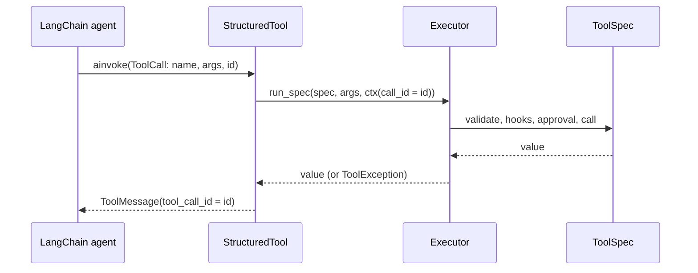

# LangChain

:material-check-circle:{ .status-ok } Available · export and import · `pip install "agent-adapter[langchain]"` (`langchain-core`)

LangChain is an export target and an import source. Exported tools run through an
`Executor`, so hooks, approval, timeouts, retries, the cache and the ledger apply to every
call LangChain (or LangGraph) makes.

## Functions

| Function (`agent_adapter.integrations.langchain`) | Returns |
|---|---|
| `structured_tool(spec, *, executor=None)` | one `StructuredTool` |
| `structured_tools(registry, *, executor=None)` | every tool exported to `langchain` (honours `targets`) |
| `import_langchain(registry, tools, *, prefix="", **policy)` | the new `ToolSpec`s, added all or nothing |
| `INTEGRATION` | the [integration](../contributing/writing-an-integration.md) object: `export_tool`, `bind_context(tool_call)` |

`executor=None` uses the default executor (`exec.defaults.default_executor()`).

## Export

```python
--8<-- "examples/langchain_tools.py:export"
```



| What | How |
|---|---|
| Schema the model sees | `spec.json_schema()` as a JSON-schema `args_schema` (LangChain drops `title`s) |
| Validation | the spec's own, once (LangChain does not validate a JSON-schema `args_schema`) |
| Call id | the ToolCall `id` becomes `ctx.call_id`; a plain dict input gets a fresh one |
| Run id | `current_context()` inside an adapter run; else `config["configurable"]["run_id"]`, else `["thread_id"]` (LangGraph's, also `ctx.thread_id`); else a fresh run per call. Pending approvals (`DeferredApproval`) resume only with a stable run id: pass the same config when you invoke again. With `thread_id`, run guards such as `once_per_run` span the thread |
| Model-visible errors (`ToolArgsInvalid`, `ToolError`, `ApprovalDenied`, `GuardrailBlocked`, `RunLimitExceeded`) | `ToolException` → an error `ToolMessage` (`status="error"`) |
| Other errors (`ToolTimeout`, `ToolFailed`, `ApprovalPending`, ...) | raised from `ainvoke` |
| `asyncio.CancelledError` | always propagates |
| Sync `invoke` | runs the call with `run_sync` (a worker thread when a loop is running) |
| `confirm=True` tools | the executor's approval port decides; `edited_args` are applied |

## Import

```python
--8<-- "examples/langchain_tools.py:import"
```

| What | How |
|---|---|
| Accepts | any `BaseTool`: `@tool` functions, `StructuredTool`, subclasses |
| Schema | `convert_to_openai_function(tool)["parameters"]`: what LangChain sends a model |
| `InjectedToolArg` parameters | left out of the schema and not supplied: give them defaults, or bind them before import. A required one that is missing fails in LangChain's own validation, which the executor reports as `ToolFailed` |
| Names | `prefix + name`, characters outside `[A-Za-z0-9_]` become `_` (`add-numbers` → `add_numbers`) |
| Policy | `kind="langchain"`, tags `{"langchain", *tool.tags}`; `**policy` overrides (`confirm=`, `timeout=`, ...) |
| `ToolException` | `ToolError` with the same message |
| Arguments the tool's own argument model rejects | `ToolArgsInvalid`, checked before the call (other exceptions from the tool propagate; the executor turns them into `ToolFailed`) |
| Results | what `tool.ainvoke(args)` returns: for `content_and_artifact` tools only the content (LangChain drops the artifact without a ToolCall) |
