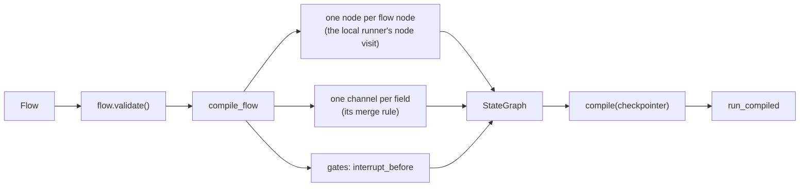

# LangGraph

:material-check-circle:{ .status-ok } Available · tool nodes, interrupt approvals, compiled flows · `pip install "agent-adapter[langgraph]"` (`langgraph`, `langgraph-checkpoint`)

Registry tools run inside LangGraph through an `Executor`, so hooks, approval, timeouts,
retries, the cache and the ledger apply (`executor=None` uses the default executor with
`LangGraphApproval()` as its port). A [`Flow`](../concepts/flows.md) compiles to a
`StateGraph` that behaves like the local runner.

## Functions

| Function (`agent_adapter.integrations.langgraph`) | Returns |
|---|---|
| `tool_node(registry, *, executor=None, messages_key="messages", concurrency=None)` | a node running the last `AIMessage`'s tool calls; `.tools` are the definitions for `bind_tools` |
| `tool_task(spec, *, executor=None, into)` | a `Send` target: runs `spec` with the `Send` argument, returns `{into: value}` |
| `fan_out(target, over)` | a conditional-edge path: one `Send(target, item)` per mapping in state key `over` (or `over(state)`) |
| `reducer(rule)` | a channel for `Annotated[T, reducer(Merge.append)]` that sees every write of a superstep |
| `LangGraphApproval(key=None)` | an `ApprovalPort` that pauses the graph with `interrupt()`; `.resume_value(interrupt, decision)` signs an answer |
| `one_use(node)` | your own node (sync or async, with or without `config`), run so each approval answer is used once; required around a node that calls `LangGraphApproval` itself |
| `compile_flow(flow, *, executor=None, checkpoint_key=None)` | a `StateGraph`; its `compile()` adds the gated nodes to `interrupt_before` |
| `async run_compiled(app, state, config)` | a `FlowResult` (`done`, `paused`, `denied`; `checkpoint=None`) |
| `langgraph_compressor(policy)` | a compressor for your agent node: the model gets a shorter list, the state keeps the full history ([Compression by framework](compression-by-framework.md#langgraph-and-langchain)) |
| `INTEGRATION` | `export_tool(spec)` (a one-tool `tool_node`), `bind_context(tool_call)`, `compile_flow` |

## Tool node

```python
--8<-- "examples/langgraph_flow.py:tool_node"
```

| What | How |
|---|---|
| Call id | the tool call `id` (`ctx.call_id`); a call without one gets `<task namespace>:<index>` |
| Run id | `current_context()` inside an adapter run, else `configurable["run_id"]`, else `["thread_id"]` (also `ctx.thread_id`) |
| Order | calls whose `confirm` rule says yes run one at a time after the others (`concurrency` caps the others), so each resume answers one interrupt |
| Model-visible errors (`ToolArgsInvalid`, `ToolError`, `ApprovalDenied`, ...) | an error `ToolMessage` (`status="error"`, content `{"error": {"kind", "message"}}`); also unknown tools and duplicate call ids |
| Other errors (`ToolTimeout`, `ToolFailed`, `ApprovalPending` from a deferred port) | raised from the node |
| `GraphInterrupt` (`GraphBubbleUp`), `CancelledError` | always propagate, unwrapped, through every executor method |

## Approvals and resume values

Every interrupt value is `{"type": "agent_adapter.approval", "binding", "request"}`. The
`binding` is the SHA-256 of the request's run id, tool, kind, `request_digest`, call id and
(for a store's record) approval id. Resume with `port.resume_value(interrupt, decision)`
under the interrupt's id, as the tool node example does: it adds `mac`, an HMAC-SHA256 of
the binding and the decision under the port's key.

| Resume value | Result |
|---|---|
| bound to this request and signed with the port's key | the decision applies (`edited_args` run), once per task run (a task run: a tool node, a tool task, a compiled node, or your node wrapped in `one_use`) |
| a bare decision, another binding (run, tool, arguments, call), no or a wrong `mac` | LangGraph's invalid resume: `ValidationError` (`is_invalid_resume`), nothing saved, answer again |
| the same answer again: two concurrent resumes, a replay of the paused checkpoint after the run went on | `ApprovalAlreadyDecided`; the tool runs once |

| Port | Who decides |
|---|---|
| `LangGraphApproval(key=None)` | the signed resume value. `key=None` is a random per-process key: the run then resumes only in that process; give every process the same `key` |
| a port with a store (`DeferredApproval`) | the store only; a resume value never decides. Decide the record (or call `run_compiled(app, decision, config)`, which does), then continue with `None`. A record used once is never used again |

`run_compiled(app, ApprovalDecision(...), config)` picks the right path. Each answer is used
once per task run in a process. With `LangGraphApproval(key=K)` shared across processes, a
resume value **can be replayed in another process** after the run went on (that process has
no record of its use): use a store-backed port when that matters.

In your own node, wrap the node with `one_use(node)`: `LangGraphApproval` outside one raises
`ToolUsageError` before it asks. LangGraph re-runs your node from the top, so your code
after an answer runs again:

| In a `one_use` node | Result |
|---|---|
| a re-run in the same process | executor calls finished before the pause replay their results (give each a stable `call_id`); their answers are claimed before your code runs |
| the re-run fails (any error; a finished result the journal cannot hold raises `ToolUsageError`) | the host's retry raises `ApprovalAlreadyDecided`: an approved tool runs once |
| a call whose arguments cannot be journaled (e.g. a `pathlib.Path` argument), then a pause | cannot pause: `ToolUsageError` (the call would run again), and the retry raises `ApprovalAlreadyDecided`. Give that call its own node or use `compile_flow` |
| a raw `interrupt()` | shifts the resume positions: it may get an earlier signed answer as its value, or every answer is an invalid resume. No approval goes to another call (binding, MAC), but fork the thread. Ask through `LangGraphApproval` only |
| **a new process**, or an evicted journal (10 000 paused nodes, 24 h) | the finished calls run again (as in `tool_node`): when that matters, use `compile_flow` (its journal is sealed into the interrupt value) or one confirm call per node |

A failure before the executor uses the answer (a `before_tool` hook, a store outage while
the answer is settled) keeps the answer: retry with `run_compiled(app, None, config)` (or
`ainvoke(None)`). A failure after it used the answer (the approval step passed, whatever
context or sink the call ran with) spends it: the retry raises
`ApprovalAlreadyDecided`. To go on anyway, fork the thread from an earlier checkpoint
(`ainvoke(..., checkpoint_config)` asks for a new approval) or write the result yourself with
`app.aupdate_state(config, {...}, as_node=<node>)` and continue. A run cancelled while the
tool runs saves nothing: with a store-backed port the retry raises `ApprovalAlreadyDecided`;
with `LangGraphApproval` it asks again and **the tool may already have run** (check first).

Write access to the checkpointer is not approval authority, but it holds the state and the
interrupt values, and those carry the requests' arguments and the finished calls' results
(possibly personal data) to anyone who can read the checkpointer or the `__interrupt__`
stream. Use LangGraph's `EncryptedSerializer` and restricted database access, and never
forward raw interrupt values to a UI: show reviewers `value["request"]` only.

## Compiled flows

```python
--8<-- "examples/langgraph_flow.py:flow"
--8<-- "examples/langgraph_flow.py:compile"
```



| Flow concept | LangGraph |
|---|---|
| node (fn, `Call`, `Map`, `Join`) | one node running the local runner's visit: hooks, timeout, retries; `Map` calls `executor.run_many` |
| static edges / `Route` | `add_edge` / `Command(goto=...)` from the node; the route sees the input state plus its own writes |
| `Join` | `defer=True` |
| merge rules | a channel per field applying the rule to all writes of a superstep, in node-name order then item order |
| loop caps, visits | reserved keys `aa_loop_counts`, `aa_visits` |
| `pause` gate | `interrupt_before` the gated nodes: nothing of the superstep runs until the gate is decided |
| tool approval in a node | a pause; answered by the store or a signed resume value bound to run, tool, arguments and (for `Call` / `Map`) the call id |
| `max_steps` | `recursion_limit` (`run_compiled` defaults it to 100); `GraphRecursionError` → `FlowLoopExceeded` |
| checkpoint | the LangGraph checkpointer (`FlowResult.checkpoint` is None); treat its storage as trusted |

`run_compiled` takes the initial state, an `ApprovalDecision` for what is pending, a
`Command`, or `None` to continue (for example after a decision made in the store). A gate
whose port decides at once does not stop the run. A denied gate ends the run without
running its superstep; a gate's grant is used once (a spent one → `ApprovalAlreadyDecided`;
gates and siblings: see below). Node names `__start__` / `__end__` → `FlowCompileError`.

## Re-runs

LangGraph re-runs an interrupted node from the top. A paused node seals its progress into
the interrupt value (`aa_state`: the approvals it surfaced and how each was answered, the
replay journal, finished `Map` items), signed with `compile_flow(..., checkpoint_key=)`
(default: the `LangGraphApproval` port's key, else a per-process key) and bound to the run,
the task and the graph. A re-run in any process with that key reads it back from the
checkpointer and replays finished calls as the local runner does: each call runs once,
the ledger has one entry per call and `once_per_run` holds, also for a node function's own
calls. A sealed state that does not verify (another key), or resume values whose sealed
state is gone, fail closed with `FlowError` and run nothing. An approved tool that failed
is not run again by a retry (its answer was used). Interrupt values are signed, not
encrypted (see above).

## Differences from the local runner

| Case | Local runner | LangGraph |
|---|---|---|
| every case of `tests/flow/parity.py` | reference | equal (status, state, visits, steps, pauses) |
| resume in a new process | the sealed checkpoint replays finished calls | the sealed interrupt value replays them (same key) |
| siblings of a gate with `edited_args` | see the edited state | see the state before the edit |
| several gates in one superstep | asked one by one, nothing runs | the same with a store-backed port; `ToolUsageError` without a store |
| a fork of an old checkpoint (time travel) | — | asks again (a new record); a used answer is refused |
