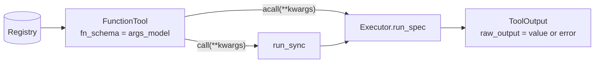

# LlamaIndex

:material-check-circle:{ .status-ok } Available · `pip install "agent-adapter[llamaindex]"` · `llama-index-core>=0.14,<0.15`

Every registry tool becomes a LlamaIndex `FunctionTool` with `fn_schema=spec.args_model`.
Both call paths run through the [executor](../concepts/executor.md): `acall` directly,
`call` through [`run_sync`](../concepts/runtime.md), so a sync agent works inside a running
event loop too. LlamaIndex is imported only when you export a tool.

## Functions

| Function (`agent_adapter.integrations.llamaindex`) | Returns |
|---|---|
| `llamaindex_tool(spec, *, executor=None)` | one `FunctionTool` |
| `llamaindex_tools(registry, *, executor=None)` | one per tool whose `targets` include `llamaindex` |
| `INTEGRATION` | the [integration](../contributing/writing-an-integration.md) object |

`executor=None` uses the default executor.

## Run

```python
--8<-- "examples/llamaindex_tools.py:run"
```



## What the model sees

`metadata.get_parameters_dict()` is the args model's JSON schema (only `type`,
`properties`, `required` and `$defs` at the root); the description is the tool's own.
`to_openai_tool()` works as usual. Tools imported from a raw schema (`spec_from_schema`)
show their loose model's schema, so nested objects appear as plain `object` / `array`.

## Approval

LlamaIndex has no approval gate or argument-edit primitive of its own. The executor's
approval port decides (`Executor(approval=...)`), and the executor applies a decision's
`edited_args` (validated again). A denial comes back as an `approval-denied` error value.

Use a port that answers in the call: `CallbackApproval` (ask a reviewer in-process),
`AutoApprove` or `AutoDeny`. `DeferredApproval` cannot resume here: LlamaIndex gives the tool
no call id of its own, so a re-run is a new call with a new id, and the `ApprovalPending` it
raises does not pause the agent (see below).

## Ids

LlamaIndex passes no call id to a tool, so `ctx.call_id` is a fresh `call_…` id and each
call is its own executor run.

## Errors to expect

| Case | `ToolOutput` / what you get |
|---|---|
| `ToolArgsInvalid`, `ToolError`, `ApprovalDenied`, `GuardrailBlocked`, `RunLimitExceeded` | `raw_output = {"error": {"kind", "message"}}` |
| any other error (`ToolTimeout`, `ToolFailed`, ...) | raised from `acall` / `call` |
| `asyncio.CancelledError` | propagates from `acall` |

Inside a LlamaIndex agent workflow, an exception from a tool (including `ApprovalPending`,
`ToolTimeout`, `ToolFailed`) is caught by the agent and sent back to the model as a
`ToolOutput(is_error=True)` with the error text; the run goes on.
