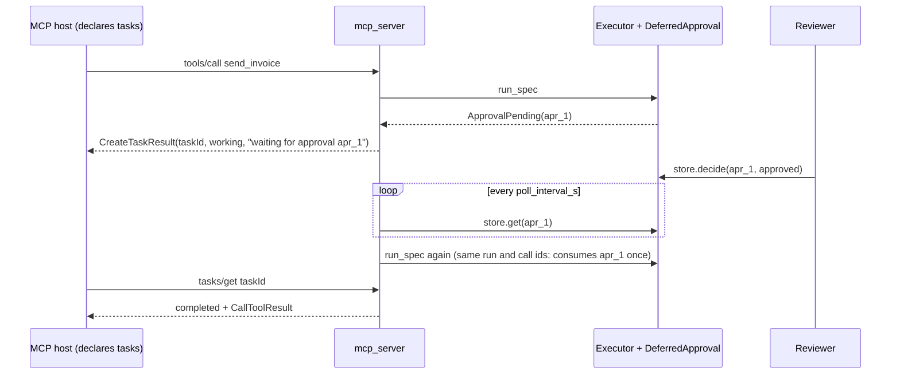

# MCP tasks, URL approval and OAuth

:material-check-circle:{ .status-ok } Available · `pip install "agent-adapter[mcp]"` · `mcp` 2.3+ · MCP 2026-07-28

Three MCP 2026-07-28 features on top of [MCP](mcp.md):

| Feature | Side | Turn it on |
|---|---|---|
| tasks extension (`io.modelcontextprotocol/tasks`) | server and client | `mcp_server(..., tasks=TaskOptions(...))`; `mcp_client(..., tasks=True)` |
| URL-mode elicitation for approvals | server | `TaskOptions(approval_url="https://…/{approval_id}")` |
| OAuth with Client ID Metadata Documents | client | `mcp_client(url, auth=oauth_client(...))` |

## Tasks: confirm tools through any tasks-capable host

Without tasks, a pending approval comes back as `approval required: <id>` with resume keys in
`_meta`. A host that drops those keys starts a new approval on every retry, so the tool never
runs. With tasks, the pending call is a task handle. The host polls `tasks/get` with the task id
only, and the task runs the tool itself once your reviewer decides.

```python
--8<-- "examples/mcp_tasks.py:serve"
```



| Call | Becomes |
|---|---|
| the client did not declare the extension, or the protocol is older | the classic result (unchanged) |
| finished within `threshold_s` | the ordinary result, no task |
| still running after `threshold_s` | a `working` task |
| waits for approval (with `DeferredApproval`) | a task that runs once the store holds a decision |
| waits for approval with another port | the classic `approval required` result |
| a resume with the client's call key | finished in the request, never a task |
| the caller is anonymous on HTTP, or over `max_per_principal` / `max_tasks` | answered without a task (a `WARNING` for the limits) |

`TaskOptions`: `threshold_s=5.0` (`None`: only pending approvals become tasks), `ttl_s=3600`,
`poll_interval_s=2.0`, `approval_url=None`, `max_tasks=10_000`, `max_per_principal=100`.

## Task security

| Rule | Effect |
|---|---|
| the approval comes only from the executor's port | the task re-reads the `ApprovalStore`; nothing a client sends approves |
| `tasks/update` never approves | answers move a URL-linked task back to `working`; other keys are ignored (spec) |
| a decision is used once | the rerun uses the same scoped run and call ids, so `DeferredApproval` checks tool and argument digest and consumes the record once |
| task ids are 256-bit random | `secrets.token_urlsafe(32)`; no `tasks/list` |
| a task belongs to its principal | another caller gets `-32602 Unknown or expired task`, the same as a forged id |
| `tasks/*` need the client capability | else `-32021`; a `Mcp-Name` header that differs from `taskId` is refused |
| several workers | `TaskOptions(store=RedisTaskStore(lambda: Redis.from_url(url)))` on every worker. The worker running a task writes its state; any worker answers `tasks/get`, `update` and `cancel` (the last two as signals to that worker). The store only mirrors state and never approves |
| a worker dies | its open tasks read `failed` after 3 polls + 5 s without a store write |
| store down | other workers answer `-32603` (fails closed); the owning worker still serves its tasks |
| the default `store=None` | tasks stay in one process: run one worker, or route `tasks/*` by `Mcp-Name` |
| results sit in the store until `ttl_s` | protect Redis like the approval store; the caller is kept as a SHA-256 digest |
| a server shutdown cancels running tasks | they end `cancelled` |

## URL-mode elicitation

Set `approval_url` to the page where your people decide approvals (your own UI over the
[HTTP server](../cross-language/http-server.md) `POST /approvals/{id}/decide`). A client that
declares URL elicitation sees the task as `input_required`, with one `elicitation/create`
request in `url` mode pointing at that page. The link is only a pointer: the store still
decides. The URL must be https (http only on a loopback host), with `{approval_id}`.

## Import from task servers

```python
--8<-- "examples/mcp_tasks.py:import"
```

| Remote task | Imported tool |
|---|---|
| `completed` | the result, as without tasks |
| `failed` / `cancelled` | `ToolError` (`remote_kind` `task_failed` / `task_cancelled`) |
| still open after `task_wait_s` (default 30) | `ToolError` with `details["task_id"]`; the same local run and call id polls that task again instead of calling twice |
| `input_required` | `ToolError` naming the task: this client answers no input requests |

## OAuth (client side)

`oauth_client(...)` returns the MCP SDK's `OAuthClientProvider`. The SDK discovers the
protected-resource and authorization-server metadata, uses your Client ID Metadata Document
when the server supports it (else dynamic registration), runs the code flow with PKCE,
refreshes tokens, and binds stored credentials to their issuer.

```python
--8<-- "examples/mcp_oauth.py:document"
```

```python
--8<-- "examples/mcp_oauth.py:client"
```

| Rule | Why |
|---|---|
| `server_url` and `auth=` URLs are https (http only on loopback) | tokens never cross plain http (`ConfigError`) |
| `client_metadata_url` is https with a path | the CIMD rule; it is your `client_id` |
| `auth=` with an `Authorization` header is a `ToolUsageError` | one credential per client |
| `MemoryTokenStorage` is the default | per process; pass your own `TokenStorage` to persist; tokens are never logged |

## Not built yet

| Feature | Status |
|---|---|
| task status notifications (`notifications/tasks`) | not sent: clients poll |
| a URL elicitation without tasks | not built: a plain retry has no way to name the pending call |
