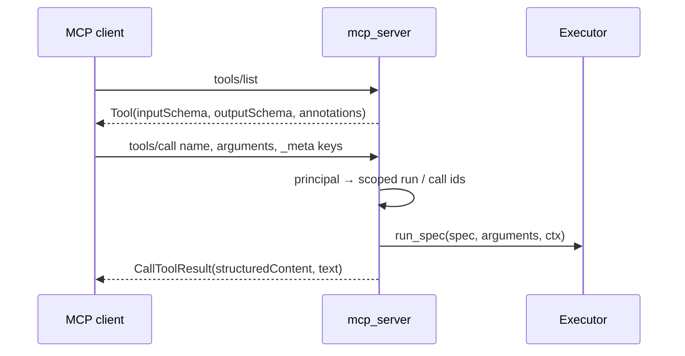
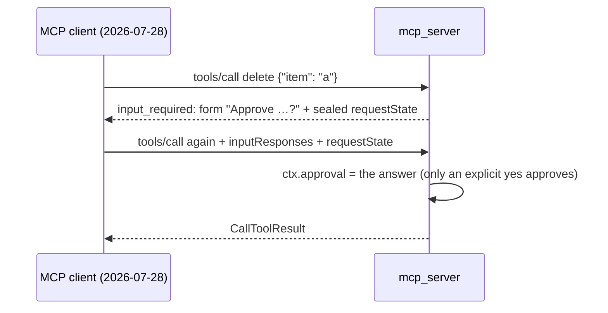

# MCP

:material-check-circle:{ .status-ok } Available · `pip install "agent-adapter[mcp]"` · `mcp` 2.3+ (v2 API)

Serve registry tools to any MCP client, and import tools from any MCP server. Every call
runs through the [executor](../concepts/executor.md), so hooks, approval, limits, cache
and the ledger apply. HTTP for other languages: [Cross-language: MCP](../cross-language/mcp.md).
Tasks, URL-mode approval links and OAuth: [MCP tasks and OAuth](mcp-tasks.md).

## Functions

| Function (`agent_adapter.integrations.mcp`) | Returns |
|---|---|
| `mcp_server(registry, *, executor=None, name=, version=, instructions=None, client_approval=False, request_state_keys=None, principal=None, allow_anonymous=None, approval_store=None, tasks=False)` | a lowlevel `mcp.server.lowlevel.Server` for `registry.for_target("mcp")` |
| `streamable_http_app(registry, *, …, path="/mcp", stateless=True, json_response=True, principal=<bearer token>, allow_anonymous=False, **http_options)` | a Starlette ASGI app (stateless Streamable HTTP, JSON); also takes the `mcp_server` options |
| `await import_mcp(registry, client, *, prefix="", names=None, send_ids=False, **policy)` | the registered `ToolSpec`s of an open `mcp.Client` |
| `mcp_client(target, *, headers=None, auth=None, tasks=False, task_wait_s=30.0)` | an unopened `mcp.Client` for a URL, `StdioServerParameters`, server or transport; `TaskOptions`, `oauth_client` are on [MCP tasks and OAuth](mcp-tasks.md) |
| `tool_annotations(spec)`, `output_schema_for(spec)`, `mcp_tool(spec)` | the MCP hints, output schema and `Tool` of one spec |
| `INTEGRATION` | `export_tools(registry)` → `mcp.types.Tool`s; `bind_context(params)` (raw keys, see Security) |

## Serve

```python
--8<-- "examples/mcp_server.py:tools"
```

```python
--8<-- "examples/mcp_server.py:demo"
```



## What a tool looks like

| `ToolSpec` | MCP |
|---|---|
| `json_schema()` | `inputSchema`, Anthropic-plain (refs inlined, titles dropped); a non-portable imported schema as given |
| `result_schema()` | `outputSchema`; a non-object schema is wrapped as `{"result": …}` (definitions moved to the root) |
| return value | `structuredContent` (wrapped the same way) and one JSON text block |
| `effects` `read_only` / `additive` / `destructive` | `read_only_hint`, `destructive_hint` |
| `effects is None`, `confirm` not `False` | `destructive_hint=True` |
| `idempotent` set | `idempotent_hint` |

## Errors

| Case | Result |
|---|---|
| unknown or not exported; bad `requestState`; failing principal hook | protocol error (`MCPError`) |
| any tool error (`ToolArgsInvalid`, `ToolError`, `ApprovalDenied`, `ToolFailed`, …) | `isError: true`, text = `ErrorInfo.message`, `_meta["agent-adapter/error_kind"]` |
| a foreign exception (not from the executor) | `isError: true`, text = the class name only |
| `ApprovalPending` | `isError: true`, text `approval required: <id>`, `_meta`: `agent-adapter/approval_id` and the resume keys |
| `CancelledError`, `GraphBubbleUp` | propagate; a tool raising `CancelledError` itself ends the request (only in-process does the client see it) |

## Security

| Rule | Effect |
|---|---|
| ids are scoped by principal | the executor sees `scoped_id(prefix, principal, key)`, never a client value: two principals never share a run, call or approval |
| `principal=` hook | `(ServerRequestContext) -> str \| None`; HTTP default: the bearer token's client id, issuer and subject; a raising hook refuses the request |
| HTTP app without auth | any client that can reach the port can call every tool; a non-local `host` → `ConfigError` unless `allow_anonymous=True`; a local host logs a `WARNING` and refuses non-loopback peers (403 `non-local-client`). Auth is `auth=` + `token_verifier=` (either alone → `ConfigError`); a custom `principal=` is not auth, and a request it names no caller for is refused unless `allow_anonymous=True`. Never put an anonymous app behind a proxy or unix socket that remote clients reach |
| anonymous keys | ignored on HTTP without a principal (one `WARNING`); `allow_anonymous=None` honours them only in-process and over stdio, `True` / `False` force it |
| call keys only resume | a client call key counts only when it resumes this principal's pending result; every other call gets a fresh call id, so `once_per_run` / `max_calls` hold |
| resumes are single use | one resume per call at a time (a concurrent duplicate is refused); other arguments are refused without spending the approval |
| where resumes are checked | with `DeferredApproval`, in its store (any worker sharing it); other ports: per-process keys (an LRU a principal minting many pending calls can flush; it fails closed: prefer `DeferredApproval` for many tenants) |
| client-approval states are single use | per process (until the state's own deadline; a principal over its quota of 1 000, or a full set, is refused) and in the `approval_store` (default: the executor's `DeferredApproval` store; create → decide → consume) |
| a resumed call | is decided by the port that parked it; the client is never asked again |
| error texts | show the client's keys, never the derived ids |
| `bind_context(params)` | the raw, unscoped keys: for inspection, never to build a server on |
| a runner may define `async visible(spec, ctx) -> bool` | `tools/list` shows only tools it returns `True` for (the HTTP server's `/mcp` uses its `authorize`) |
| `_meta` keys `agent-adapter/run_id`, `agent-adapter/call_id` | the client's run key (over HTTP also `X-Run-Id`); a resume key from a pending result, ignored otherwise |

## Approval

| Mode | Who decides | Edits |
|---|---|---|
| default | the executor's approval port, in Python (e.g. `DeferredApproval`) | yes (`edited_args`) |
| `client_approval=True` | the MCP client's user, through a 2026-07-28 `input_required` form | no |

With `DeferredApproval`, the first call returns the pending result. Decide it in the store,
then call again with the pending result's `run_id` and `call_id` keys. Imported tools do
this for you:

```python
--8<-- "examples/mcp_import.py:resume"
```

`client_approval=True` makes the remote MCP client the approver: it replaces the executor's
port for every client that can elicit (a `WARNING` at build when that port is not
`AutoApprove`). An agentic host may accept the form without a person, so do not enable it
where a server-side approver is the control. The confirm rule is asked before the
executor's `before_tool` hooks and run guards; they run on the approved retry.



The state is sealed (AES-GCM, 10 minutes), bound to the tool, its arguments and the
principal, and used once. Legacy-protocol and non-eliciting clients fall back to the port.
Several processes need the same `request_state_keys` (32+ byte secrets) and a shared
`approval_store` (else `ConfigError`; it needs `client_approval=True`). A
`MemoryApprovalStore` is per process: replays on other workers are not refused (a `WARNING`
at build). Services sharing keys need distinct `name`s: the name is the state's audience.

## Import

```python
--8<-- "examples/mcp_import.py:import"
```

| Remote | Local `ToolSpec` |
|---|---|
| name | `prefix + name`, other characters → `_` |
| `inputSchema`, `outputSchema` | kept verbatim (`spec_from_schema`); a `result` wrapper is undone |
| hints | `effects` (`read_only` / `destructive` / `additive`), `idempotent` |
| `isError` | `ToolError` with the remote text; `details` holds `approval_id`, `remote_kind` |
| — | `kind="mcp"`, `tags={"mcp"}`; `**policy` overrides any of these |

Local run and call ids stay local unless `send_ids=True` (then the run id is the remote run
key). A remote pending result's resume keys are sent back when the same local call runs
again. The tools work only while `client` stays open.

## Transports

| Transport | Server | Client |
|---|---|---|
| in-process | `mcp_server(registry)` | `mcp_client(server)`; `Client(server, mode="legacy")` for full JSON-RPC |
| stdio | `serve_stdio()` below | `mcp_client(StdioServerParameters(command, args))` |
| Streamable HTTP | `streamable_http_app(registry)` | `mcp_client("https://host/mcp", headers={...})` |

```python
--8<-- "examples/mcp_server.py:stdio"
```
