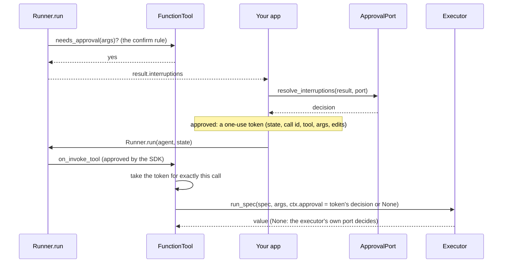

# OpenAI Agents SDK

:material-check-circle:{ .status-ok } Available · `pip install "agent-adapter[openai-agents]"` · `openai-agents>=0.24`

Every registry tool becomes a `FunctionTool` that runs through the
[executor](../concepts/executor.md): validation, hooks, guards, cache, ledger and events
apply inside the Agents SDK run loop. A tool's `confirm=` rule becomes the SDK's
`needs_approval` gate.

## Functions

| Function (`agent_adapter.integrations.openai_agents`) | Returns |
|---|---|
| `function_tool(spec, *, executor=None, strict=True)` | one `FunctionTool` with the OpenAI strict schema |
| `function_tools(registry, *, executor=None, strict=True)` | one per tool whose `targets` include `openai_agents` |
| `async resolve_interruptions(result, port, *, run_id="")` | the `RunState` with each pending call approved or rejected |
| `INTEGRATION` | the [integration](../contributing/writing-an-integration.md) object; `bind_context(tool_context)` reads `tool_call_id` |

`executor=None` uses the default executor. `strict=False`, or an imported schema that is not
portable, gives a non-strict schema. Export raises `IntegrationError` for an SDK outside
the extra's range (`0.24` to below `1.0`).

## Run and approve

```python
--8<-- "examples/openai_agents_tools.py:run"
```



## Approval

| `confirm=` | SDK gate (`needs_approval`) |
|---|---|
| `False` | `False` |
| `True` | an async check: validates the arguments, then asks for approval |
| callable `(call, ctx) -> bool` | an async check: validates the arguments, then asks the rule |

Invalid arguments are never sent for approval: the call runs and returns a
`tool-args-invalid` error. A rule that says "no" lets the call through the SDK gate; the
executor still runs the rule itself, with its own context, before the tool runs.

**The SDK's own approval never counts alone.** `RunState.approve`, `always_approve=True`
and an approval stored in a run state's JSON only let the SDK call the tool. The executor
skips its own port only for a token `resolve_interruptions` issued after **your** port
approved.

| Token is bound to | So that |
|---|---|
| the run state (the SDK's per-state scope id) | another copy (`to_state()` again) or a state loaded with `RunState.from_json` gets no approval |
| the `tool_call_id` and the tool | an `always_approve` for one call covers no other call |
| a digest of the validated arguments | other arguments get no approval |
| one use, within 60 seconds | a replay gets no approval |

Without a matching token the executor decides: its rule, then its own port (none: denied).

Tokens are issued only for tools this bridge exported. One resolve issues at most 256; the
rest, and any older token a full table drops, fall back to the executor's port (logged as
a WARNING with the count).

- `resolve_interruptions` asks the port once per pending call. For an exported tool the
  request carries the **validated** arguments; for other SDK tools the model's raw ones.
  It also carries the `run_id` you pass and `metadata={"integration": "openai_agents"}`.
  Pass the same `run_id` on every pass.
- Approved calls get `RunState.approve`, denied ones `RunState.reject` with a model-visible
  `approval-denied` error as the message. An exported tool's call with no call id, or with
  invalid arguments, is denied without asking.
- The SDK re-runs an approved call with its **original** arguments. Edits travel in the
  token; the executor validates them and runs its `before_tool` checks on them.
- An edit for an SDK tool this bridge did not export raises `ToolUsageError` before any
  decision is applied (the edit could not reach it). To recover, reject that item on the
  state yourself (`state.reject(item)`), or decide it again under a new `run_id`.
- Resume the returned state in the same process. A state you store and load again gets
  no token: the executor's own port decides when the call runs.
- `result` may be a `RunState`; it is then updated in place.
- `DeferredApproval` (out-of-band review) is asked in two phases; see
  [Approval batches](../concepts/approval-batches.md): resolve again after each decision,
  with the same `result` / state and `run_id`.

## Ids

| Context field | From |
|---|---|
| `ctx.call_id` | `ToolContext.tool_call_id` |
| `ctx.run_id` | the SDK trace id when tracing is on (it survives a resume); else a fresh run per call |

## Errors to expect

| Case | What the model sees / what you get |
|---|---|
| `ToolArgsInvalid` (also bad JSON), `ToolError`, `ApprovalDenied`, `GuardrailBlocked`, `RunLimitExceeded` | the tool output `{"error": {"kind", "message"}}` (a JSON string) |
| any other error (`ToolTimeout`, `ToolFailed`, ...) | `Runner.run` raises the SDK's `agents.exceptions.UserError("Error running tool …")` with our error as `__cause__` |
| `asyncio.CancelledError` | propagates: the tools are built with `set_function_tool_failure_error_function(tool, None)` (an SDK without it raises `IntegrationError` at export) |

Return values: a `str` is passed through; anything else is sent as JSON.
