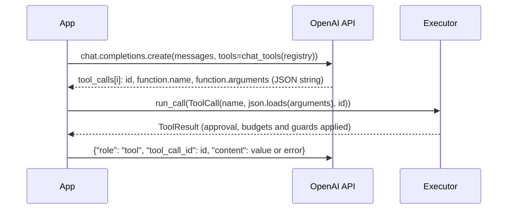

# OpenAI

:material-check-circle:{ .status-ok } Available · Chat Completions and Responses API · no SDK needed

The renderers return plain dicts. Import the functions by name
(`from agent_adapter.integrations.openai import ...`), so the `openai` SDK name stays free.

## Functions

| Function (`agent_adapter.integrations.openai`) | Returns |
|---|---|
| `chat_tools(registry, *, strict=True)` | every tool in Chat Completions format |
| `chat_tool(spec, *, strict=True)` | one tool: `{"type": "function", "function": {...}}` |
| `responses_tools(registry, *, strict=True)` | every tool in Responses API format |
| `responses_tool(spec, *, strict=True)` | one tool, flat: `{"type", "name", "description", "parameters", "strict"}` |
| `INTEGRATION` | the [integration](../contributing/writing-an-integration.md) object (Chat format); `OpenAIIntegration(api="responses", strict=False)` for others. `bind_context(call)` reads `call_id`, else `id` |

## Round trip

Pass the rendered list as `tools=`. Run each tool call the model sends through one
`Executor`, never with `spec.invoke`: `invoke` skips approval, budgets, run guards, the
cache and the ledger, so a `confirm=True` tool would run unapproved.

```python
--8<-- "examples/providers.py:openai"
```



| Step | Notes |
|---|---|
| Executor | build it once, with `approval=` if any tool has `confirm=True`; with no port such a call is denied ([approval](../concepts/approval.md)) |
| Several calls | the loop runs them in order; `executor.run_many(calls)` runs them at once and keeps their order |
| Whole loop | [`run_tool_loop`](../concepts/tool-loop.md) with `OpenAIModel` sends the calls and answers them for you |
| Responses API | the call is a `function_call` item: use its `name`, `arguments` and `call_id`, and answer with `{"type": "function_call_output", "call_id", "output"}` |

## Strict mode

`strict=True` (the default) makes every field required and optional ones nullable, and
sets `additionalProperties: false` everywhere. Each argument's default is written into
its description (`Default: "c".`). When the model sends `null`, validation applies your
default. See [Strict mode and nulls](../concepts/strict-mode.md).

`strict=False` gives the plain schema: optional fields stay optional and keep `default`.

## Errors to expect

`run_call` returns every failure as `result.error`; it never raises for them.

| `result.error.kind` | When |
|---|---|
| `tool-not-found` | the model names a tool you did not register |
| `tool-args-invalid` | the arguments fail validation; the error tells the model what to fix |
| `approval-denied` | a `confirm` tool was denied, or no approval port is set |
| `approval-pending` | a `DeferredApproval` port parked the call ([human in the loop](../how-to/human-in-the-loop.md)) |

`json.loads` raises `json.JSONDecodeError` when the model sends malformed JSON. That
comes from the standard library, not the adapter.
