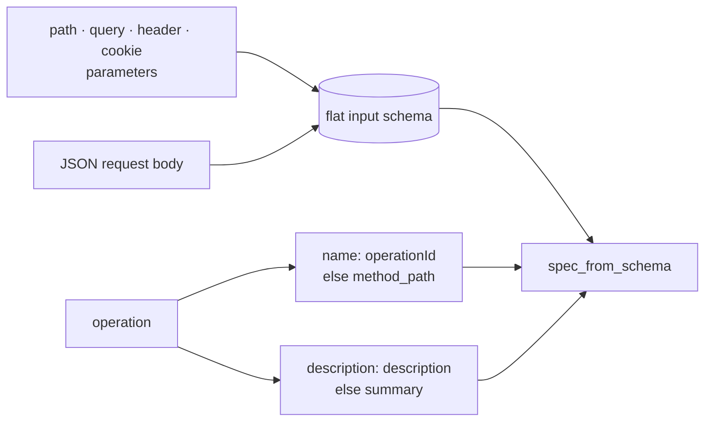

# OpenAPI

:material-check-circle:{ .status-ok } Available · importer · `pip install "agent-adapter[openapi]"` (`httpx`, `pyyaml`)

`import_openapi` turns every operation of an OpenAPI 3.x document into a tool. The tools
call the API over httpx and run through the executor like any other tool.

## Functions

| Name (`agent_adapter.integrations.openapi`) | What |
|---|---|
| `import_openapi(registry, spec, *, base_url=None, auth=None, headers=None, operations=None, prefix="", timeout=30.0, client_factory=None, **policy)` | the new `ToolSpec`s, added all or nothing |
| `BearerAuth(token)` | `Authorization: Bearer …`; `token` is a string or a sync/async callable asked per call |
| `HeaderAuth(name, value)` / `QueryAuth(name, value)` | a fixed header / query parameter (prefer the header: see [Credentials](#credentials)) |
| `INTEGRATION` | the integration object (import only: `export_tool` raises `IntegrationError`) |

```python
--8<-- "examples/openapi_import.py:import"
```

## Options

| Option | Default | Meaning |
|---|---|---|
| `spec` | — | a mapping, JSON or YAML text (has a newline or starts with `{`), or a file path; URLs are refused |
| `base_url` | `servers[0].url` with variable defaults | must be absolute |
| `headers` | none | sent with every request |
| `operations` | all | operationIds (or `{method}_{path}` keys) to import; unknown ones are a `ConfigError` |
| `prefix` | `""` | added to every tool name |
| `client_factory` | `httpx.AsyncClient` | called as `client_factory(base_url=, headers=, timeout=)`, once per event loop |
| `timeout` | `30.0` | seconds for the whole request, connect to last body byte (also the client's per-phase timeout) |
| `**policy` | `kind="http"`, tags `{"openapi", *operation tags}`, `effects`, `idempotent` | any tool option (`retries=`, `confirm=`, `cache_ttl=` ...); `timeout=` is the HTTP timeout above, not the tool option |

## One operation, one tool



| Rule | Example |
|---|---|
| Names are sanitised to `[A-Za-z0-9_]` | `X-Trace` → `X_Trace`, `page[size]` → `page_size`, `GET /pets/{id}` → `get_pets_id` |
| Two parameters with one name | the later one gets its location: `id` (path), `query_id` |
| A name already taken | numbered from `_2`: `dup`, `dup_2`, `dup_3` (tool names stay within 64 characters) |
| One operationId on several operations | all imported with numbered names; one `WARNING` per import lists the duplicated ids |
| Object body | its properties join the schema; a clash gets `body_` (`name` → `body_name`) |
| Array, scalar, map or `allOf`/`oneOf` body | one `body` field (`body_body` on a clash) |
| `readOnly` body properties | left out |
| `$ref` | local refs inlined; a recursive ref becomes `{}` (any value); remote refs are a `ConfigError`. Within one tool, repeated targets are one shared object: `copy.deepcopy(spec.input_schema)` before editing it in place |
| OpenAPI 3.0 `nullable: true` | `type: [X, "null"]` |
| `Accept`, `Content-Type`, `Authorization` header parameters | ignored (OpenAPI rule; use `auth=`) |
| Non-JSON request body (form, multipart) | operation skipped (see [Untrusted documents](#untrusted-documents)) |
| `effects` | `read_only` for GET/HEAD, `destructive` for DELETE, else `additive` |
| `idempotent` | GET, HEAD, PUT, DELETE |
| Result schema | the lowest 2xx JSON response |

Unset optional arguments are not sent, so the API applies its own defaults. Query arrays
repeat the key unless the parameter says `explode: false` (comma-joined); objects in
query, header and cookie values are compact JSON. Path values are one percent-encoded
segment (`/` and `.` included); `""`, `.`, `..` and `null` are `ToolArgsInvalid`, as are
header and cookie values that are not printable ASCII (no CR/LF).

## Responses and retries

| Outcome | Tool result |
|---|---|
| 2xx | the JSON body, else the text; `None` for 204 or an empty body |
| 3xx, 4xx except 429 | `ToolError("HTTP 404 from GET /pets/{petId}: <first 500 chars>")`, `details={"status": …}`; not retried |
| 429 | `httpx.HTTPStatusError` (message, request and response without the query string); retried up to `retries`, then `ToolFailed` |
| 5xx, idempotent operation | as 429 |
| 5xx, non-idempotent operation (POST, PATCH, ...) | `ToolError(... "not retried because POST is not idempotent")`: the server may have acted |
| connection refused / connect or pool timeout | the httpx error; retried (nothing was sent) |
| other transport errors (read timeout, dropped connection) | retried for idempotent operations; `ToolError` for the others |
| body over a fixed 10 MiB response cap (raw or decoded) | `ToolError`; the rest is not read |
| `Content-Encoding` other than gzip / deflate / identity, or corrupt, truncated or trailing compressed data | `ToolError` (we send `Accept-Encoding: gzip, deflate, identity` and inflate with bounded output; concatenated gzip members are all decoded; NUL padding after the last member is ignored) |
| no complete response within `timeout` (whole request) | `httpx.ReadTimeout`, handled as a transport error |

Idempotent means GET, HEAD, PUT and DELETE. Pass `idempotent=True` to opt every imported
operation (POST included) into 5xx retries when the API dedupes requests itself. Before a
retry of a 429 or retryable 503, a `Retry-After` (seconds or HTTP date) is waited for, at
most 30 s, and only when the executor will make another attempt (it says so through
`exec.pipeline.current_attempt()`; a direct `spec.invoke` never waits). The executor's backoff
follows, so the worst-case wait before one retry is `min(Retry-After, 30 s)` plus
`Backoff.max_s` (30 s by default). Redirects are never followed, whatever the
`client_factory` client is configured to do, so credentials cannot follow a 3xx elsewhere.

## Untrusted documents

A document decides where requests go, so treat third-party specs as code:

- **Always pass `base_url=`** so `servers` in the document cannot redirect calls.
- The server URL may not carry credentials (`user:pw@`: put them in `auth=`) or an
  ambiguous numeric host (`0x7f.1`, `0177.0.0.1`, `2130706433`, `127.1`: write `a.b.c.d`);
  server variable values may not contain `@`, `/`, `\`, `?` or `#`. Schemes match in any case.
- Path keys must be plain absolute paths (no scheme, `//`, `?`, `#`, `\`, `.` or `..`
  segment) and their `{placeholders}` must match the path parameters (`ConfigError`).
- Each call checks scheme, host and port against `base_url` before credentials are added.
- Only local `$ref`s are followed. A repeated `$ref` is built once and shared, so the
  inlining work stays linear in the document. Bounds per operation skip that operation
  (or drop its response schema); document-wide budgets refuse the import:

  | Bound | Limit | Over it |
  |---|---|---|
  | one resolved schema, parameter or body (expanded) | 10 000 values, 128 levels | operation skipped; a response schema is dropped instead |
  | the document, YAML aliases expanded | 2 000 000 values | `ConfigError` |
  | values built while inlining (shared values count once) | 64 per document value, 50 000 to 1 000 000; half for response schemas | `ConfigError`; response schemas are dropped instead |
  | values all imported tools hold (each tool copies its schemas) | 64 per document value, 50 000 to 4 000 000 | `ConfigError`; response schemas are dropped instead |
  | top-level input fields of all tools (each is a pydantic field, built on first use) | 8 per document value, 5 000 to 100 000; checked before an operation holds anything | operations that no longer fit are skipped |

  An import logs at most three `WARNING`s, each naming the first five entries: duplicated
  operationIds, skipped operations (with the reason: not JSON, too large, too deep, over
  the fields budget) and dropped response schemas.
  An operation named in `operations=` that a bound skips is a `ConfigError` (after the
  summary is logged).
- The origin check compares host names, not addresses: DNS rebinding (a name that later
  resolves elsewhere) is out of scope; pin DNS or use an egress proxy for that.
- Malformed shapes are a `ConfigError` naming the operation.

## Credentials

Credentials never appear in our logs or error messages; the auth objects' `repr` hides
them. Prefer `HeaderAuth` or `BearerAuth`: `QueryAuth` values are masked in this process's
httpx log lines, but servers, proxies and their access logs still record query strings.
