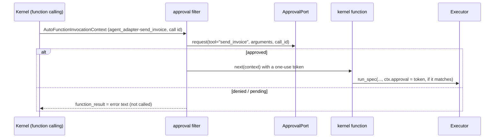

# Semantic Kernel

:material-check-circle:{ .status-ok } Available · kernel functions and a plugin ·
auto-invocation filter approval · `pip install "agent-adapter[semantic-kernel]"`

!!! warning "Dependency pin"
    `semantic-kernel` 1.4x pins `pydantic<2.14`: installing the extra downgrades pydantic
    (to 2.13.x) and pulls ~430 MB. It is not in `all` and has its own nox session
    (`contract-semantic_kernel`). Semantic Kernel is in maintenance mode; for new agents
    see [Microsoft Agent Framework](agent-framework.md).

## Functions

| Function (`agent_adapter.integrations.semantic_kernel`) | Returns |
|---|---|
| `kernel_function(spec, *, executor=None)` | one `KernelFunctionFromMethod` (a subclass), one parameter per schema property |
| `kernel_plugin(registry, *, name="agent_adapter", executor=None)` | a `KernelPlugin`; the model sees `<name>-<tool>` |
| `approval_filter(port, registry, *, plugin="agent_adapter")` | an `AUTO_FUNCTION_INVOCATION` filter for that plugin's functions (`None`: any plugin) |
| `INTEGRATION` | `get_integration("semantic_kernel")`; `bind_approval(port)` = the filter, resolving specs from our functions |

Each parameter carries its property schema (`$ref`s inlined) as `schema_data`. Values
that are not strings come back as JSON text (the model sees `str(result)`).

## Wiring

```python
--8<-- "examples/semantic_kernel_tools.py:wire"
```

## Approval



| Case | What happens |
|---|---|
| Approved | a one-use token for that invocation only, bound to the conversation's run, the call id, `<plugin>-<function>` and the validated arguments; the executor does not ask again |
| No call id on the function call | denied (the approval could not be bound to it) |
| Denied | the function is not called; its result is `{"error": {"kind": "approval-denied", ...}}` |
| Port raises `ApprovalPending` | the result is `approval required: <id>` |
| Edited arguments | not supported: an edit is treated as a denial (logged at `WARNING`) |
| A function of another plugin | not gated by the filter: the executor's own port decides |
| No filter, or `kernel.invoke(...)` outside function calling | the executor's own confirm rule and port decide (no port: denied) |

The filter never sets `context.terminate`: after a denial the model gets the result and
the conversation goes on.

## Calls and errors

| Item | Behaviour |
|---|---|
| Call id | the function call content's `id` → `ctx.call_id` (auto-invocation only) |
| Run | one run id per chat history (conversation) behind the filter |
| `ToolArgsInvalid`, `ToolError`, `ApprovalDenied`, `GuardrailBlocked`, `RunLimitExceeded` | returned as `{"error": {"kind", "message"}}` |
| Other errors | raised; SK reports `An error occurred while invoking the function ...` |
| `CancelledError` | propagates |

Semantic Kernel injects `kernel`, `service`, `execution_settings` and `arguments` by name,
so tools with such argument names are refused with `ToolDefinitionError`.
