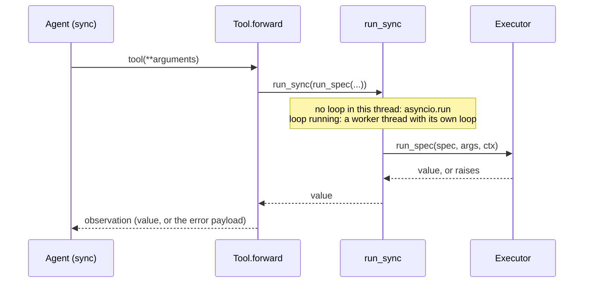

# smolagents

:material-check-circle:{ .status-ok } Available · `Tool` subclass per spec · `pip install "agent-adapter[smolagents]"`

smolagents tools are synchronous. Each exported tool's `forward` runs the executor through
`run_sync`, so the full async pipeline applies.

## Functions

| Function (`agent_adapter.integrations.smolagents`) | Returns |
|---|---|
| `smolagents_tool(spec, *, executor=None)` | one `smolagents.Tool` for `spec` |
| `smolagents_tools(registry, *, executor=None)` | a tool for every registry tool whose `targets` include `smolagents` |
| `INTEGRATION` | the [integration](../contributing/writing-an-integration.md) object (`get_integration("smolagents")`) |

`executor=None` uses the default executor at call time (`set_default_executor`).

## Use

```python
--8<-- "examples/smolagents_tools.py:tools"
```

In a `ToolCallingAgent`:

```python
--8<-- "examples/smolagents_tools.py:agent"
```



## What smolagents sees

| `Tool` attribute | From |
|---|---|
| `name`, `description` | `spec.name`, `spec.description`; a Python keyword as name raises `IntegrationError` |
| `inputs` | each property of the plain schema, with `description` (default `""`) and `nullable: True` for optional or nullable arguments |
| `inputs[...]["type"]` | the JSON type; `Optional[X]` becomes X (nested schema kept); other unions a type list; anything else `"any"` |
| `output_type` | the result schema's JSON type, else `"any"` |

## Behaviour

| Topic | Rule |
|---|---|
| Validation | The tool's own args model, in the executor. smolagents' agent check runs first in agents, with the same types |
| Errors | `ToolArgsInvalid`, `ToolError`, `ApprovalDenied`, `GuardrailBlocked`, `RunLimitExceeded` come back as `{"error": {"kind", "message"}}` (its JSON text when `output_type` is `"string"`); anything else raises |
| Positional args | `tool("tea")` maps to inputs in order, as agents call one-input tools |
| Call id | `forward` gets only arguments, so each call gets a fresh `call_...` id. `ctx.extras["smolagents"]` is the tool |
| Approval | smolagents has no per-tool gate: `confirm` tools ask the executor's `ApprovalPort`. Edited arguments from the port are validated again and applied. Use a port that blocks until it decides (`CallbackApproval`, a console or UI prompt): a `DeferredApproval` raises `ApprovalPending`, which the agent (it catches `Exception`) reports to the model as a tool error instead of pausing the run |
| Serialisation | `Tool.save`, `push_to_hub`, `to_dict` and remote executors (E2B, Docker, Modal) are not supported: the tool closes over the spec and the executor, which cannot be written out as source |
| Cancellation | `forward` blocks a thread. Cancelling the awaiter of `asyncio.to_thread(tool, ...)` does not stop that thread; the tool's own timeout does. `CancelledError` raised inside the tool propagates |
