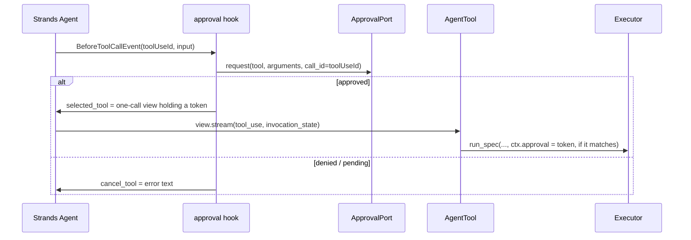

# Strands Agents

:material-check-circle:{ .status-ok } Available · `AgentTool` per spec · approval hook ·
`pip install "agent-adapter[strands]"` (`strands-agents`, heavy: boto3, OTel SDK) · own environment
(needs `mcp<2.2`; not in `all`)

## Functions

| Function (`agent_adapter.integrations.strands`) | Returns |
|---|---|
| `strands_tool(spec, *, executor=None)` | one `AgentTool` (`inputSchema.json` = neutral schema) |
| `strands_tools(registry, *, executor=None)` | one per registry tool exported to `strands` |
| `strands_approval_hook(port, registry)` | an async `BeforeToolCallEvent` callback |
| `INTEGRATION` | `get_integration("strands")`; `bind_approval(port)` = the hook, resolving specs from the exported tools |

Results are Strands tool results: `status` `success` with a `text` (strings) or `json`
block, or `status` `error`.

## Wiring

```python
--8<-- "examples/strands_tools.py:wire"
```

## Approval

The hook runs before every tool call. For a registry tool whose `confirm` rule says yes it
asks the [approval port](../concepts/approval.md) once.



| Case | What happens |
|---|---|
| Approved | the hook swaps in a one-call view of the tool holding a one-use token of this hook, bound to the agent's run, the `toolUseId`, the tool and the validated input; the executor does not ask again |
| Input changed after approval (a later hook), replayed view, or any value put in `invocation_state` | no token: the executor asks its own port |
| Denied | the call is cancelled; the model sees `{"error": {"kind": "approval-denied", ...}}` |
| Port raises `ApprovalPending` | the call is cancelled with `approval required: <id>` |
| Edited arguments | not supported: an edit is treated as a denial (logged at `WARNING`) |
| No hook registered | the executor's own confirm rule and port decide (no port: denied) |

## Calls and errors

| Item | Behaviour |
|---|---|
| Call id | `toolUseId` → `ctx.call_id` |
| Run | one run id per `Agent` object, shared by the hook's requests and the calls |
| `ToolArgsInvalid`, `ToolError`, `ApprovalDenied`, `GuardrailBlocked`, `RunLimitExceeded` | `status: error` with `{"error": {"kind", "message"}}` |
| Other errors | raised; Strands reports `Error: <message>` |
| Outer cancellation (cancelling `invoke_async`) | propagates with both executors and cancels the tool |
| A tool's own `CancelledError` | Strands' default `ConcurrentToolExecutor` drops it (the result goes missing); `SequentialToolExecutor` propagates it |
