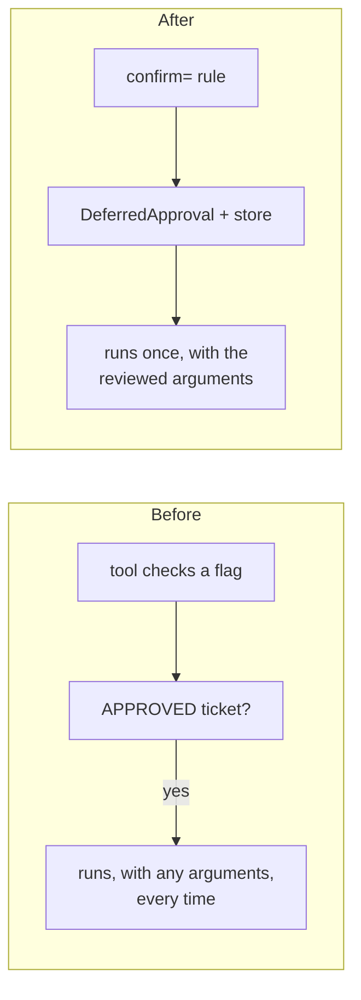

# From a hand-rolled approval flow

You check "does this need approval?" inside the tool, park the arguments in a dict or a
table, and run the tool once someone flips a flag. That code usually has two bugs: a
replay runs the action again, and the approved call can run with other arguments.



## Mapping

| Before | After |
|---|---|
| `if amount > 100 and not approved:` inside the tool | `confirm=lambda call, ctx: ...` on the tool |
| a `PENDING` dict or table | an `ApprovalStore` (`SQLiteApprovalStore`, `RedisApprovalStore`, `SQLAlchemyApprovalStore`, `DynamoDBApprovalStore`; [Database stores](../concepts/approval-stores-db.md)) |
| `APPROVED.add(ticket)` | `store.decide(approval_id, Decision(...))` |
| re-calling the tool after approval | re-running the same call (same run id, same call id) |
| "needs approval" as a return value | `ToolResult(status="pending")`, `error.details["approval_id"]` |
| editing the stored arguments | `Decision(edited_args=...)`, validated again |

## Before

```python
--8<-- "examples/guide_migrate_approval.py:before"
```

```python
--8<-- "examples/guide_migrate_approval.py:bugs"
```

## After

```python
--8<-- "examples/guide_migrate_approval.py:after"
```

```python
--8<-- "examples/guide_migrate_approval.py:fixed"
```

## Output

```text
needs approval
refunded 500 refunded 5000
pending refunded 500.0
pending
tool-usage-error [500.0]
```

The old flow paid twice, the second time ten times more. The new one paid once.

## Gained and lost

| Gained | Lost |
|---|---|
| one decision runs one call, once | the approval check inside the tool body (move it to `confirm=`) |
| the decision is bound to the run, call id, tool and arguments | free-form tickets: keep yours in `ApprovalRequest.metadata` or your own table, keyed by approval id |
| the same flow for frameworks, MCP and the HTTP server | |

## Checklist

- [ ] Remove the approval check from the tool body; add `confirm=`.
- [ ] Use a durable store if more than one process runs.
- [ ] Store `run_id` and the call id with the approval id, so the resume matches.
- [ ] Reviewers decide through your UI, the [HTTP server](../cross-language/http-server.md) or a [chat app](../cookbook/approval-notify.md).
- [ ] Delete the `PENDING` and `APPROVED` tables once nothing reads them.

## Files

| File | Does |
|---|---|
| `examples/guide_migrate_approval.py` | the old flow and its bugs, then the new one |
| `tests/docs/test_migration.py` | runs it offline and checks the output |
