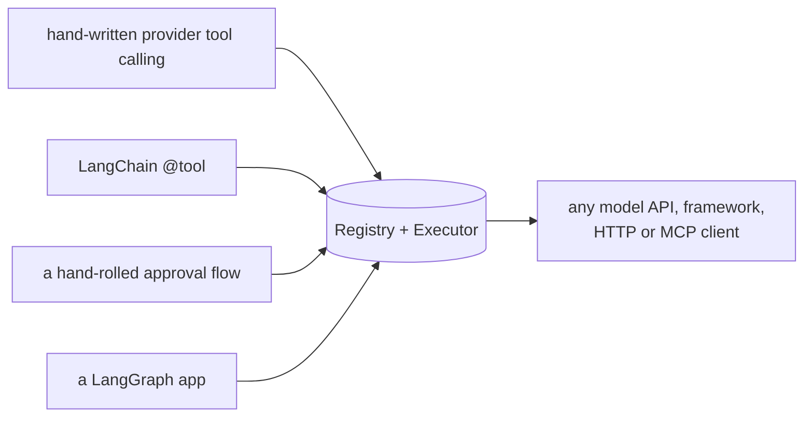

# Migration guides

Move existing tool code onto the adapter one step at a time. Each guide has a mapping
table, a before-and-after example, what you gain and lose, and a checklist.

| From | Guide |
|---|---|
| raw OpenAI or Anthropic tool calling (JSON schemas and a dispatch dict) | [Raw tool calling](raw-tool-calling.md) |
| LangChain `@tool` functions | [LangChain tools](langchain-tools.md) |
| a "needs approval" table you wrote yourself | [Hand-rolled approval](hand-rolled-approval.md) |
| a LangGraph graph | [Migrate from LangGraph](../tutorials/migrate-langgraph.md) (tutorial) |

## The order that works

1. Register the tools; keep calling them the old way.
2. Route every call through one `Executor`.
3. Turn on the policies you need: `confirm=`, budgets, caching.
4. Delete the old schemas, dispatch tables and approval code.

Every step ships on its own and can be rolled back.

The examples are `examples/guide_migrate_*.py`; `tests/docs/test_migration.py` runs them.
