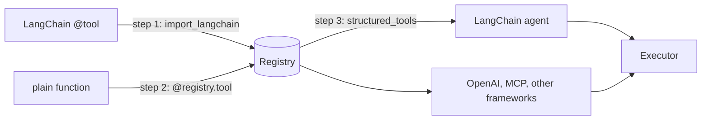

# From LangChain tools

Your tools are LangChain `@tool` functions. Move them into a registry so any framework
can use them, while LangChain agents keep working.



## Mapping

| LangChain | Agent Adapter |
|---|---|
| `@tool` from `langchain_core.tools` | `@registry.tool` |
| `args_schema=` | type hints, `Annotated[..., Field(...)]`, or `args_model=` |
| `return_direct`, callbacks | events and hooks (`LoggingHook`, your own `Hook`) |
| `RunnableConfig["configurable"]["thread_id"]` | read by exported tools as `ctx.thread_id` |
| `HumanInTheLoopMiddleware`, interrupts | `confirm=` plus an approval port |
| `tool.invoke(args)` | `await executor.run("name", args)` |

## Step 1: import, no rewrite

```python
--8<-- "examples/guide_migrate_langchain.py:import"
```

Imported tools run through the executor like any other, with the policy you pass.

## Step 2: rewrite as plain functions

```python
--8<-- "examples/guide_migrate_langchain.py:native"
```

```python
--8<-- "examples/guide_migrate_langchain.py:run"
```

## Step 3: give LangChain the registry

```python
--8<-- "examples/guide_migrate_langchain.py:export"
```

## Output

```text
3 ok
FAQ
2
```

Without `langchain-core` installed, the example prints `3 ok` and skips steps 1 and 3.

## Gained and lost

| Gained | Lost |
|---|---|
| tools without a LangChain dependency | LangChain-only features on the tool object (`return_direct`, tool callbacks) |
| the same tools for every other framework and model API | |
| approval with one-use decisions, budgets, caching, ledger | |

## Checklist

- [ ] `pip install "agent-adapter[langchain]"` for steps 1 and 3.
- [ ] Each tool rewritten keeps its name, so prompts and traces still match.
- [ ] Agents get `structured_tools(registry, executor=executor)`, not the old list.
- [ ] Remove `langchain_core` imports from tool modules once step 2 is done.

## Files

| File | Does |
|---|---|
| `examples/guide_migrate_langchain.py` | the import, the rewrite and the export |
| `tests/docs/test_migration.py` | runs it offline; the LangChain steps run when `langchain-core` is installed |
