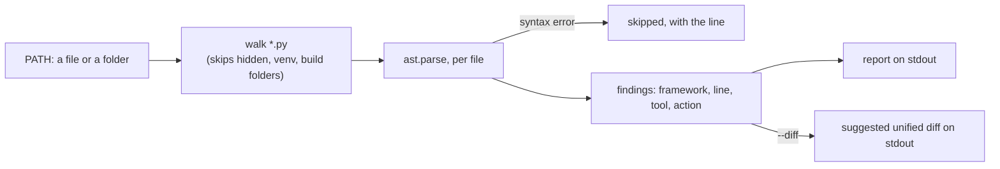

# `agent-adapter migrate`

`migrate` reads your Python files and lists every framework tool definition it finds. With
`--diff` it also prints a suggested patch that moves those tools onto a `Registry`.

It is read-only. It parses each file with Python's `ast` module: it never imports, runs or
writes your code. You review the patch and apply it yourself.



## Usage

```bash
agent-adapter migrate src/                          # report only
agent-adapter migrate src/ --diff > migrate.patch   # report, then the patch
agent-adapter migrate app.py --framework langchain  # one framework only
```

| Argument | Meaning |
|---|---|
| `PATH` | one `.py` file, or a folder scanned recursively |
| `--framework` | `auto` (default: every framework), or one of `langchain`, `crewai`, `openai-agents`, `adk`, `pydantic-ai`, `llamaindex`, `smolagents`, `agno`, `strands`, `openai`, `anthropic` |
| `--diff` | print the suggested unified diff after the report |

The exit code is 0, even when files are skipped. It is 2 when `PATH` does not exist.

## What it finds

| Framework | Finds | Suggests |
|---|---|---|
| LangChain | `@tool`, `StructuredTool.from_function(f)`, `BaseTool` subclasses | `@registry.tool`, `registry.wrap(f)` |
| CrewAI | `@tool("name")`, `BaseTool` subclasses | `@registry.tool(name=...)` |
| OpenAI Agents SDK | `@function_tool`, `name_override=` | `@registry.tool(name=...)` |
| Google ADK | `FunctionTool(func=f)`, plain functions in `Agent(tools=[...])` | `registry.wrap(f)`, `@registry.tool` |
| Pydantic AI | `@agent.tool`, `@agent.tool_plain`, `Tool(f)` | `@registry.tool`; `RunContext` becomes `ToolContext` |
| LlamaIndex | `FunctionTool.from_defaults(fn=f)` | `registry.wrap(f, name=...)` |
| smolagents | `@tool`, `Tool` subclasses | `@registry.tool` |
| Agno, Strands | `@tool`, plain functions in `Agent(tools=[...])` | `@registry.tool` |
| raw OpenAI or Anthropic | tool schema dicts (`"type": "function"`, `"input_schema"`) | reported only |

Names are matched by where they are imported from, so `from langchain_core.tools import
tool as lc_tool` is found too. A function named `tool` that you wrote yourself is not.

## The report

```text
agent-adapter migrate: read-only, no file was changed
app.py:10: langchain @tool `ticket_status`: use @registry.tool
app.py:22: langchain @tool `escalate`: manual: its options have no direct match
tools.py:6: crewai BaseTool subclass `opening_hours`: manual: move its run method into a @registry.tool function
legacy/broken.py: skipped, syntax error at line 5
3 tool definition(s) in 2 file(s); 2 need a manual step
langchain: give it structured_tools(registry, executor=executor) from agent_adapter.integrations.langchain
```

The last lines name the bridge for each framework found. Pass its result where the
framework takes its tools, so every call goes through the executor.

## The diff

For each file with an automatic finding, the patch:

- swaps the framework decorator for `@registry.tool`, keeping a string `name=` or
  `description=`;
- turns wrapper calls into `registry.wrap(f)`;
- adds `@registry.tool` to plain functions passed in `tools=[...]`;
- drops a framework import name once nothing else uses it;
- adds, after the imports, `registry = Registry()`, one `Executor` and the bridge import.

```diff
-from langchain_core.tools import tool
+from agent_adapter import Executor, Registry
+from agent_adapter.integrations.langchain import structured_tools
+
+registry = Registry()
+executor = Executor(registry)  # add approval=, hooks= and limits= here


-@tool("refund_ticket")
+@registry.tool(name="refund_ticket")
 def refund(ticket_id: str, amount: float) -> str:
```

Apply it with `git apply migrate.patch` (or `patch -p1`), then run your tests.

## Left for you

These stay as they are and are marked `manual` in the report:

- decorator or wrapper options with no direct match, such as `return_direct=True` or ADK's
  `require_confirmation=True`; use `confirm=` and an approval port instead;
- a name that is not a valid tool name (`"Ticket price"`);
- `BaseTool` subclasses: move the body of `_run` into a function;
- raw schema dicts: write the function, then render the schema with `chat_tools(registry)`
  or `anthropic_tools(registry)`.

Files are skipped, never fatal, when they are symlinks, over 2 MB, not decodable, or not
valid Python.

## Files

| File | Does |
|---|---|
| `agent_adapter/cli/migrate.py` | the command: walks `PATH`, reads each file, prints the report and diff |
| `agent_adapter/cli/_migrate_rules.py` | which import paths count as framework tools, and each framework's bridge |
| `agent_adapter/cli/_migrate_scan.py` | finds tool definitions in one parsed module and plans the edits |
| `agent_adapter/cli/_migrate_diff.py` | applies the edits to a copy of the text and renders the diff |

The step-by-step guides: [LangChain tools](langchain-tools.md) and
[raw tool calling](raw-tool-calling.md).
