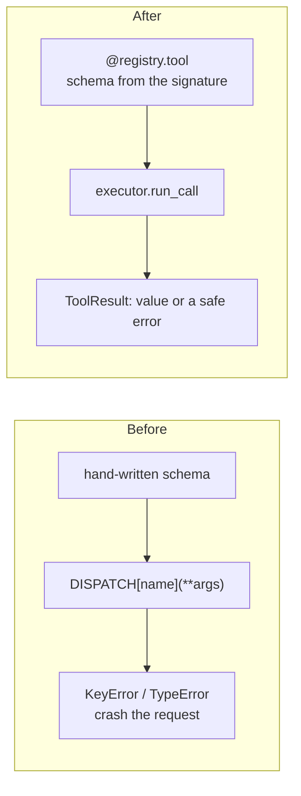

# From raw OpenAI or Anthropic tool calling

You wrote the JSON schema by hand, kept a `name -> function` dict, and called
`fn(**json.loads(arguments))`. Replace all three with a registry and an executor.



## Mapping

| Before | After |
|---|---|
| a `tools=[{...}]` list written by hand | `chat_tools(registry)` / `responses_tools(registry)` / `anthropic_tools(registry)` |
| `DISPATCH[name](**json.loads(args))` | `await executor.run_call(ToolCall(name, json.loads(args), id))` |
| `try: ... except Exception: return str(e)` | `result.error`: a stable `kind` and a message safe for the model |
| your own retry loop | `retries=`, `timeout=` on the tool |
| the agent loop you wrote | `run_tool_loop(model, registry, messages)` with `OpenAIModel` / `AnthropicModel` |

## Before

```python
--8<-- "examples/guide_migrate_raw.py:before"
```

## After

```python
--8<-- "examples/guide_migrate_raw.py:after"
```

```python
--8<-- "examples/guide_migrate_raw.py:compare"
```

Or let the adapter run the whole loop:

```python
--8<-- "examples/guide_migrate_raw.py:loop"
```

## Output

```text
0.92
['currency']
{'role': 'tool', 'tool_call_id': 'c1', 'content': '0.92'}
tool-args-invalid
['rate']
tool_result tu_1
stop 1 USD is 0.92 EUR.
```

## Gained and lost

| Gained | Lost |
|---|---|
| one schema source: the signature and docstring | hand-tuned schema wording (use `description=`, `Annotated` and docstrings instead) |
| validation before the tool runs; errors the model can act on | nothing: `json.loads` stays in your code |
| approval, budgets, caching, ledger and events on every call | |
| the same tools on Gemini, MCP and 18 frameworks | |

## Checklist

- [ ] Every tool has a docstring and type hints (else `ToolDefinitionError` at start-up).
- [ ] One `Executor`, built at start-up.
- [ ] Each tool call becomes `run_call`; its `ToolResult` becomes the tool message.
- [ ] Risky tools have `confirm=` and the executor has an approval port.
- [ ] The old `TOOLS` list and `DISPATCH` dict are deleted.
- [ ] No `spec.invoke` outside tests.

## Files

| File | Does |
|---|---|
| `examples/guide_migrate_raw.py` | the old code, the new code, both renderings and a loop |
| `tests/docs/test_migration.py` | runs it offline and checks the output |
