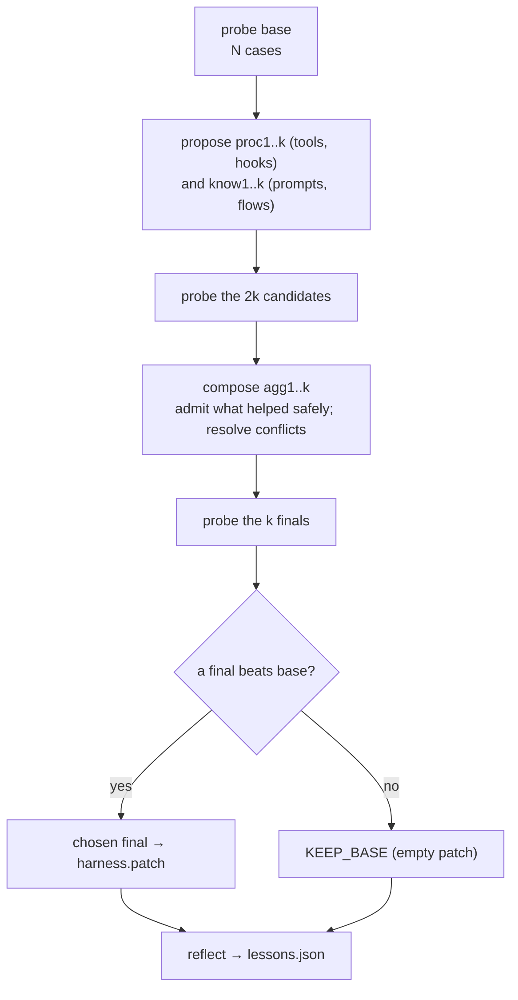

# Optimiser

The optimiser improves an agent by editing its **harness** (tool descriptions and hints,
hook settings, system prompt sections, flow node prompts), never the model. It runs your eval
cases offline, tries edits, measures them and writes a reviewable patch. **Nothing is applied
to your code or registry**; you read the patch and apply what you like. Step by step: [Optimise your agent](how-to/optimise-your-agent.md).

```python
--8<-- "examples/optimiser_demo.py:host"
```

```python
--8<-- "examples/optimiser_demo.py:run"
```

## The loop



`mode="sequential"` repeats the steps `k` times, each round against the last checkpoint.

## Surface

| Path | Changes | Default cap |
|---|---|---|
| `tool/<name>/description` | what the model reads when it picks a tool | 1 200 |
| `tool/<name>/prompt_hint` | a usage note per tool (`RegistryHost` lists hints in the system prompt) | 600 |
| `hook/<name>/config.json` | a tunable hook's settings (`Hook.config_schema()` / `with_config`) | 4 000 |
| `prompt/system` | `PromptLayout.static` | 12 000 |
| `prompt/layout/<section>` | a named layout section | 6 000 |
| `flow/<flow>/<node>/prompt` | a node's prompt (`Flow.with_prompts`, read with `node_prompt(ctx)`) | 6 000 |

A proposal lists `{path, content, delete, reason}` edits; omitted paths are inherited. The
procedure editor edits `tool/*`, `hook/*`, the knowledge editor `prompt/*`, `flow/*`. A
proposal failing a check (grammar, editor, caps, hook schema, `host.validate`) is retried once
with the problems, then falls back to its parent.

## Hosts

| Host | Runs a case with | Surface |
|---|---|---|
| `RegistryHost(registry, layout=, cases=, judge=, hooks=, ...)` | `run_tool_loop` over `apply_tree(registry, tree)` | prompts, tools, tunable hooks |
| `FlowHost(flow, initial_state=, output=, cases=, judge=, hooks=, ...)` | `FlowRunner(executor, model=...)` over `flow.with_prompts(...)` | node prompts, tunable hooks |
| `CallableHost(run_case, surface=, cases=, judge=, required=, withhold=, ...)` | your `run_case(tree, case, model)` (any agent or framework) | the paths in `surface` |
| your own class with the `Host` protocol | anything; `run()` never raises (errors become `CaseRun(ok=False)`) | whatever `surface()` returns |

A hook is tunable when it has a `config_schema()`; safety hooks (`BudgetHook`,
`GuardrailHook`, `RateLimitHook`, `LoggingHook` and subclasses) are not, unless the host
passes `allow_safety_tuning=True`. `RegistryHost` runs `hooks=` on tool calls only, so a
tunable hook acting on LLM calls has no effect there.

`judge(case, run) -> Score | None` grades a run (`value` in [0, 1]); `None` or a failing judge
leaves the run ungraded. Cases and graders are the [evals](how-to/evaluate-your-agent.md) ones (`agent_adapter.evals.graders`, `load_cases(path)`; `optimiser.graders` re-exports them).
The proposer never sees the judge's numbers unless `show_scores_to_proposer=True`, and never sees `EvalCase.expected`; it does see
`Score.notes` as reviewer remarks, so keep expected answers out of them.

## Budget

| Count | Value |
|---|---|
| case runs | `(1 + 3k) × N` (base, 2k candidates, k finals) |
| proposer calls | `2k`; a retry is an attempt (`Candidate.attempts`), not a call |
| merge calls | counted separately; only `compose_mode="llm"` with a conflict makes one per final |
| reflection / selection | at most one each, counted in the ledger stages `reflect` / `select` |

Every call goes through `InstrumentedModel` with the response cache (namespace
`config.namespace`) and the ledger, so an unchanged harness costs nothing to probe again.
`OptimiserBudget(max_usd, max_case_runs, max_wall_s)` is checked before each stage; a
`BudgetHook` stops calls once `max_usd` is spent and `max_wall_s` cancels a stage in flight;
a stopped run still writes a partial report. `max_usd` counts the optimiser's own model calls, plus a
host's `metrics["cost_usd"]` (the case run's total) beyond what the ledger saw; a judge's or a tool's is not seen. Each case run and each judging gets
`case_timeout_s` (default 300). Pass `ledger=` to receive every entry in your `Ledger`.

`OptimiserError` (after the partial outputs are written) when: the proposer, composer or
selector gets `ModelAuthError` / `ModelBadRequest`; any case run gets `ModelAuthError`; every
base case fails (rejected, or not run at all); or every proposer, or every case run of a
stage's probes, fails on a model error. Such a stage is not saved, so a rerun repeats it.
Other model-error or timeout failures show as `<label>: n/N case runs failed: <kind>` in
`errors`. Timeouts are never fatal: if every candidate times out the run ends as KEEP_BASE,
and `report.md` suggests raising `case_timeout_s`.

## Composition and choice

| Step | Rule |
|---|---|
| admit | no case lost its answer, the edit was exercised (tool called, hook acted) where that is observable, and, when cases were graded, at least one improved and the mean gain is ≥ `min_gain`; with no graded case a safe, exercised candidate is admitted and the choice decides |
| conflicts | several admitted candidates wrote one path: `greedy` takes the highest gain; `llm` asks the composer for one merged text, and falls back to greedy if that is invalid |
| `agg_i` | `agg1` uses every admitted candidate, `agg2` leaves out the weakest, and so on |
| choose | with judge scores: the best final whose mean beats the base and answers as many cases; without: a blind pick between anonymised answer sets, the base included (bounded by `evidence_chars`) |

## Outputs

| File (in `out_dir`) | Content |
|---|---|
| `harness.patch` | unified diff `--- a/<path>` / `+++ b/<path>` of the chosen tree (empty for KEEP_BASE) |
| `report.md` | budget identity, base and candidate tables, decisions, lessons, errors |
| `result.json` | `OptimiseResult`; transcripts are referenced as `runs/<label>/<case>.md` |
| `runs/<label>/<case>.md` | each case's answer and transcript (ids with other characters than `A-Za-z0-9._-`, or equal to another id but for case, get a digest suffix) |
| `harness.after.json` | the chosen tree (or the base), so a later run can diff against it |
| `state.json` | finished stages, rewritten after each one (it holds every transcript, so it grows with N × stages); a rerun with the same inputs and `out_dir` resumes (case inputs should be JSON or have a stable `str`) |

**Lessons.** One reflection call rates each changed path (`helped`, `hurt`, `no observed effect`,
`confounded`) and may write one lesson to `lessons_path`; `NO_ENTRY`, an incomplete lesson or
one resting only on confounded rows is not stored. Later runs of the same `domain` show up to
`max_lessons` matching lessons to the proposers. `lessons_path=""` turns lessons off.

## CLI

```
python -m agent_adapter.optimiser --host mypkg.evals:build_host --model openai:gpt-5
    [--proposer-model openai:gpt-5] [--k 1] [--mode parallel|sequential] [--compose greedy|llm]
    [--out runs/opt1] [--budget-usd 5] [--max-case-runs 200] [--lessons .agent_adapter/lessons.json] [--dry-run]
```

`--dry-run` prints the surface, the cases and the budget identity without calling a model; `--model none` (with `--proposer-model`) suits a host whose agent brings its own model.
Exit codes: `0` a final was chosen (patch written), `1` error, `2` KEEP_BASE, `3` a budget
limit stopped the run before any final was chosen.

## Safety

- Candidates are text and JSON only; no candidate code is ever executed. Hook configs reach a
  hook only through its own `with_config`.
- Put guardrails on `executor=`, which is never tuned; pass in `hooks=` only hooks meant to
  be tuned.
- Transcripts redact argument keys such as `key`, `token`, `secret`, `password`, and withhold
  the arguments of `confirm` tools. Tool *results* are kept as returned: do not run the
  optimiser on cases whose tools return secrets.
- Text in transcripts is data for the proposer, never instructions.
- When a provider sends no tool-call ids (some Gemini replies) `RegistryHost` derives them
  from the run id, so those turns miss the response cache across probes.

## Files

| Module | Does |
|---|---|
| `model.py` / `surface.py` | data model and config; path grammar, caps, editor rules, `validate_tree` |
| `hosts.py` / `callable_host.py` / `cases.py` / `graders.py` / `apply.py` / `evidence.py` / `prompts.py` | hosts, `apply_tree`; `CallableHost`, `NullModel`; `load_cases` and judges (from `evals`); `load_harness`, `layout_from_tree`; bounded evidence; our prompts and schemas |
| `propose.py` / `probe.py` / `compose.py` / `loop.py` | the three stages; `optimise()` with budget and resume |
| `lessons.py` / `report.py` / `__main__.py` | lessons store and reflection; outputs; CLI |

The method follows Harness² (Xu et al., 2026, arXiv 2610.14224;
[google-research/harness2](https://github.com/google-research/harness2)); this is an
independent implementation, using no harness2 code or prompt text.
