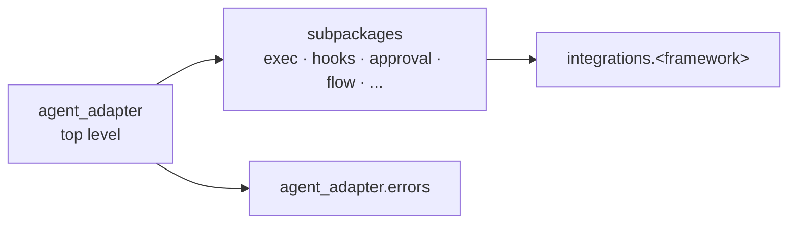

# API reference

Generated from the docstrings. One page per public module.
Each name is documented once, under the path you import it from.

## Where to import from

| Import from | Names |
|---|---|
| `agent_adapter` | The everyday names in `agent_adapter.__all__`: `Registry`, `tool`, `wrap`, `default_registry`, `ToolSpec`, `Executor`, `run_tool_loop`, the approval policies and stores, the built-in hooks, `Ledger`, `Flow`, the message types and the five most caught errors |
| `agent_adapter.errors` | Every other error, plus `ErrorInfo` |
| A subpackage (`agent_adapter.exec`, `.hooks`, `.approval`, ...) | Everything else, such as `ShortCircuit` from `agent_adapter.hooks` |
| The port's subpackage | The ports you implement: `LLMPort`, `PromptCachePlugin`, `ModelCaps` from `.models`; `CachePort` from `.cache`; `LedgerPort` from `.cost`; `EventSink` from `.tracing`; `ApprovalPort` from `.approval`; `EmbeddingPort` from `.embeddings` |

`import agent_adapter` is cheap: each name loads on first use.
A subpackage page links the top-level names it re-exports instead of repeating them.

## Pages

| Page | Modules |
|---|---|
| [Top level](reference/top-level.md) | `agent_adapter` |
| [Errors](reference/errors.md) | `agent_adapter.errors`: the error catalogue (kind, cause, fix) |
| [Executor](reference/exec.md) | `agent_adapter.exec`, `.exec.control`, `.exec.integration` |
| [Hooks](reference/hooks.md) | `agent_adapter.hooks`, `.hooks.builtin` |
| [Approval](reference/approval.md) | `agent_adapter.approval` |
| [Flows](reference/flow.md) | `agent_adapter.flow`, `.flow.runner`, `.flow.visit` |
| [Cost](reference/cost.md) | `agent_adapter.cost` |
| [Cache](reference/cache.md) | `agent_adapter.cache`, `.cache.providers` |
| [Embeddings](reference/embeddings.md) | `agent_adapter.embeddings` |
| [Memory](reference/memory.md) | `agent_adapter.memory` |
| [Retrieval](reference/retrieval.md) | `agent_adapter.retrieval` |
| [Sandbox](reference/sandbox.md) | `agent_adapter.sandbox` |
| [Policy](reference/policy.md) | `agent_adapter.policy` |
| [Audit log](reference/audit.md) | `agent_adapter.audit` |
| [Context compression](reference/context.md) | `agent_adapter.context`, `agent_adapter.context.formats` |
| [Runtime](reference/runtime.md) | `agent_adapter.runtime` |
| [Tracing](reference/tracing.md) | `agent_adapter.tracing` |
| [Models](reference/models.md) | `agent_adapter.models` and its provider modules |
| [HTTP server](reference/server.md) | `agent_adapter.server`, `.server.asgi`, `.server.service` |
| [Handlers](reference/handlers.md) | `agent_adapter.handlers` |
| [Chat contract](reference/chat.md) | `agent_adapter.chat`: what a chat agent receives and returns |
| [Run viewer](reference/viewer.md) | `agent_adapter.viewer`: `record()`, the recorder and the local viewer |
| [Model APIs, protocols and importers](reference/integrations-providers.md) | `integrations.openai`, `.gemini`, `.anthropic`, `.langchain`, `.openapi`, `.mcp`, `.a2a`, `.ag_ui` |
| [Agent frameworks](reference/integrations-frameworks.md) | `integrations.langgraph`, `.adk`, `.openai_agents` and 14 more |
| [Durable engines](reference/integrations-durable.md) | `integrations.temporal`, `.dbos` |
| [Protocol and discovery](reference/integrations-base.md) | `integrations.base`, `.discovery` |
| [Evals](reference/evals.md) | `agent_adapter.evals`, `.evals.graders` |
| [Optimiser](reference/optimiser.md) | `agent_adapter.optimiser`, `.optimiser.graders` |
| [CLI](reference/cli.md) | the `agent-adapter` command: `init` templates, `doctor` |

Framework modules import their framework lazily: install the extra to call them
(see [Integrations](integrations/index.md)). Terms are defined in the [Glossary](concepts/glossary.md).

`tests/docs/test_reference_pages.py` fails when a public name is missing here,
rendered twice, or rendered under a path that is not its import path.
