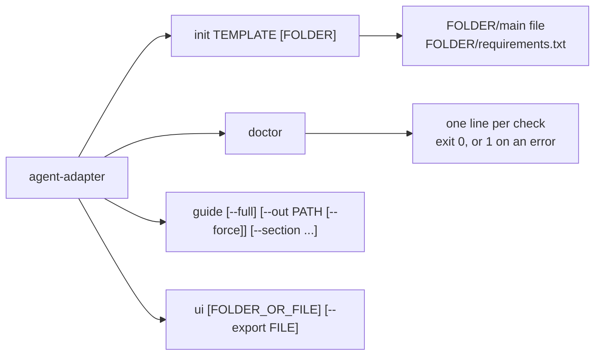

# CLI

The `agent-adapter` command has subcommands. `init` writes a starter project. `doctor`
checks this environment. `guide` prints the guide for AI coding agents. `ui` shows
recorded runs in a local web page.
`python -m agent_adapter` and `python -m agent_adapter.cli` are the same command.



## `agent-adapter init`

```bash
agent-adapter init fastapi my-service      # writes my-service/app.py and requirements.txt
agent-adapter init script                  # into the current folder
agent-adapter init flask . --force         # replace files that exist
```

| Argument | Meaning |
|---|---|
| `TEMPLATE` | One of the templates below |
| `FOLDER` | Where to write; default `.`; created if missing |
| `--force` | Replace existing files. Without it, `init` never overwrites and exits 2 |

Each template is a tested file under `examples/`. The package ships a byte-for-byte copy,
and a test keeps the two equal, so a template cannot drift from what the tests run.

| Template | Writes | Run | Source |
|---|---|---|---|
| `script` | `main.py` | `python main.py` | `examples/template_script.py` |
| `fastapi` | `app.py` | `uvicorn app:app --reload` | `examples/template_fastapi.py` |
| `flask` | `app.py` | `flask --app app run` | `examples/template_flask.py` |
| `celery` | `tasks.py` | `python tasks.py` | `examples/template_celery.py` |
| `langgraph` | `graph.py` | `python graph.py` | `examples/template_langgraph.py` |
| `openai-agents` | `agent.py` | `python agent.py` | `examples/template_openai_agents.py` |
| `mcp-server` | `server.py` | `python server.py` | `examples/template_mcp_server.py` |

`requirements.txt` pins `agent-adapter~=X.Y` (this CLI's version) with the extra the
template needs, plus the web framework or queue for `fastapi`, `flask` and `celery`.
Every template builds one `Executor`; add `approval=`, `hooks=` and `limits=` there. With
no approval port, a `confirm=True` tool is denied (fails closed).

The `openai-agents` template uses [`attach`](../how-to/attach-anywhere.md). It prints its
tools when `OPENAI_API_KEY` is not set, and runs the agent when it is. The others run
offline as written: `celery` runs its task in-process, with no worker.

## `agent-adapter doctor`

```bash
agent-adapter doctor
```

Prints `[level] topic: message` lines, then a count. Exit code: 1 when any line is an
`error`, else 0. Use it in CI after `pip install`.

| Topic | Checks | Level when wrong |
|---|---|---|
| `python` | Python 3.11 or later; a virtual environment is active | error; warn |
| `agent-adapter` | the installed metadata matches the imported code (stale editable installs miss new entry points) | warn |
| `extras` | the extras whose packages are all installed | ok (always) |
| `integrations` | an entry point that failed to load, with the reason | warn |
| `integration NAME` | ready with the package versions, or the `pip install` line | ok / info |
| `shadowing` | a local `mcp.py`, `agents/` or similar hides the installed SDK | warn |
| `pip index` | the index pip uses (public PyPI or a mirror) | ok |
| `pip index` | any `extra-index-url` (dependency confusion) | warn |
| `uv index` | `UV_DEFAULT_INDEX` / `UV_INDEX_URL` set; `UV_EXTRA_INDEX_URL` | ok; warn |

`doctor` reads pip's config files in pip's order (global, user, site, `PIP_CONFIG_FILE`),
then `PIP_INDEX_URL` and `PIP_EXTRA_INDEX_URL`. It never runs pip and never prints a
credential: user, password and query string are removed from every URL. See
[Install](../get-started/install.md#install-from-pypi).

## `agent-adapter guide`

```bash
agent-adapter guide                                # print the concise guide (about 26 KB)
agent-adapter guide --full                         # plus the API index (about 125 KB)
agent-adapter guide --out docs/agent-adapter.md    # write it; an existing file needs --force
agent-adapter guide --section safety               # install, safety, recipes, errors, cli or api
```

Both tiers ship in the wheel and match the installed version. Output is always UTF-8, so
`agent-adapter guide > file.md` works on any Windows code page. How to hand it to Claude
Code, Cursor or Copilot: [For AI coding agents](../get-started/for-ai-agents.md).
`agent-adapter --help` lists every command with a one-line example.

## `agent-adapter ui`

```bash
agent-adapter ui                                      # .agent_adapter/runs, port 8780
agent-adapter ui runs --approvals approvals.db --reviewer ana
agent-adapter ui runs --export report.html            # one offline file, then exit
```

| Argument | Meaning |
|---|---|
| `FOLDER_OR_FILE` | a runs folder written by `record()`, or one run file; default `.agent_adapter/runs` |
| `--port` | port on 127.0.0.1; default 8780 |
| `--host` | only `127.0.0.1` is accepted; anything else exits 2 |
| `--approvals PATH.db` | a `SQLiteApprovalStore` file: adds the Approvals tab |
| `--reviewer NAME` | stored as `decided_by`; needed with `--approvals` |
| `--export FILE.html` | write every run into one self-contained file and exit; not with `--approvals` |
| `--run KEY` | with `--export`: only that run |

It prints `http://127.0.0.1:PORT/#token=...` and serves until Ctrl+C. The token opens the
page (it stays in that browser tab only): anyone with the address can read the runs and, with `--approvals`, decide as
`--reviewer`, so keep it private. Recording, the page and its security:
[See your runs](../how-to/see-your-runs.md).

## Exit codes

| Code | Meaning |
|---|---|
| 0 | done; `doctor` found no error |
| 1 | `doctor` found an error |
| 2 | bad arguments, a file exists without `--force`, or a folder cannot be written; `ui`: a non-loopback host, a missing approvals file or reviewer, a taken port |

## Files

| File | Does |
|---|---|
| `agent_adapter/cli/main.py` | parses arguments, runs a subcommand, maps errors to exit 2 |
| `agent_adapter/cli/scaffold.py` | the template table; writes the file and `requirements.txt` |
| `agent_adapter/cli/templates/` | packaged copies of `examples/template_*.py` |
| `agent_adapter/cli/doctor.py` | Python, package, extras, integrations and shadowing checks |
| `agent_adapter/cli/pipindex.py` | reads pip's index settings; redacts URLs |
| `agent_adapter/cli/guide.py` | prints, writes or slices the packaged `_guide/AGENTS.md` (concise) and `_guide/llms-full.txt` (full) |
| `agent_adapter/cli/ui.py` | the `ui` arguments; serves `agent_adapter.viewer` or exports one file |
| `tests/cli/` | generates each template into a temp folder and runs it offline |
