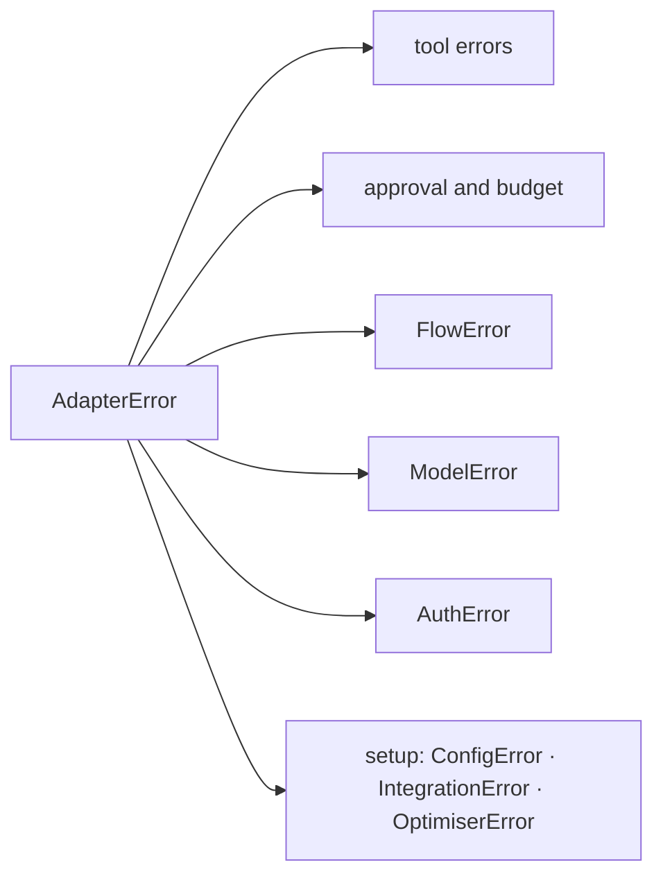

---
search:
  boost: 2
---

# Errors

Every error Agent Adapter raises, in one table. All subclass `AdapterError`.
For how to catch and log them, read [Errors](../concepts/errors.md).

- **Kind**: a stable id. It appears in `ErrorInfo`, HTTP problems and events.
- **Retryable**: `yes` means another attempt may succeed.
- **HTTP**: the status the [HTTP server](../cross-language/http-server.md) sends in its problem.
- **Import**: the five most caught errors come from `agent_adapter`; every other one from `agent_adapter.errors`.

The table is generated from the code. A test fails when it drifts; run
`python -m tests.docs.test_error_catalogue` to rewrite it.

<!-- catalogue:start -->
| Error | Kind | Bases | Retryable | HTTP | Cause | Fix |
|---|---|---|---|---|---|---|
| `AdapterError` | `internal-error` | `Exception` | no | 500 | Base class for every error raised by Agent Adapter. | Catch it to handle any adapter failure; read `kind` to tell them apart |
| `ToolDefinitionError` | `tool-definition-invalid` | `AdapterError` | no | 500 | A function cannot be turned into a tool. | Read the message: a valid name (letters, digits, `_`), a description or docstring, a signature it can model |
| `DuplicateTool` | `duplicate-tool` | `AdapterError` | no | 500 | A tool with this name is already registered. | Pick another `name=`, or use a separate `Registry` |
| `ToolNotFound` | `tool-not-found` | `AdapterError` | no | 404 | No tool is registered under the requested name. | Check the name and the registry; the model may have invented a tool |
| `ToolArgsInvalid` | `tool-args-invalid` | `AdapterError` | no | 422 | Arguments supplied for a tool failed validation. | Send `.errors` back to the model so it can retry with valid arguments |
| `ToolUsageError` | `tool-usage-error` | `AdapterError`, `TypeError` | no | 400 | Host code called the tool incorrectly (not the model's fault). | Fix the host code the message names: a confirm rule, an approval callback, a reused call id |
| `SchemaNotPortable` | `schema-not-portable` | `AdapterError` | no | 500 | A schema uses features that some providers reject. | Read `.problems`; simplify the type (see [Schemas](../concepts/schemas.md)) |
| `MissingDependency` | `missing-dependency` | `AdapterError`, `ImportError` | no | 500 | An optional extra needed for this call is not installed. | Install the extra the message names |
| `ToolError` | `tool-error` | `AdapterError` | no | 502 | Raised by tool code to report a failure; the message is shown to the model. | Raise it from your tool with a message the model can act on |
| `ToolTimeout` | `tool-timeout` | `AdapterError`, `TimeoutError` | yes | 504 | A tool call ran past its timeout. | Retry, raise the tool's `timeout`, or make the tool faster |
| `ToolFailed` | `tool-failed` | `AdapterError` | no | 502 | A tool raised a non-adapter exception; raised `from` that cause. | Read `cause_type` and `__cause__`, fix the tool, or raise `ToolError` for expected failures |
| `RunLimitExceeded` | `run-limit-exceeded` | `AdapterError` | no | 409 | A run guard refused the call (`limit` is "once_per_run" or "max_calls"). | Start a new run, or raise the tool's run limit |
| `GuardrailBlocked` | `guardrail-blocked` | `AdapterError` | no | 403 | A guardrail rejected a payload (`stage`: args, result, llm_request, llm_response). | Read `.reason` and `.stage`; change the input or the guardrail check |
| `ApprovalDenied` | `approval-denied` | `AdapterError` | no | 403 | A reviewer denied a tool call. | Tell the model the call was refused; do not retry it unchanged |
| `ApprovalPending` | `approval-pending` | `AdapterError` | no | 202, not a problem | A tool call waits for a decision that arrives later (deferred approval). | Keep `.approval_id`, ask a reviewer, then resume with the decision |
| `ApprovalNotFound` | `approval-not-found` | `AdapterError` | no | 404 | No approval request has this id. | Check the id; it may have expired or belong to another store |
| `ApprovalAlreadyDecided` | `approval-already-decided` | `AdapterError` | no | 409 | The approval request already has a decision. | Read the stored decision instead of deciding again |
| `ApprovalStoreCorrupt` | `internal-error` | `AdapterError` | no | 500 | A stored approval row is unreadable or disagrees with itself; the store fails closed. | Treat it as tampering: inspect the row, then delete it and ask again ([Approval stores](../concepts/approval-stores.md)) |
| `BudgetExceeded` | `budget-exceeded` | `AdapterError` | no | 429 | Spend reached the configured limit. | Stop the run, or raise the `BudgetHook` limit |
| `PlanInvalid` | `plan-invalid` | `AdapterError` | no | 500 | A plan of steps cannot run (unknown tools, cycles, bad references). | Fix each item in `.problems` |
| `FlowError` | `flow-error` | `AdapterError` | no | 500 | A flow failed while running. | Read `.flow` and `.node`; the cause is in `__cause__` |
| `FlowDefinitionError` | `flow-definition-invalid` | `FlowError` | no | 500 | A flow definition is invalid; `problems` lists every issue found. | Fix each item in `.problems` |
| `FlowCompileError` | `flow-compile-failed` | `FlowDefinitionError` | no | 500 | A flow cannot be compiled for a target framework. | Drop what `.target` does not support, or run the flow with `FlowRunner` |
| `FlowLoopExceeded` | `flow-loop-exceeded` | `FlowError` | no | 500 | A flow node was visited more often than its loop limit allows. | Fix the route that loops, or raise the node's loop limit |
| `ConfigError` | `config-invalid` | `AdapterError`, `ValueError` | no | 500 | Invalid configuration. | Fix the setting the message names |
| `IntegrationError` | `integration-error` | `AdapterError` | no | 500 | A framework integration failed or is unknown. | Check the integration name and the framework version |
| `AuthError` | `auth-error` | `AdapterError` | no | 500 | Authentication or authorisation failed. | Catch it to handle both subclasses below |
| `Unauthorized` | `unauthorized` | `AuthError` | no | 401 | No valid credentials. | Send a valid bearer token |
| `Forbidden` | `forbidden` | `AuthError` | no | 403 | Valid credentials without permission. | Grant the principal the scope it needs, such as the approver scope |
| `OptimiserError` | `optimiser-error` | `AdapterError` | no | 500 | The optimiser could not complete. | Read the message; check the eval cases and the optimiser budget |
| `ModelError` | `model-error` | `AdapterError` | no | 502 | A model provider call failed. | Catch it for any provider failure; check `retryable` before retrying |
| `ModelRateLimited` | `model-rate-limited` | `ModelError` | yes | 502 | The provider rate-limited the call. | Wait `.retry_after` seconds, then retry |
| `ModelUnavailable` | `model-unavailable` | `ModelError` | yes | 502 | 5xx, overload or a connection error. | Retry with backoff, or fall back with `FallbackModel` |
| `ModelTimeout` | `model-timeout` | `ModelError` | yes | 502 | The provider call timed out. | Retry, or raise the client timeout |
| `ModelAuthError` | `model-auth-failed` | `ModelError` | no | 502 | The provider rejected the credentials. | Check the API key and its permissions |
| `ModelBadRequest` | `model-bad-request` | `ModelError` | no | 502 | The provider rejected the request as invalid. | Read the message; check the model name, tool schemas and strict mode |
| `ModelContextOverflow` | `model-context-overflow` | `ModelBadRequest` | no | 502 | The request has more tokens than the model's context window. | Send fewer tokens: a `CompressionPolicy` with `if_still_too_long` retries once ([Context compression](../concepts/context-compression.md)) |
| `ModelContentFiltered` | `model-content-filtered` | `ModelError` | no | 502 | The provider withheld the output for safety reasons. | Change the prompt or input; do not retry it unchanged |
| `ModelOutputInvalid` | `model-output-invalid` | `ModelError` | no | 502 | The model output does not match the requested schema. | Retry with a clearer prompt, or loosen the output schema |
<!-- catalogue:end -->

## API

::: agent_adapter.errors
    options:
      members: [ApprovalAlreadyDecided, ApprovalNotFound, ApprovalStoreCorrupt, AuthError, BudgetExceeded, ConfigError, DuplicateTool, ErrorInfo, FlowCompileError, FlowDefinitionError, FlowError, FlowLoopExceeded, Forbidden, GuardrailBlocked, IntegrationError, ModelAuthError, ModelBadRequest, ModelContentFiltered, ModelContextOverflow, ModelError, ModelOutputInvalid, ModelRateLimited, ModelTimeout, ModelUnavailable, OptimiserError, PlanInvalid, RunLimitExceeded, SchemaNotPortable, ToolArgsInvalid, ToolDefinitionError, ToolFailed, ToolNotFound, ToolTimeout, ToolUsageError, Unauthorized]

Also exported here, documented under the canonical path: [`AdapterError`](top-level.md#agent_adapter.AdapterError), [`ApprovalDenied`](top-level.md#agent_adapter.ApprovalDenied), [`ApprovalPending`](top-level.md#agent_adapter.ApprovalPending), [`MissingDependency`](top-level.md#agent_adapter.MissingDependency), [`ToolError`](top-level.md#agent_adapter.ToolError).
