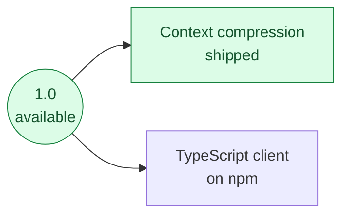

# Roadmap

What we plan to add or improve after **1.0**. Everything available today is on
[Features](features.md); what changed in each release is in the [Changelog](changelog.md).

These are plans, not promises: none has a date yet.

## Shipped since 1.0

| Item | What it brings | Guide |
|---|---|---|
| Context compression | Shrinks long conversations before each model call, with your own models; works with no framework and with every framework's message list | [Context compression](concepts/context-compression.md), [Compress a long context](how-to/compress-long-context.md) |

## Planned

| Item | What it brings | Why it is not done yet |
|---|---|---|
| TypeScript client on npm | Install the client with `npm install` instead of a tarball | The package is private until a registry is chosen ([TypeScript client](cross-language/typescript-client.md)) |

## How we decide

We favour safety, stable public APIs and fewer moving parts. A planned item moves to
[Features](features.md) only when it ships with tests and a guide.
