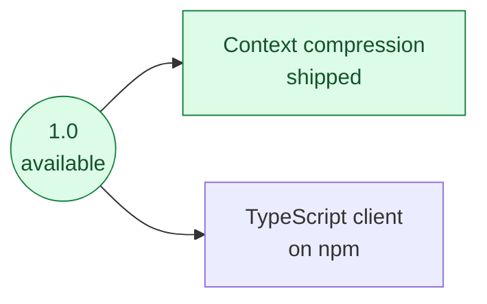

# Roadmap

What we plan to add or improve after **1.0**. Everything available today is on
[Features](features.md); what changed in each release is in the [Changelog](changelog.md).

These are plans, not promises: none has a date yet.

## Shipped since 1.0

| Item | What it brings | Guide |
|---|---|---|
| Context compression | Shrinks long conversations before each model call, with your own models; works with no framework and with every framework's message list | [Context compression](concepts/context-compression.md), [Compress a long context](how-to/compress-long-context.md) |
| Voice agents (next release) | Phone and browser calls on our own pipeline or inside LiveKit and Pipecat; tools that finish once when the caller cuts in; spoken approvals; call features | [A voice call with no framework](how-to/voice-pipeline.md), [Voice stacks compared](how-to/voice-compared.md) |
| Video (next release) | The agent looks at the caller's camera, a screen share or a robot camera through a tool | [Let a voice agent see](how-to/voice-video.md) |
| Robot gate (next release) | Limits, an emergency stop and an audit log for robot tools; tested in MuJoCo and ROS 2 simulation | [Gate a robot](how-to/robot-safety.md) |

## Planned

| Item | What it brings | Why it is not done yet |
|---|---|---|
| Phone menu (IVR) navigation | The agent listens to "press 1 for sales" menus and presses the right keys to reach a person | Next on the voice list |
| Live tests on phone networks | Telnyx, Plivo and Vonage called for real, not only format-tested | Needs paid accounts |
| TypeScript client on npm | Install the client with `npm install` instead of a tarball | The package is private until a registry is chosen ([TypeScript client](cross-language/typescript-client.md)) |

## How we decide

We favour safety, stable public APIs and fewer moving parts. A planned item moves to
[Features](features.md) only when it ships with tests and a guide.
